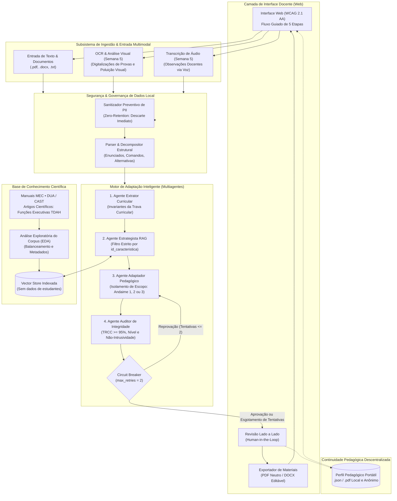
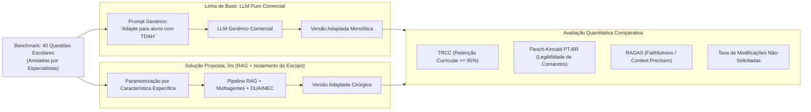

# Arquitetura e Decisões Técnicas — Íris

## 1. Visão Geral da Arquitetura

A plataforma **Íris** adota uma arquitetura modular orientada a serviços *stateless*, fundamentada no princípio de *Privacy by Design* e conformidade com a LGPD. O sistema não persiste cadastros ou dados identificáveis de estudantes em banco de dados centralizado (*Zero-Database*), operando em memória durante a sessão de adaptação e delegando a continuidade histórica ao **Perfil Pedagógico Portátil** mantido localmente pelo professor.



---

## 2. Detalhamento dos Componentes

### 2.1. Gateway de Privacidade: Sanitizador Preventivo de PII (*Zero-Retention Scrubber*)
A Íris **não gerencia, não solicita e não armazena documentos civis ou dados cadastrais de estudantes (como CPF, RG ou número de matrícula)**. A plataforma processa exclusivamente materiais curriculares (avaliações, exercícios) e notas pedagógicas informadas pelo professor.

No entanto, para prevenir que professores submetam acidentalmente avaliações antigas contendo nomes de estudantes no cabeçalho ou citem nomes próprios em transcrições de voz (ex.: *"O aluno Gabriel perde o foco em enunciados longos"*), a camada de segurança atua localmente antes de qualquer requisição externa a modelos de linguagem:
* **Detecção Heurística Local:** Executa expressões regulares e modelos compactos de reconhecimento de entidades (NER) para localizar nomes próprios de pessoas ou menções institucionais isoladas.
* **Descarte Imediato (*Zero-Retention*):** O dado identificado é permanentemente substituído por marcadores genéricos (`[ESTUDANTE]`, `[ESCOLA]`).
* **Inexistência de Dicionário de Restauração:** Não é mantida nenhuma tabela ou mapa de reidratação em memória no servidor para restaurar nomes originais, eliminando qualquer risco de persistência residual ou exfiltração de dados identificáveis.
* **Formatação de Cabeçalho Escolar Neutro:** Ao gerar a versão final para impressão, a plataforma insere um cabeçalho padrão em branco para preenchimento manual em sala de aula:
  ```text
  Estudante: __________________________________________________ Data: ___/___/______
  Turma: ______________ Professor(a): _____________________________________________
  ```

### 2.2. Subsistema de Ingestão e Entrada Multimodal (Semana 5)
Permite a entrada de materiais pedagógicos em múltiplos formatos, reduzindo o atrito de redigitação:
1. **Parser de Documentos Textuais:** Processamento direto de textos colados ou arquivos nos formatos `.pdf`, `.docx` e `.txt`, dividindo deterministicamente enunciados, comandos, alternativas e textos de apoio.
2. **OCR e Análise Visual de Provas:** Módulo de visão computacional voltado para digitalizações e fotos de avaliações impressas. Identifica o conteúdo textual e mapeia métricas de poluição visual (densidade de caixas, proximidade de imagens distratoras).
3. **Transcrição de Observações em Áudio:** Módulo de conversão fala-texto (Speech-to-Text) para transcrição de relatos empíricos do professor sobre o comportamento funcional do estudante, passando pelo sanitizador de PII antes de alimentar o perfil pedagógico.

### 2.3. Sistema Multiagentes de Adaptação com Isolamento de Escopo (Semana 4)
Para evitar que uma única instrução genérica resulte em empobrecimento curricular ou infantilização, a adaptação pedagógica é segmentada em quatro agentes autônomos e cooperativos:

1. **Agente Extrator Curricular:**
   * **Entradas:** Material didático bruto + declaração de Travas Curriculares pelo professor.
   * **Atribuição:** Analisa o material original, extrai os conceitos científicos essenciais, vocabulário técnico e competências avaliativas (invariantes curriculares).
   * **Saída:** Contrato de invariantes conceituais obrigatórios para a questão.

2. **Agente Estrategista Psicopedagógico (RAG):**
   * **Entradas:** Características atômicas ativadas (`id_caracteristica`) + Nível de andaime selecionado (1, 2 ou 3) + Invariantes curriculares.
   * **Atribuição:** Realiza a busca vetorial no corpus científico aplicando filtro de metadados estrito à característica observada. Se o docente selecionou apenas *Dificuldade de sustentação atencional em textos contínuos*, o agente recupera exclusivamente evidências do DUA sobre fragmentação visual e formatação em blocos, sem resgatar estratégias para outras áreas.
   * **Saída:** Diretiva psicopedagógica com citações teóricas da literatura curada.

3. **Agente Adaptador Pedagógico:**
   * **Entradas:** Material original + Diretiva psicopedagógica + Invariantes curriculares.
   * **Atribuição:** Aplica as intervenções de andaime (*scaffolding*) respeitando a **Regra de Isolamento de Escopo**. É terminantemente proibido de alterar o vocabulário das travas curriculares, proibido de responder às perguntas pelo aluno e proibido de aplicar modificações em dimensões não selecionadas.
   * **Saída:** Minuta da atividade adaptada com justificativas das intervenções.

4. **Agente Auditor de Integridade Curricular e Não-Intrusividade:**
   * **Entradas:** Material original + Minuta adaptada + Invariantes + Características selecionadas + Nível pretendido.
   * **Atribuição:** Avalia a conformidade a partir de quatro verificações determinísticas e probabilísticas:
     * *Taxa de Retenção de Conceitos-Chave (TRCC):* Verifica se $\text{TRCC} \ge 95\%$.
     * *Aderência ao Nível (SAEN):* Confere se as restrições estruturais do Nível 1, 2 ou 3 foram obedecidas.
     * *Não-Intrusividade de Escopo:* Avalia se foram adicionadas intervenções para características não marcadas pelo professor.
     * *Prevenção de Efeito Muleta:* Verifica se o enunciado adaptado não revelou a resposta ou suprimiu a etapa cognitiva exigida.
   * **Controle de Ciclo (*Circuit Breaker*):** O loop de auto-correção entre o Agente Auditor e o Agente Adaptador é limitado a **no máximo duas iterações** (`max_retries = 2`). Caso o material adaptado não atinja conformidade após duas tentativas, o ciclo é interrompido e a minuta é enviada à interface com um alerta preventivo em destaque, permitindo que o professor exerça a mediação direta (*Human-in-the-Loop*).

---

## 3. Análise Exploratória de Dados (EDA) e Governança do Conhecimento

A plataforma Íris estabelece dois pipelines estruturados de Análise Exploratória de Dados (EDA) para garantir rigor metodológico e respaldo empírico antes da parametrização dos modelos de IA:

### 3.1. EDA 1: Análise Exploratória do Corpus Científico RAG (Semana 2)
A base de conhecimento do RAG é composta por manuais oficiais do MEC, publicações do consórcio DUA/CAST e literatura científica revisada por pares sobre Funções Executivas e TDAH. Antes da vetorização, o corpus passa por um protocolo exploratório contendo:
* **Balanceamento por Característica Atômica:** Mapeamento da quantidade de trechos normativos e científicos associados a cada uma das características do catálogo. Identifica eventuais lacunas bibliográficas para assegurar que nenhuma dificuldade cadastrada fique sem cobertura no banco vetorial.
* **Distribuição de Comprimento de Seções e Tokens:** Análise de histogramas de densidade de palavras e sentenças por documento fonte, orientando de forma orientada a dados a escolha de parâmetros de fragmentação (*chunk_size* e *chunk_overlap*).
* **Densidade Terminológica e Indexação por Metadados:** Extração e catalogação de termos-chave do Desenho Universal para a Aprendizagem (representação, ação/expressão, engajamento) para viabilizar indexação híbrida (busca densa + filtros determinísticos por `id_caracteristica`).

### 3.2. EDA 2: Análise Exploratória do Dataset de Avaliações Escolares (*Golden Benchmark* — Semanas 2 e 3)
Para balizar a validação quantitativa da Semana 3 (Experimento Comparativo LLM Puro vs. RAG) e da Semana 7 (Avaliação Final), é consolidado um *Golden Benchmark* de 30 a 50 questões escolares reais de Ensino Fundamental II e Médio (obtidas a partir de matrizes curriculares públicas, Prova Brasil, INEP e repositórios abertos de planos de aula alinhados à BNCC). A EDA sobre esse corpus inicial mede:
* **Baseline de Legibilidade Flesch-Kincaid PT-BR:** Distribuição de comprimento médio de sentenças ($\text{ASL}$) e contagem de sílabas por palavra ($\text{ASW}$) nas provas regulares aplicadas nas escolas brasileiras.
* **Densidade de Comandos Conjugados:** Quantificação da incidência de questões que acumulam múltiplos verbos de comando na mesma oração sem separação gráfica (fator de sobrecarga cognitiva para alunos com TDAH).
* **Proporção de Elementos Visuais e Diagramação:** Classificação das questões entre puramente textuais, mistas com tabelas/gráficos e visuais, servindo de base comparativa para a camada multimodal da Semana 5.

---

## 4. Experimento Comparativo (Semana 3: LLM Puro vs. RAG)

Na Semana 3 do roadmap da Residência em IA, a arquitetura do Íris é submetida a um estudo experimental controlado para comprovar a superioridade da recuperação orientada a evidências em relação a modelos generalistas:



### Hipóteses do Experimento:
1. **Hipótese 1 (Integridade Curricular):** O LLM Puro apresenta queda significativa de TRCC ($< 80\%$) devido à tendência de resumir conceitos complexos ou fornecer pistas diretas que resolvem o problema pelo estudante. O pipeline RAG com travas curriculares mantém $\text{TRCC} \ge 95\%$.
2. **Hipótese 2 (Não-Intrusividade):** O LLM Puro modifica elementos textuais não relacionados à dificuldade do aluno (rebaixamento de vocabulário e infantilização), enquanto o pipeline cirúrgico mantém intactas as dimensões não assinaladas.

---

## 5. Quadro de Decisões Arquiteturais e Protocolos de Teste (ADRs)

Para atender à diretriz do Challenge 2 de justificar decisões técnicas sem antecipar conclusões antes da execução empírica, o quadro a seguir consolida o status de cada decisão, distinguindo restrições normativas de hipóteses técnicas em validação experimental:

| Identificador | Decisão / Hipótese Técnica | Opções Consideradas | Status da Decisão | Justificativa Normativa ou Protocolo Experimental Planejado |
| :--- | :--- | :--- | :--- | :--- |
| **ADR-01** | Armazenamento de dados de estudantes | Banco relacional centralizado (PostgreSQL) vs. Arquitetura *stateless Zero-Database* com Perfil Portátil local (.json) | **Decidido por Diretriz Normativa** | Conformidade com a LGPD e o Art. 14 (proteção de menores). A ausência de banco central elimina o risco de vazamentos em massa de perfis pedagógicos infantis. |
| **ADR-02** | Tratamento de dados pessoais na entrada (PII) | Dicionário de reidratação em memória vs. Sanitizador com descarte imediato (*Zero-Retention Scrubber*) | **Decidido por Princípio Arquitetural** | O descarte imediato impede que identificadores pessoais transitem ou permaneçam na memória do servidor, garantindo a natureza puramente didática do insumo. |
| **ADR-03** | Estratégia de orquestração de IA | Prompt monolítico em cadeia única (*Single-Prompt Chain*) vs. Pipeline Multiagentes com Agente Auditor dedicado | **Em Validação Experimental (Semana 4)** | **Protocolo Experimental:** Submeter 40 questões do benchmark a ambas as abordagens. Avaliar a taxa de sucesso na retenção de travas curriculares ($\text{TRCC}$), a obediência ao isolamento de escopo e a latência de execução para comprovar a necessidade de segregação de papéis. |
| **ADR-04** | Estratégia de fragmentação do corpus RAG (*Chunking*) | Fragmentação por contagem de caracteres fixa (ex.: 500 chars com overlap de 50) vs. *Chunking* semântico estruturado por diretriz do DUA/MEC | **Validado na Semana 2 (`ingestao.py`)** | **Resultado Empírico:** Corte estrutural por seção/artigo com teto de 350 palavras, mínimo de 40 palavras e sobreposição do último parágrafo (até 60 palavras), gerando 1.368 trechos limpos a partir de 38 documentos curados. |
| **ADR-05** | Modelo de *Embeddings* e Recuperação em 2 Estágios | Busca lexical (BM25) vs. MPNet vs. `Qwen3-Embedding-0.6B` + Reordenação Cross-Encoder (`mmarco-mMiniLMv2`) | **Validado na Semana 2 (`consultar.py`)** | **Resultado Empírico:** A recuperação em dois estágios (`qwen3+rerank50`) elevou o Recall@5 de 0,28 (Qwen3 isolado) e 0,20 (BM25) para **0,42** (IC 95%: 0,32 a 0,52), atendendo a 87% das consultas com resposta na base. |
| **ADR-06** | Limite de iterações do loop de auditoria (*Circuit Breaker*) | Loop indefinido até atingir $\text{TRCC} \ge 95\%$ vs. Limite rígido de duas iterações (`max_retries = 2`) com aviso ao docente | **Em Validação Experimental (Semana 4)** | **Protocolo Experimental:** Mensurar tempo de resposta total e consumo de tokens em cascata para checar se 2 iterações são suficientes para convergência sem violar o requisito de latência ($\le 40\text{s}$) estipulado em RNF-07. |
| **ADR-07** | Gerenciamento de ambiente e dependências | Pip/Virtualenv vs. Poetry vs. UV | **Decidido por Requisito do Projeto** | O gestor `uv` foi selecionado em cumprimento ao RNF-11, unificando dependências da API e do RAG no `pyproject.toml` com empacotamento editável de `backend/src/iris`. |
| **ADR-08** | Mapeamento Taxonômico entre Catálogo de Características e Base RAG | Reindexação vetorial por micro-característica vs. Mapeamento determinístico `id_caracteristica` $\rightarrow$ `barreira_rag_associada` via schema modular | **Implementado (`#39` e `#44`)** | O catálogo `rag/catalogs/tdah_caracteristicas_funcionais.json` define 9 características atômicas observáveis em sala (com diretrizes de Nível 1, 2 e 3) mapeadas para as 9 tags `barreiras` indexadas no RAG, permitindo expansão para TEA/Dislexia sem reindexar vetores nem alterar código. |
| **ADR-09** | Separação Física e Stack da Interface Web Docente (`frontend/` vs. `backend/`) | Templates monolíticos acoplados ao backend vs. Arquitetura desacoplada **Frontend Next.js (`frontend/`) + Backend Python FastAPI (`backend/`)** | **Implementado (`#4` — História 1.1.1)** | O repositório separa fisicamente o backend Python (`backend/src/iris/` e `backend/tests/`) da aplicação web em **Next.js 14 + TypeScript + Tailwind CSS** (`frontend/`), comunicando-se via REST stateless (`POST /api/v1/materials/upload` e `POST /api/v1/materials/text`) com conformidade WCAG 2.1 AA e fidelidade ao protótipo do Figma. |

---

## 6. Arquitetura do Catálogo Modular de Características (`#39`), Ponte RAG (`#44`) e Divisão `backend/` vs. `frontend/`

O desacoplamento entre a interface docente em Next.js (`frontend/`), a API FastAPI (`backend/src/iris/`) e o motor científico de recuperação (`rag/iris-rag/pacote/`) é realizado pelo módulo [`backend/src/iris/rag/bridge.py`](file:///Users/aluno1/Iris/backend/src/iris/rag/bridge.py) e pelo validador de schema [`backend/src/iris/schemas/catalog.py`](file:///Users/aluno1/Iris/backend/src/iris/schemas/catalog.py):

| `id_caracteristica` (Catálogo Modular `#39`) | `barreira_rag_associada` (Índice RAG) | Princípio DUA Primário | Documentos de Referência Vinculados (`fontes.json`) |
| :--- | :--- | :--- | :--- |
| `sobrecarga_memoria_trabalho_comandos_multiplos` | `memoria_trabalho` | Ação e Expressão | `RBEE-SEBASTIAN-HEREDERO-2020-DIRETRIZES-DUA`, `SWELLER-2019-CARGA-COGNITIVA` |
| `retencao_dados_intermediarios_problemas_multietapas` | `memoria_trabalho` | Representação | `ZERBATO-MENDES-2018-DUA-INCLUSAO-ESCOLAR`, `RBEE-SEBASTIAN-HEREDERO-2020-DIRETRIZES-DUA` |
| `atencao_sustentada_textos_longos` | `leitura_texto_longo` | Representação | `GALLIUSSI-2020-ESPACAMENTO-DISLEXIA`, `RBEE-SEBASTIAN-HEREDERO-2020-DIRETRIZES-DUA` |
| `distratibilidade_poluicao_visual_layout` | `sobrecarga_visual` | Representação | `CDC-ADHD-CLASSROOM-2026`, `GAASTRA-2016-META-INTERVENCOES-SALA` |
| `impulsividade_leitura_superficial_negacoes` | `controle_inibitorio` | Ação e Expressão | `ZERBATO-MENDES-2018-DUA-INCLUSAO-ESCOLAR`, `MS-PCDT-TDAH-2022` |
| `organizacao_sequencial_expressao_escrita` | `organizacao_sequencial` | Ação e Expressão | `RBEE-SEBASTIAN-HEREDERO-2020-DIRETRIZES-DUA`, `LEI-14254-2021-DISLEXIA-TDAH` |
| `fadiga_executiva_autorregulacao_provas_extensas` | `atencao_sustentada` | Engajamento | `RBEE-SEBASTIAN-HEREDERO-2020-DIRETRIZES-DUA`, `NCEO-TOOLKIT-TEMPO-EXTRA-2026` |
| `flexibilidade_cognitiva_alternancia_topicos` | `flexibilidade_cognitiva` | Representação | `RBEE-SEBASTIAN-HEREDERO-2020-DIRETRIZES-DUA`, `CORTESE-2015-META-TREINO-COGNITIVO` |
| `bloqueio_iniciacao_tarefas_abertas` | `iniciacao_tarefa` | Ação e Expressão | `RBEE-SEBASTIAN-HEREDERO-2020-DIRETRIZES-DUA`, `GAASTRA-2016-META-INTERVENCOES-SALA` |
| `ritmo_processamento_pressao_temporal` | `velocidade_processamento` | Representação | `NCEO-TOOLKIT-TEMPO-EXTRA-2026`, `INEP-CARTILHA-REDACAO-ENEM-2026-DISLEXIA` |

---

## 7. Gestão do Perfil Pedagógico Portátil (*Zero-Database*)

Para viabilizar que o professor de uma nova série ou um novo bimestre conheça as estratégias que favoreceram o estudante sem necessidade de cadastros centrais, o sistema adota o padrão **Perfil Portátil**:

```json
{
  "versao_schema": "1.0",
  "id_anonimo": "aluno-8f7a2c1b",
  "data_atualizacao": "2026-11-04",
  "caracteristicas_funcionais_observadas": [
    "atencao_sustentada_textos_longos",
    "sobrecarga_memoria_trabalho_comandos_multiplos"
  ],
  "potencialidades_e_interesses": [
    "alta_compreensao_visual",
    "interesse_em_ciencias_da_natureza"
  ],
  "historico_intervencoes": [
    {
      "id_caracteristica": "sobrecarga_memoria_trabalho_comandos_multiplos",
      "estrategia_aplicada": "divisao_em_checklists_curtos",
      "nivel_utilizado": 2,
      "eficacia_observada": "alta",
      "observacoes_docente": "O estudante concluiu a resolucao no tempo previsto quando os comandos foram dispostos em topicos numerados."
    },
    {
      "id_caracteristica": "atencao_sustentada_textos_longos",
      "estrategia_aplicada": "substituicao_completa_por_desenho",
      "nivel_utilizado": 3,
      "eficacia_observada": "baixa",
      "observacoes_docente": "A supressao do texto gerou perda de contexto da questao."
    }
  ]
}
```

O arquivo é gravado unicamente no dispositivo do professor ou arquivado no prontuário físico/local da unidade escolar. O sistema pode reimportar esse `.json` a qualquer momento para inicializar a sessão de adaptação sem que nenhum dado persista no servidor.
