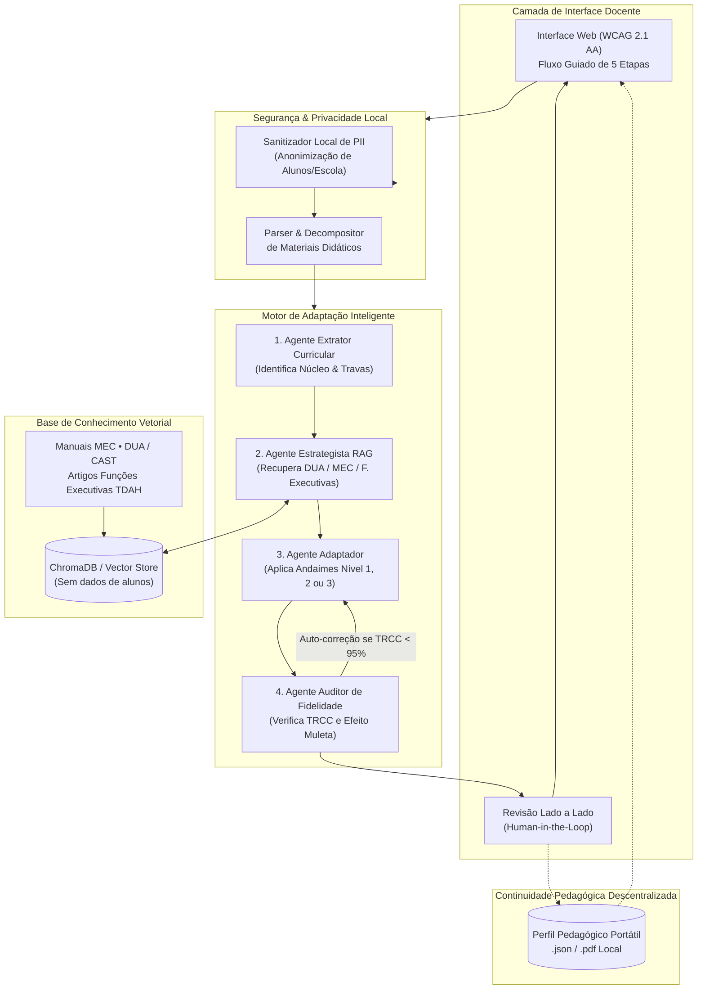

# Arquitetura e Decisões Técnicas — Íris

## 1. Visão Geral da Arquitetura

A plataforma **Íris** adota uma arquitetura modular orientada a serviços *stateless*, garantindo conformidade com a LGPD (*Privacy by Design*) e flexibilidade para substituição de componentes de IA.



---

## 2. Detalhamento dos Componentes

### 2.1. Camada de Privacidade Local (Sanitizador PII)
Executa estritamente antes de qualquer requisição externa a provedores de LLM. Utiliza expressões regulares e modelos leves de NLP local para reconhecer:
* Nomes próprios de pessoas (docentes e estudantes);
* Dados cadastrais (CPF, RG, matrículas);
* Identificadores institucionais (nomes de escolas, turmas, bairros).

Todos os identificadores são substituídos por marcadores anônimos (`[ESTUDANTE_A]`, `[ESCOLA_X]`), que são restaurados apenas localmente na interface do professor após a conclusão da adaptação.

### 2.2. Sistema Multiagentes de Adaptação (Semana 4)
Para evitar que uma única chamada a um modelo de linguagem sofra de viés de simplificação ou alucinação, o pipeline distribui tarefas entre agentes com objetivos claros:

1. **Agente Extrator Curricular:**
   * **Entrada:** Enunciado original + Travas Curriculares definidas pelo professor.
   * **Função:** Extrai os conceitos semânticos centrais e as operações cognitivas exigidas pela questão (ex.: inferência, cálculo, dedução, interpretação).
   * **Saída:** Lista de invariantes avaliativos que não podem ser alterados.

2. **Agente Estrategista Psicopedagógico (RAG):**
   * **Entrada:** Barreiras funcionais selecionadas + Nível de suporte (1, 2 ou 3) + Invariantes curriculares.
   * **Função:** Consulta a base vetorial e recupera intervenções pedagógicas validadas (baseadas no Desenho Universal para a Aprendizagem e no referencial de Funções Executivas).
   * **Saída:** Plano de intervenção pedagógica com citações da literatura científica.

3. **Agente Adaptador:**
   * **Entrada:** Enunciado original + Invariantes curriculares + Plano de intervenção.
   * **Função:** Aplica a reescrita estrutural (ajuste de espaçamento, quebra em checklists, glossários de apoio ou organizadores gráficos).
   * **Saída:** Minuta do material adaptado.

4. **Agente Auditor de Fidelidade e Nível:**
   * **Entrada:** Material original + Minuta adaptada + Invariantes curriculares + Nível solicitado.
   * **Função:** Calcula a Taxa de Retenção de Conceitos-Chave (TRCC) e verifica se o modelo não resolveu a questão no próprio enunciado (*efeito muleta*). Se $\text{TRCC} < 95\%$, rejeita a minuta e instrui o Agente Adaptador a auto-corrigir.
   * **Saída:** Material validado com relatório de auditoria para visualização docente.

---

## 3. Gestão do Perfil Pedagógico Portátil (*Zero-Database*)

Para viabilizar que o professor de uma nova série ou um novo bimestre saiba quais estratégias pedagógicas funcionaram com um aluno sem criar um banco de dados de menores, o sistema adota o padrão **Perfil Portátil**:

```json
{
  "versao_schema": "1.0",
  "id_anonimo": "aluno-8f7a2c1b",
  "data_atualizacao": "2026-11-04",
  "barreiras_funcionais_observadas": [
    "atencao_sustentada_textos_longos",
    "sobrecarga_memoria_trabalho",
    "iniciacao_tarefas_complexas"
  ],
  "potencialidades_e_interesses": [
    "alta_compreensao_visual",
    "interesse_ciencias_da_natureza"
  ],
  "historico_intervencoes": [
    {
      "estrategia": "divisao_em_checklists_curtos",
      "nivel_utilizado": 2,
      "eficacia_observada": "alta",
      "observacoes_docente": "Aluno concluiu a atividade dentro do tempo regulamentar quando os enunciados foram fragmentados."
    },
    {
      "estrategia": "substituicao_completa_por_desenho",
      "nivel_utilizado": 3,
      "eficacia_observada": "baixa",
      "observacoes_docente": "Gerou dispersao atencional adicional."
    }
  ]
}
```

* O arquivo é mantido em posse do professor ou arquivado no dossiê físico/local da escola.
* A qualquer momento, o professor pode fazer o upload desse `.json` no Íris para iniciar uma adaptação já calibrada pelo histórico de intervenções.

