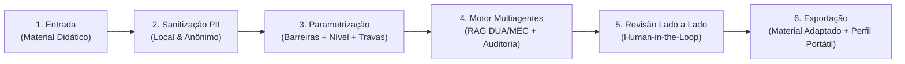

  <h1>Projeto Íris</h1>
  
Plataforma Inteligente de Adaptação de Materiais Pedagógicos para Alunos Neurodivergentes (TDAH)

  

    Residência em IA
    Challenge 2: Qualidade de Vida
    Privacy by Design • LGPD
    Andaime Cognitivo em 3 Níveis
  

> **Parceria Institucional:** Universidade de Brasília (UnB) • Lab Livre • Instituto de Pesquisas Eldorado • Softex • MCTI  
> **Metodologia:** Challenge Based Learning (CBL) — **Grupo 3**

---

## Propósito do Íris

O **Íris** é uma solução baseada em inteligência artificial desenhada para atuar como **assistente pedagógico especializado do professor**, apoiando o processo de decisão e adaptação de avaliações, atividades e materiais didáticos para estudantes neurodivergentes, com recorte inicial no **Transtorno do Déficit de Atenção com Hiperatividade (TDAH)**.

Em vez de atuar como um gerador genérico de texto que simplesmente resume ou dilui os conteúdos, o Íris combina **recuperação de evidências científicas (RAG)** e **orquestração multiagentes** para aplicar **andaimes cognitivos (*scaffolding*) graduados**, preservando rigorosamente as habilidades curriculares avaliadas e eliminando o *efeito muleta*.

---

## Os Três Pilares Inegociáveis

  

    <h4>1. Barreiras > Rótulo</h4>
    
O sistema não trata o TDAH de forma homogênea. O professor parametriza a adaptação com base em <strong>barreiras executivas observadas em sala</strong> (atenção sustentada, memória de trabalho, organização sequencial) e potencialidades do estudante.

    Modular & Extensível
  

  

    <h4>2. Andaimes em 3 Níveis</h4>
    
Graduação de suporte: <strong>Nível 1 (Leve)</strong>, <strong>Nível 2 (Moderado)</strong> e <strong>Nível 3 (Intensivo)</strong>. Com <strong>Trava Curricular Inegociável</strong> que proíbe o modelo de interpretar ou resolver a questão pelo aluno.

    Preservação Curricular
  

  

    <h4>3. Privacy by Design</h4>
    
Arquitetura <strong>Zero-Database</strong> de alunos. Nenhum dado pessoal é salvo em nuvem. Conta com sanitizador local de PII e <strong>Perfil Pedagógico Portátil</strong> (<code>.json</code> e <code>.pdf</code> local) anônimo para continuidade escolar.

    Conformidade LGPD
  

---

## Fluxo de Processamento do Sistema

---

## Navegação Rápida

  

    <h4><a href="definicao_projeto_entrega/">Documento de Entrega (PDF)</a></h4>
    
Versão alinhada e consolidada da Definição do Projeto para entrega da Semana 1 (Cenário, EQ, GQs com Diagnóstico, Stakeholders, Personas, Requisitos e Riscos).

  

  

    <h4><a href="visao_produto/">Visão do Produto</a></h4>
    
Entenda o problema da sobrecarga docente, as personas primárias e secundárias, os diferenciais em relação a LLMs comerciais e os limites do MVP.

  

  

    <h4><a href="requisitos_funcionais/">Requisitos Funcionais</a></h4>
    
Especificação detalhada dos 15 Requisitos Funcionais (RF-01 a RF-15), organizados em 5 módulos estruturados de engenharia.

  

  

    <h4><a href="requisitos_nao_funcionais/">Requisitos Não Funcionais</a></h4>
    
Restrições de privacidade LGPD, métricas objetivas (TRCC ≥ 95%, Flesch PT-BR, RAGAS), latência e acessibilidade WCAG 2.1 AA.

  

  

    <h4><a href="arquitetura/">Arquitetura & Decisões</a></h4>
    
Detalhamento da arquitetura stateless, pipeline multiagentes, fluxo RAG e schema do Perfil Pedagógico Portátil.

  

  

    <h4><a href="cbl/">Metodologia CBL</a></h4>
    
Big Idea (Qualidade de Vida), Essential Question, as 4 Guiding Questions e o Roadmap de execução ao longo das 7 semanas.

  

  

    <h4><a href="skills/">Catálogo de Skills</a></h4>
    
Definição das skills operacionais que norteiam a equipe de engenharia e os agentes de IA na construção do projeto.

  

