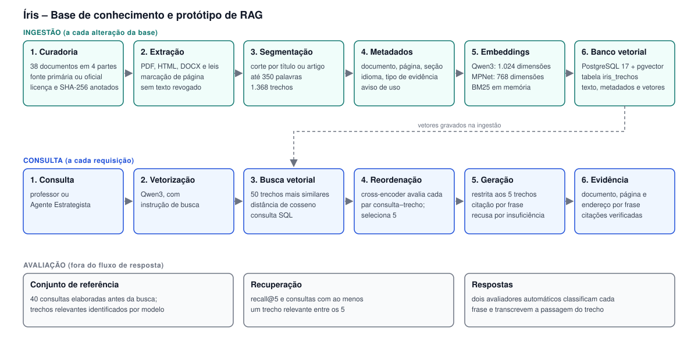

# Íris – Documentação de arquitetura da base de conhecimento e do protótipo de RAG

Documento estruturado segundo o modelo arc42. Versão correspondente à entrega de 09/11/2026.

## 1. Introdução e objetivos

### 1.1 Requisitos

O componente descrito atende ao Agente Estrategista do Íris, que define a adaptação de uma atividade didática a partir da barreira funcional do estudante. O componente deve:

- recuperar, para uma consulta em português, os trechos mais relevantes de uma base de documentos em português e em inglês;
- gerar resposta restrita ao conteúdo dos trechos recuperados;
- indicar, para cada frase da resposta, o trecho que a sustenta, com documento, página, seção e endereço de origem;
- declarar insuficiência de informação quando os trechos recuperados não respondem à consulta.

### 1.2 Objetivos de qualidade

| Prioridade | Atributo | Descrição |
|---|---|---|
| 1 | Qualidade da recuperação | Os trechos relevantes devem constar entre os cinco entregues ao modelo gerador |
| 2 | Fundamentação | Cada afirmação da resposta deve estar contida no trecho citado |
| 3 | Rastreabilidade | Cada trecho deve ser identificável até o documento de origem e sua versão |
| 4 | Reprodutibilidade | A reexecução dos scripts deve produzir os mesmos resultados |
| 5 | Privacidade | Nenhum dado de estudante é armazenado; documentos e consultas não são enviados a serviços externos na etapa de recuperação |

### 1.3 Partes interessadas

| Parte | Expectativa |
|---|---|
| Professor (usuário final do Íris) | Adaptações justificadas por fonte verificável |
| Agente Estrategista (consumidor do componente) | Cinco trechos com metadados de origem e avisos de uso |
| Equipe de desenvolvimento | Componente reexecutável, com avaliação automatizada |
| Avaliadores do desafio | Evidência da qualidade da recuperação, da fundamentação e da rastreabilidade |

## 2. Restrições

| Tipo | Restrição |
|---|---|
| Técnica | Modelos de vetorização e de reordenação executados localmente |
| Técnica | Servidor de implantação sem GPU |
| Técnica | Banco de dados relacional PostgreSQL, compartilhado com a aplicação web prevista |
| Legal | Uso exclusivo de documentos de acesso público; os textos de oito documentos com direitos reservados ou sem licença aberta não são redistribuídos |
| Legal | Vedação ao armazenamento de dados de estudantes |
| Organizacional | Nenhum treinamento ou ajuste de modelo no escopo da entrega |

## 3. Contexto e escopo

### 3.1 Contexto de negócio

| Elemento externo | Entrada | Saída |
|---|---|---|
| Agente Estrategista | Consulta (barreira funcional, tipo de atividade, restrição a preservar) | Cinco trechos com fonte; resposta com citações |
| Fontes documentais (órgãos públicos, sociedades científicas, periódicos) | Documentos originais | – |
| Modelo de linguagem gerador | Instruções, trechos e consulta | Resposta em texto |

### 3.2 Contexto técnico

| Interface | Tecnologia | Descrição |
|---|---|---|
| `consultar.buscar(pergunta, metodo, k, filtro_barreira, filtro_parte)` | Função Python | Retorna os `k` trechos com metadados |
| `gerar.responder(pergunta)` | Função Python | Executa a recuperação, a geração e a verificação das citações |
| Banco vetorial | PostgreSQL 17 com pgvector, via `psycopg` | Consulta SQL com operador de distância de cosseno |
| Modelo gerador | API HTTP (Groq) ou Ollama local | Requisição de geração de texto |

## 4. Estratégia de solução

| Objetivo | Abordagem |
|---|---|
| Recuperação em base bilíngue | Modelo de embeddings multilíngue (Qwen3-Embedding-0.6B) |
| Precisão nas primeiras posições | Recuperação em dois estágios: busca vetorial de 50 candidatos e reordenação por cross-encoder |
| Fundamentação | Instruções que restringem a resposta aos trechos e exigem citação por frase; verificação automática das citações |
| Rastreabilidade | Metadados de origem por trecho; hash do documento original no catálogo |
| Integração futura | Vetores e metadados na mesma tabela do banco relacional da aplicação |

## 5. Visão de blocos de construção

Arquivo do diagrama: `docs/rag/diagrama_arquitetura.svg`.

| Bloco | Artefato | Responsabilidade |
|---|---|---|
| Extração | `rag/iris-rag/scripts/` | Conversão do documento original em texto, por formato de origem |
| Catálogo | `rag/iris-rag/fontes.json`, `FONTES.md` | Registro de origem, hash, licença, vigência e qualidade da extração |
| Ingestão | `pacote/ingestao.py` | Limpeza, segmentação e atribuição de metadados; gera `chunks.jsonl` |
| Vetorização | `pacote/embeddings.py` | BM25, modelos de embeddings e fusão de listas |
| Banco vetorial | `pacote/banco_pg.py` | Criação da tabela, carga e busca por similaridade |
| Recuperação | `pacote/consultar.py` | Métodos de busca, reordenação e filtros |
| Geração | `pacote/gerar.py` | Montagem das instruções, chamada ao modelo gerador e verificação das citações |
| Demonstração | `pacote/demonstrar_resposta.py` | Consulta, trechos, resposta e evidência por frase |
| Avaliação | `pacote/avaliar*.py`, `pacote/medir_*.py` | Métricas de recuperação e de fundamentação |

## 6. Visão de tempo de execução

### 6.1 Ingestão

1. O documento original é obtido e o hash SHA-256 é registrado no catálogo.
2. O texto é extraído conforme o formato, com marcação de página em documentos PDF.
3. O catálogo é consolidado, com marcação de duplicatas e de avisos de uso.
4. O texto é limpo e segmentado; cada trecho recebe metadados e um prefixo de contexto.
5. Os trechos são vetorizados.
6. Trechos, metadados e vetores são gravados na tabela `iris_trechos`.

### 6.2 Consulta

1. A consulta é vetorizada pelo modelo Qwen3, com a instrução de busca do modelo.
2. O banco retorna os 50 trechos de maior similaridade de cosseno.
3. O cross-encoder atribui nota de relevância a cada par consulta–trecho.
4. Os cinco trechos de maior nota são selecionados.
5. O modelo gerador recebe as instruções, os cinco trechos numerados e a consulta.
6. A resposta é verificada: existência dos trechos citados e presença de citação em cada frase.

## 7. Visão de implantação

| Elemento | Especificação |
|---|---|
| Ambiente de execução | Python 3.11; dependências em `pacote/requirements.txt` |
| Banco de dados | Contêiner `pgvector/pgvector:pg17`, porta 5433 no endereço local |
| Modelos | Obtidos do Hugging Face na primeira execução e mantidos em cache local |
| Modelo gerador | Serviço externo (Groq) ou execução local (Ollama), selecionado por variável de ambiente |

As variáveis de ambiente constam no `README.md` do pacote.

## 8. Conceitos transversais

### 8.1 Segmentação (chunking)

| Regra | Valor | Justificativa |
|---|---|---|
| Ponto de corte | Título, artigo de lei ou ponto de verificação do DUA | Um assunto por trecho |
| Tamanho máximo | 350 palavras | Contexto de cerca de 1.500 palavras para cinco trechos |
| Tamanho mínimo | 40 palavras | Agregação de trechos com pouca informação |
| Sobreposição | Último parágrafo do trecho anterior; caput em textos legais | Continuidade entre trechos |
| Quadros | Uma página por trecho | Preservação da relação entre linhas e colunas |
| Prefixo de contexto | `Documento: <título> \| Seção: <seção>` | Identificação da origem no texto vetorizado |

Resultado: 1.368 trechos; mediana de 215 palavras e de 360 tokens. Vinte por cento dos trechos excedem 508 tokens e são truncados pelos modelos com limite de 512 tokens; quatro trechos excedem o limite de 1.024 tokens do Qwen3.

### 8.2 Embeddings

| Mecanismo | Modelo | Dimensões | Uso |
|---|---|---|---|
| Qwen3 | `Qwen/Qwen3-Embedding-0.6B` | 1.024 | Primeiro estágio do método adotado |
| MPNet multilíngue | `paraphrase-multilingual-mpnet-base-v2` | 768 | Alternativa avaliada |
| BM25 | – | – | Referência lexical; componente da busca híbrida |
| Reordenação | `cross-encoder/mmarco-mMiniLMv2-L12-H384-v1` | – | Segundo estágio do método adotado |

Sessenta e sete por cento dos trechos estão em inglês e as consultas são formuladas em português, o que torna obrigatório o suporte multilíngue.

### 8.3 Metadados e rastreabilidade

Cada trecho registra identificador, documento, parte da base, idioma, tipo de evidência, título, órgão, ano, endereço de origem, licença, seção, página inicial e final, temas, barreiras funcionais relacionadas e aviso de uso. O catálogo registra o hash SHA-256 do documento original.

### 8.4 Avisos de uso

O campo `nao_usar_para` restringe a finalidade de citação de um trecho, e o campo `nota_uso` descreve a restrição. O aviso é transmitido ao modelo gerador com o trecho.

### 8.5 Recusa

Quando os trechos não respondem à consulta, o modelo gerador retorna uma frase fixa de insuficiência de informação. A verificação automática identifica a recusa.

### 8.6 Esquema do banco

A tabela `iris_trechos` contém uma linha por trecho, com chave primária `chunk_id`, colunas de metadados tipadas, as colunas vetoriais `vec_mpnet vector(768)` e `vec_qwen3 vector(1024)`, índices HNSW com distância de cosseno em cada coluna vetorial, índice sobre `doc_id` e índice GIN sobre `barreiras`.

No volume atual, o otimizador do PostgreSQL executa leitura sequencial com ordenação, equivalente à busca exata; os índices HNSW não são utilizados.

## 9. Decisões de arquitetura

| ID | Decisão | Alternativas consideradas | Justificativa | Estado |
|---|---|---|---|---|
| D1 | PostgreSQL com pgvector como banco vetorial | Índice vetorial local em arquivo; FAISS | Trechos, metadados e vetores no banco relacional da aplicação; filtro e busca na mesma consulta | Adotada |
| D2 | Segmentação pela estrutura do documento | Janela de tamanho fixo | Preserva um assunto por trecho e permite citar artigo de lei ou ponto de verificação isoladamente | Adotada |
| D3 | Qwen3-Embedding-0.6B no primeiro estágio | MPNet multilíngue; BM25; busca híbrida | Maior recall@5 entre os mecanismos isolados (0,28, ante 0,20 do BM25 e 0,11 do MPNet) | Adotada |
| D4 | Reordenação por cross-encoder sobre 50 candidatos | Sem reordenação; reordenação sobre 20 candidatos | Recall@5 de 0,42, ante 0,28 e 0,36 | Adotada |
| D5 | Execução local dos modelos de recuperação | Embeddings por API externa | Documentos e consultas não saem do ambiente; ausência de custo por requisição | Adotada |
| D6 | Manutenção dos documentos no idioma original | Tradução automática para o português | Preserva a citação literal e evita erro de tradução em números e termos técnicos | Adotada |
| D7 | Citação obrigatória por frase, com verificação automática | Citação ao final da resposta | Permite rastrear cada afirmação ao trecho de origem | Adotada |

## 10. Requisitos de qualidade

| Atributo | Cenário | Medida | Resultado |
|---|---|---|---|
| Qualidade da recuperação | Consulta com resposta na base | Recall@5 | 0,42 (IC 95%: 0,32 a 0,52) |
| Qualidade da recuperação | Consulta com resposta na base | Consultas com ao menos um trecho relevante entre os cinco | 33 de 38 |
| Fundamentação | Frase de conteúdo da resposta | Frases sustentadas pelo trecho citado, para dois avaliadores | 161 de 187 (86%) |
| Rastreabilidade | Citação na resposta | Citações de trecho inexistente | 0 de 211 frases |
| Recusa | Consulta sem resposta na base | Recusas | 2 de 2 |
| Reprodutibilidade | Reexecução da demonstração | Arquivo de saída idêntico | Atendido |
| Desempenho | Consulta com reordenação, em computador portátil com GPU integrada | Tempo por consulta | 463 ms |

O protocolo de medição consta em `docs/rag/avaliacao.md`.

## 11. Riscos e dívida técnica

| Item | Descrição | Tratamento previsto |
|---|---|---|
| Validação humana ausente | Conjunto de referência e avaliadores são modelos de linguagem | Validação de amostra por avaliador humano |
| Modelo gerador | Respostas avaliadas com modelos distintos do configurado no protótipo; modelo gerador do produto não definido | Definição do modelo e reavaliação |
| Cobertura da base | Recall@5 de 0,26 em consultas de prática docente | Inclusão de fontes voltadas à prática docente |
| Formato de consulta | Consultas avaliadas simulam perguntas de professores | Avaliação com o formato do Agente Estrategista |
| Posição dos trechos no contexto | Efeito da ordem dos cinco trechos sobre a resposta não avaliado; os trechos são entregues na ordem de relevância do segundo estágio | Avaliação com permutação da ordem dos trechos |
| Desempenho em CPU | Tempo de reordenação não medido em servidor sem GPU | Medição no ambiente de implantação |
| Truncamento | 20% dos trechos excedem o limite de 512 tokens do reordenador | Monitoramento; sem efeito mensurado sobre o recall |
| Granularidade das barreiras | Barreiras funcionais atribuídas por documento | Atribuição por trecho |
| Cobertura temática | Poucos documentos sobre dislexia e transtorno do espectro autista | Ampliação da base |

## 12. Glossário

| Termo | Definição |
|---|---|
| RAG | Geração aumentada por recuperação: geração de texto condicionada a documentos recuperados de uma base |
| Trecho (chunk) | Segmento de documento indexado como unidade de busca |
| Embedding | Representação vetorial de um texto |
| Cross-encoder | Modelo que avalia conjuntamente consulta e trecho e atribui nota de relevância |
| Recall@k | Fração dos trechos relevantes presente entre os k primeiros retornados |
| BM25 | Função de ordenação por correspondência lexical |
| HNSW | Índice de busca aproximada de vizinhos mais próximos |
| DUA | Desenho Universal para a Aprendizagem |
| Aviso de uso | Metadado que restringe a finalidade de citação de um trecho |
