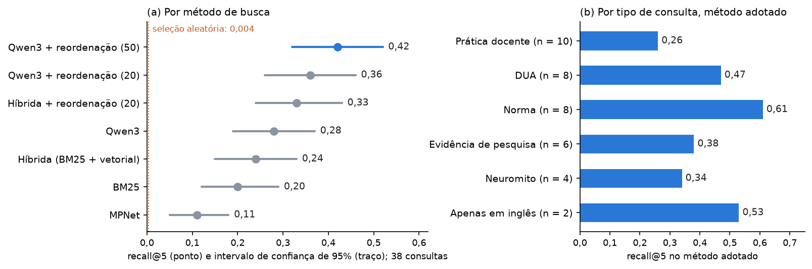
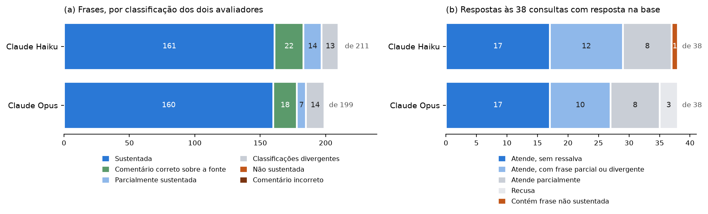

# Íris – Avaliação da recuperação e das respostas

Protocolo, métricas e resultados da avaliação do protótipo de RAG. Versão correspondente à entrega de 09/11/2026.

## 1. Objetivo

Medir três propriedades do protótipo:

- qualidade da recuperação: presença dos trechos relevantes entre os cinco entregues ao modelo gerador;
- fundamentação: sustentação de cada frase da resposta pelo trecho citado;
- rastreabilidade: validade das citações.

Nenhum modelo foi treinado ou ajustado. Os resultados decorrem de contagem sobre saídas de modelos pré-treinados.

## 2. Conjunto de avaliação

| Característica | Valor |
|---|---|
| Consultas | 40, elaboradas antes de qualquer execução de busca |
| Consultas com resposta na base | 38 |
| Consultas sem resposta na base | 2, para verificação da recusa |
| Tipos de consulta | Prática docente (10), DUA (8), norma (8), evidência de pesquisa (6), neuromito (4), resposta disponível apenas em inglês (2) |
| Trechos de referência | 167 trechos classificados como relevantes |
| Origem da referência | Modelo de linguagem (Claude Opus), por leitura da base, sem acesso ao mecanismo de busca |
| Validação humana | Não realizada |

Arquivos: `rag/iris-rag/gabarito/perguntas_v0.json` e `rag/iris-rag/gabarito/gabarito_rascunho_v0.json`. O conjunto de referência é válido para a segmentação identificada pelo hash registrado no arquivo; alterações na segmentação invalidam os identificadores de trecho.

## 3. Métricas

| Métrica | Definição |
|---|---|
| Recall@k | Fração dos trechos relevantes de uma consulta presente entre os k primeiros retornados; média sobre as consultas |
| Consultas atendidas | Número de consultas com ao menos um trecho relevante entre os cinco retornados |
| MRR | Média do inverso da posição do primeiro trecho relevante |
| Frases sustentadas | Frases de conteúdo classificadas como sustentadas pelo trecho citado, por dois avaliadores |
| Citações inválidas | Frases que citam trecho não entregue ao modelo gerador |
| Concordância | Proporção de classificações idênticas entre avaliadores e coeficiente kappa de Cohen |

Os intervalos de confiança de 95% foram obtidos por bootstrap com 2.000 reamostragens das consultas e semente fixa. As comparações entre métodos são pareadas por consulta. A referência de acaso para o recall@5 é 0,004, correspondente à seleção aleatória de 5 entre 1.368 trechos.

## 4. Recuperação

### 4.1 Métodos avaliados

| Método | Recall@5 (IC 95%) | Recall@10 | MRR | Consultas atendidas |
|---|---|---|---|---|
| BM25 | 0,20 (0,12 a 0,29) | 0,31 | 0,32 | 47% |
| MPNet multilíngue | 0,11 (0,05 a 0,18) | 0,13 | 0,23 | 32% |
| Híbrida (BM25 + vetorial, fusão de posições) | 0,24 (0,15 a 0,33) | 0,37 | 0,41 | 61% |
| Qwen3 | 0,28 (0,19 a 0,37) | 0,41 | 0,46 | 68% (26 de 38) |
| Híbrida + reordenação (20 candidatos) | 0,33 (0,24 a 0,43) | 0,44 | 0,52 | 74% |
| Qwen3 + reordenação (20 candidatos) | 0,36 (0,26 a 0,45) | 0,46 | 0,56 | 76% (29 de 38) |
| **Qwen3 + reordenação (50 candidatos)** | **0,42 (0,32 a 0,52)** | **0,57** | **0,60** | **87% (33 de 38)** |

Fontes: `rag/iris-rag/pacote/outputs/16-gabarito-opus.txt`; `rag/outputs/18-variacoes-busca.txt`.

### 4.2 Comparações pareadas

| Comparação | Diferença de recall@5 (IC 95%) |
|---|---|
| Qwen3 + reordenação (50) − Qwen3 | +0,14 (+0,08 a +0,21) |
| Qwen3 + reordenação (50) − Qwen3 + reordenação (20) | +0,06 (+0,01 a +0,13) |

### 4.3 Resultado por tipo de consulta, método adotado

| Tipo | Consultas | Recall@5 |
|---|---|---|
| Norma | 8 | 0,61 |
| Resposta disponível apenas em inglês | 2 | 0,53 |
| DUA | 8 | 0,47 |
| Evidência de pesquisa | 6 | 0,38 |
| Neuromito | 4 | 0,34 |
| Prática docente | 10 | 0,26 |

Nas dez consultas de prática docente, foram retornados 10 dos 43 trechos relevantes.

### 4.4 Tempo de resposta

Tempo mediano por consulta, em computador portátil com GPU integrada: 40 ms para o Qwen3 isolado e 463 ms para o método adotado. O tempo em servidor sem GPU não foi medido para 50 candidatos.

## 5. Experimentos adicionais

As variações a seguir foram avaliadas sobre o método adotado. Para cada uma, o resultado esperado e o critério de adoção foram registrados antes da execução.

| Variação | Resultado | Diferença de recall@5 (IC 95%) | Decisão |
|---|---|---|---|
| Busca por resposta hipotética (HyDE) | Trechos relevantes entre os 50 candidatos: 129 de 167, ante 125; recall@5 de 0,42 | 0,00 (−0,03 a +0,03) | Não adotada |
| Consulta combinada com resposta hipotética | Trechos relevantes entre os 50 candidatos: 130 de 167; recall@5 de 0,42 | 0,00 (0,00 a +0,01) | Não adotada |
| Consulta com três reformulações | Trechos relevantes entre os 50 candidatos: 121 de 167; recall@5 de 0,43 | +0,01 (0,00 a +0,03) | Não adotada |
| Resposta hipotética como entrada da reordenação | Recall@5 de 0,21 | −0,21 (−0,32 a −0,11) | Não adotada |
| União de candidatos (50 da consulta e 50 da resposta hipotética) | Trechos relevantes entre os candidatos: 139 de 167; recall@5 de 0,42 | 0,00 (0,00 a +0,01) | Não adotada |
| Exclusão da cartilha da ABDA do resultado | Recall@5 de 0,41; nas consultas de prática docente, 9 de 43 trechos relevantes, ante 10 | −0,01 (−0,04 a +0,02) | Não adotada |

Fontes: `rag/outputs/29-hyde-e-reescrita.txt`; `rag/outputs/31-leitor-do-reranker.txt`; `rag/outputs/35-busca-sem-o-guia-abda.txt`.

### 5.1 Efeito do tamanho dos trechos

| Grupo de trechos relevantes | Trechos | Mediana de tokens | Acima de 508 tokens |
|---|---|---|---|
| Entregues entre os cinco | 62 | 462 | 39% |
| Entre os 50 candidatos, não entregues | 63 | 473 | 35% |
| Fora dos 50 candidatos | 42 | 333 | 17% |
| Base completa | 1.368 | 360 | 20% |

Os trechos relevantes não recuperados são mais curtos que os recuperados. Entre os candidatos, a proporção de trechos entregues é de 50% para pares truncados e de 49% para pares não truncados. O truncamento não explica a perda de trechos relevantes. Fonte: `rag/outputs/32-comprimento-dos-trechos.txt`.

### 5.2 Estabilidade do banco vetorial

Em 114 listas de resultado (57 consultas, em português e em inglês), a ordenação retornada pelo PostgreSQL coincidiu com o cálculo exato do cosseno até a centésima posição e repetiu-se em três execuções independentes. Fonte: `rag/outputs/22-estabilidade-pgvector.txt`.

## 6. Respostas

### 6.1 Procedimento

Para cada consulta, o sistema recuperou cinco trechos pelo método adotado e um modelo de linguagem gerou a resposta com as instruções do protótipo (`gerar.py`). Dois modelos geradores foram utilizados: Claude Haiku e Claude Opus. O modelo configurado no protótipo (Qwen, pela plataforma Groq) não foi avaliado, por indisponibilidade da credencial.

A verificação automática, sem uso de modelo, confere a existência dos trechos citados, a presença de citação em cada frase e a ocorrência de recusa.

A avaliação de fundamentação emprega dois avaliadores automáticos, instâncias independentes do modelo Claude Sonnet, que aplicam a regra descrita em `rag/iris-rag/pacote/regra_juiz_respostas_v2.md`. Cada frase é classificada como sustentada, parcialmente sustentada ou não sustentada pelo trecho citado. Para as duas primeiras classes, o avaliador transcreve a passagem do trecho; um script confere a transcrição literalmente e descarta a classificação quando a passagem não consta no trecho. Frases que qualificam as fontes são classificadas à parte, como comentário correto ou incorreto. Nos arquivos de saída, os avaliadores são identificados como juiz A e juiz B.

### 6.2 Verificação automática

| Indicador | Claude Haiku | Claude Opus |
|---|---|---|
| Frases | 211 | 199 |
| Frases com citação de trecho inexistente | 0 | 0 |
| Frases sem citação | 1 | 0 |
| Recusas nas 2 consultas sem resposta na base | 2 | 2 |
| Recusas nas 38 consultas com resposta na base | 0 | 3 |

Fonte: `rag/outputs/23-respostas-conferencia.txt`.

### 6.3 Fundamentação das frases de conteúdo

| Classificação comum aos dois avaliadores | Claude Haiku | Claude Opus |
|---|---|---|
| Sustentada | 161 (86,1%) | 160 (91,4%) |
| Parcialmente sustentada | 14 (7,5%) | 7 (4,0%) |
| Não sustentada | 0 | 0 |
| Classificações divergentes | 12 (6,4%) | 8 (4,6%) |
| Total de frases de conteúdo | 187 | 175 |

Fonte: `rag/outputs/26-respostas-juizes-v2.txt`.

### 6.4 Concordância entre avaliadores

Matriz para as 187 frases de conteúdo geradas pelo Claude Haiku (linhas: avaliador A; colunas: avaliador B):

| | Sustentada | Parcialmente sustentada | Não sustentada | Descartada |
|---|---|---|---|---|
| **Sustentada** | 161 | 5 | 0 | 0 |
| **Parcialmente sustentada** | 6 | 14 | 0 | 0 |
| **Não sustentada** | 0 | 0 | 0 | 0 |
| **Descartada** | 0 | 0 | 0 | 1 |

| Modelo gerador | Classificações idênticas | Kappa de Cohen |
|---|---|---|
| Claude Haiku | 176 de 187 (94,1%) | 0,70 |
| Claude Opus | 168 de 175 (96,0%) | 0,68 |

### 6.5 Classificação das respostas

Respostas às 38 consultas com resposta na base:

| Classe | Claude Haiku | Claude Opus |
|---|---|---|
| A. Atende à consulta, sem ressalva | 17 | 17 |
| B. Atende à consulta, com frase parcialmente sustentada ou com classificação divergente | 12 | 10 |
| C. Contém frase não sustentada para os dois avaliadores | 1 | 0 |
| D. Atende parcialmente à consulta | 8 | 8 |
| E. Recusa | 0 | 3 |
| A + B | 29 (76%; IC 95%: 63% a 89%) | 27 (71%; IC 95%: 55% a 84%) |

A resposta da classe C contém um comentário incorreto sobre o conteúdo dos trechos, e não uma afirmação de conteúdo não sustentada.

Nas dez consultas de prática docente, com o Claude Haiku, uma resposta foi classificada em A, três em B e seis em D.

## 7. Ameaças à validade

| Ameaça | Descrição |
|---|---|
| Referência produzida por modelo | O conjunto de referência da recuperação não foi validado por avaliador humano e pode omitir trechos relevantes |
| Avaliadores automáticos | A fundamentação foi classificada por modelos de linguagem, sem validação humana |
| Revisão da regra de avaliação | A regra foi revisada uma vez após a primeira aplicação sobre as mesmas respostas; os resultados reportados correspondem à segunda aplicação |
| Modelo gerador | As respostas avaliadas não foram geradas pelo modelo configurado no protótipo; o modelo gerador do produto não está definido |
| Tamanho da amostra | 38 consultas com resposta; cada consulta corresponde a 2,6 pontos percentuais |
| Formato das consultas | As consultas simulam perguntas de professores; o formato do Agente Estrategista não foi avaliado |
| Posição dos trechos | O efeito da ordem dos trechos no contexto do modelo gerador não foi avaliado; os trechos são apresentados na ordem de relevância do segundo estágio |
| Ambiente de geração das respostas | As respostas foram geradas a partir de um índice local de desenvolvimento; a recuperação reproduzida no PostgreSQL coincidiu em 39 das 40 consultas |

## 8. Reprodução

Os comandos são executados a partir de `rag/iris-rag/pacote/`, com o banco em execução e com os textos de todos os documentos do índice (ver `README.md`, Condições para a reexecução).

| Resultado | Comando | Saída | Reexecução verificada fora do repositório de origem |
|---|---|---|---|
| Recuperação por método | `python avaliar_opus.py` | `rag/outputs/16-gabarito-opus.txt` | Sim; valores iguais |
| Método adotado e variações | `python medir_variacoes.py ranquear`; `python medir_variacoes.py medir` | `../../outputs/18-variacoes-busca.txt` | Sim; recall@5, intervalos e diferenças pareadas iguais |
| Demonstração | `python demonstrar_resposta.py` | `rag/outputs/05-consulta-resposta-fonte.txt` | Sim; saída igual, exceto identificação do banco |
| Verificação automática das respostas | `python medir_respostas.py conferir` | `../../outputs/23-respostas-conferencia.txt` | Não: depende de dados intermediários não distribuídos |
| Fundamentação | `python medir_respostas.py medir2` | `../../outputs/26-respostas-juizes-v2.txt` | Não: depende das saídas completas dos avaliadores, não distribuídas |
| Experimentos adicionais | `python medir_hyde.py`; `python medir_sem_abda.py` | `../../outputs/28` a `35` | Não verificada |

As saídas completas dos avaliadores não são distribuídas por conterem passagens de documentos de licença restrita. As respostas, as classificações e as passagens verificadas utilizadas neste documento estão registradas em `respostas_medidas.json`, `respostas_vereditos_v2.json` e `respostas_passagens_v2.json`.
