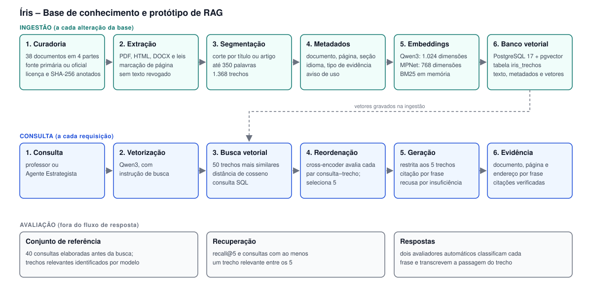
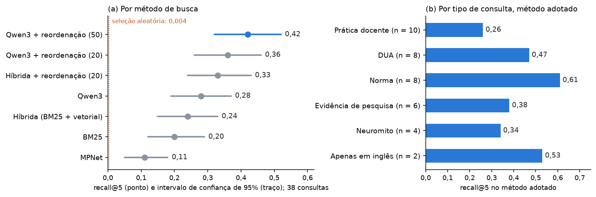
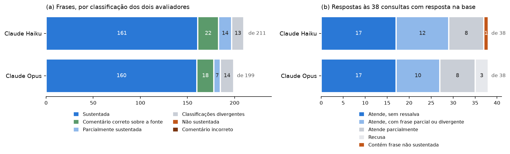

# Íris: base de conhecimento e protótipo de geração aumentada por recuperação (RAG)

Relatório técnico do Segundo Desafio. Residência em IA, Turma 1 – Grupo 3. Brasília, 2026.

## Resumo

Este relatório descreve a base de conhecimento e o protótipo de geração aumentada por recuperação (RAG) do Íris, sistema que adapta material didático para estudantes neurodivergentes. A base reúne 38 documentos de fontes primárias ou oficiais, organizados em quatro partes e segmentados em 1.368 trechos com metadados de origem. Os trechos são vetorizados com o modelo Qwen3-Embedding-0.6B e armazenados em PostgreSQL com a extensão pgvector. A recuperação ocorre em dois estágios: busca vetorial dos 50 trechos mais próximos e reordenação por um modelo cross-encoder, que seleciona 5. A resposta é gerada exclusivamente a partir desses trechos, com citação obrigatória por frase. A avaliação empregou 40 consultas elaboradas antes de qualquer execução. O método adotado obteve recall@5 de 0,42 (IC 95%: 0,32 a 0,52), ante 0,28 da busca vetorial isolada e 0,004 de uma seleção aleatória. Nas respostas, nenhuma frase citou trecho inexistente, e 86% das frases de conteúdo foram classificadas como sustentadas pelo trecho citado por dois avaliadores automáticos. O desempenho é inferior em consultas de natureza prática (recall@5 de 0,26). Os conjuntos de referência e os avaliadores são modelos de linguagem, sem validação humana, o que torna os resultados provisórios.

**Palavras-chave:** geração aumentada por recuperação; recuperação de informação; banco vetorial; embeddings; educação inclusiva.

## 1 INTRODUÇÃO

### 1.1 Contexto

O Íris é um sistema de apoio ao professor que transforma material didático comum em material adaptado para estudantes neurodivergentes. Na arquitetura do sistema, o Agente Estrategista define a adaptação a aplicar a partir da barreira funcional do estudante e do tipo de atividade. Para que essa decisão seja verificável, o agente consulta uma base de conhecimento e fundamenta a proposta em documentos identificáveis.

### 1.2 Objetivo

Este relatório documenta a base de conhecimento curada e o protótipo de RAG que atende ao Agente Estrategista, e apresenta a avaliação da qualidade da recuperação, da fundamentação das respostas e da rastreabilidade das fontes.

### 1.3 Escopo

O escopo compreende a curadoria da base, o pipeline de ingestão, as estratégias de segmentação e de embeddings, o banco vetorial, o fluxo de consulta com geração de resposta e a avaliação. Interface e experiência do usuário estão fora do escopo. O primeiro perfil atendido é o do estudante com transtorno do déficit de atenção com hiperatividade (TDAH). A base contém somente documentos públicos; nenhum dado de estudante é armazenado.

Nenhum modelo foi treinado ou ajustado. Todos os modelos utilizados são pré-treinados e de uso público. Modelos de linguagem foram empregados como apoio à implementação, à avaliação automática e à revisão textual; os resultados numéricos são produzidos por scripts incluídos no pacote que acompanha este relatório.

### 1.4 Organização do documento

As seções 2 a 6 descrevem a base e a sua preparação. A seção 7 apresenta a arquitetura e o fluxo de consulta. A seção 8 apresenta a demonstração. A seção 9 apresenta a avaliação. A seção 10 traz as considerações finais. O Apêndice A lista os documentos da base e o Apêndice B descreve o pacote entregue.

## 2 BASE DE CONHECIMENTO

### 2.1 Composição

A curadoria aceitou 40 documentos, dos quais 38 compõem o índice de busca. Dois documentos aceitos são versões alternativas de um terceiro e foram mantidos apenas no catálogo, para evitar que conteúdo duplicado ocupasse posições no resultado da busca. A base está organizada em quatro partes, conforme a Tabela 1.

**Tabela 1 – Composição da base de conhecimento**

| Parte | Questão atendida | Documentos | Exemplos |
|---|---|---|---|
| A. Desenho Universal para a Aprendizagem (DUA) | Princípio de desenho que sustenta a adaptação | 4 | Diretrizes CAST 3.0; diretrizes do DUA publicadas na Revista Brasileira de Educação Especial; Caderno 4 do MEC |
| B. TDAH e funções executivas | Conhecimento sobre a barreira e intervenções escolares | 12 | Diretrizes NICE NG87 e AAP 2019; Protocolo Clínico do Ministério da Saúde; revisões sistemáticas |
| C. Normas e MEC | Obrigações e vedações aplicáveis à escola | 10 | Lei nº 14.254/2021; Lei Brasileira de Inclusão; LDB; Decreto nº 12.686/2025; Portaria MEC nº 421/2026 |
| D. Pesquisa | Força da evidência, incluindo neuromitos | 12 | Estudos sobre neuromitos, carga cognitiva, tipografia para dislexia e simplificação automática de texto |

*Fonte: elaboração própria, a partir de `rag/iris-rag/fontes.json`.*

Dos 1.368 trechos, 914 (67%) estão em inglês. As consultas são formuladas em português, o que condiciona a escolha dos modelos de busca (seção 5).

### 2.2 Critérios de curadoria

A inclusão de cada documento obedeceu a quatro critérios, registrados individualmente no catálogo:

a) fonte primária ou oficial: órgão governamental, sociedade científica ou periódico com revisão por pares;

b) acesso público e lícito, com registro da licença declarada no documento;

c) vigência verificada em 2026, no caso de normas;

d) conferência da extração do texto em ao menos duas páginas de cada documento.

Foram recusados 22 documentos, com o motivo registrado. Dois decretos revogados foram excluídos pelo critério de vigência.

Estudos sobre neuromitos educacionais foram incluídos deliberadamente, para que o sistema possa indicar a ausência de fundamento de uma prática. Documentos que declaram evidência limitada também foram incluídos, por constituírem informação relevante para a decisão do agente.

### 2.3 Avisos de uso e licenciamento

Determinados trechos carregam um aviso de uso, transmitido ao modelo gerador junto com o texto. O aviso restringe a finalidade para a qual o trecho pode ser citado. Uma cartilha sem referências bibliográficas, por exemplo, pode ser usada como orientação prática, mas não como evidência de eficácia.

A licença de cada documento está registrada no catálogo, conforme declarada na fonte. Dos 38 documentos do índice, o pacote distribui o texto de 32: 18 com licença Creative Commons, 7 textos legais ou atos oficiais em domínio público, 3 com permissão de reprodução declarada pela fonte e 4 publicados por órgãos governamentais sem licença declarada (a Política Nacional de Educação Especial de 2008, a Nota Técnica MEC/SECADI nº 04/2014, o Protocolo Clínico e Diretrizes Terapêuticas do TDAH e a página do CDC sobre TDAH em sala de aula). A redistribuição desses quatro textos em repositório público deve ser avaliada previamente.

Oito textos não acompanham esta entrega, por direitos reservados ou ausência de licença aberta: três versões das diretrizes do CAST, as diretrizes NICE e AAP, o guia da ABDA, um artigo de revisão e o Caderno 4 do MEC. Seis deles integram o índice. O catálogo registra o endereço de origem de cada documento, e o Apêndice A indica a situação de cada um.

## 3 PIPELINE DE INGESTÃO

A ingestão é executada a cada alteração da base e compreende nove etapas:

a) obtenção do documento original e registro do hash SHA-256;

b) extração do texto conforme o formato de origem, com preservação do número de página nos documentos em PDF e remoção de dispositivos revogados nos textos legais;

c) conferência da extração em duas páginas de cada documento;

d) consolidação do catálogo, com marcação de duplicatas e de avisos de uso;

e) limpeza de cabeçalhos, rodapés, numeração de página e hifenização de fim de linha;

f) segmentação em trechos (seção 4);

g) atribuição de metadados a cada trecho: documento, parte, idioma, tipo de evidência, página, seção, barreiras relacionadas e aviso de uso;

h) geração dos vetores (seção 5);

i) gravação de trechos, metadados e vetores no banco (seção 6).

A Tabela 2 relaciona etapas cuja ausência compromete a rastreabilidade ou a qualidade da busca.

**Tabela 2 – Etapas de ingestão e efeito de sua ausência**

| Etapa | Efeito da ausência |
|---|---|
| Preservação do número de página | A citação não indica a página, o que impede a conferência pelo usuário |
| Remoção de dispositivos revogados | A resposta pode citar dispositivo legal sem vigência |
| Descarte de listas de referências | Listas de referências concentram termos de busca e superam o texto explicativo no resultado; 168 segmentos foram descartados |
| Recorte do Protocolo Clínico (páginas 1 a 18) | As 181 páginas restantes são tabelas de medicamentos e deslocam consultas sobre TDAH para posologia |

*Fonte: elaboração própria.*

No total, 372 páginas ou segmentos foram descartados. A contagem por motivo consta em `rag/iris-rag/pacote/outputs/01-chunking.txt`.

## 4 ESTRATÉGIA DE SEGMENTAÇÃO (CHUNKING)

A segmentação segue a estrutura do documento, de modo que cada trecho trate de um único assunto. As regras constam na Tabela 3.

**Tabela 3 – Regras de segmentação**

| Regra | Valor | Justificativa |
|---|---|---|
| Ponto de corte | Título, artigo de lei ou ponto de verificação do DUA | A estrutura do documento delimita a mudança de assunto; janelas de tamanho fixo fragmentam frases e misturam assuntos |
| Tamanho máximo | 350 palavras | Mantém um assunto por trecho; cinco trechos totalizam cerca de 1.500 palavras de contexto para o modelo gerador |
| Tamanho mínimo | 40 palavras | Trechos muito curtos carregam pouca informação e são agregados ao trecho vizinho |
| Sobreposição | Último parágrafo do trecho anterior; em textos legais, o caput do artigo | Preserva a continuidade entre trechos e o vínculo entre inciso e caput |
| Quadros | Uma página por trecho | A divisão de um quadro separa linhas de suas colunas |
| Prefixo de contexto | Título do documento e da seção, antepostos ao texto vetorizado | Trechos intermediários de uma seção preservam a indicação de origem |

*Fonte: elaboração própria.*

O processo resultou em 1.368 trechos, com mediana de 215 palavras (primeiro quartil de 110 e terceiro quartil de 305).

Em tokens, a mediana é de 360 por trecho, à razão de 1,86 token por palavra em português. Dos 1.368 trechos, 274 (20%) excedem 508 tokens e são truncados pelos dois modelos com limite de 512 tokens (MPNet e reordenador); quatro trechos excedem o limite de 1.024 tokens do Qwen3. A análise do efeito do truncamento consta na seção 9.3 e não indicou perda de desempenho atribuível ao tamanho dos trechos.

## 5 ESTRATÉGIA DE EMBEDDINGS

Cada trecho é representado por um vetor numérico (embedding). A consulta é vetorizada pelo mesmo modelo, e a similaridade entre consulta e trecho é medida pelo cosseno entre os vetores. Três mecanismos de busca foram implementados sobre os mesmos trechos, conforme a Tabela 4.

**Tabela 4 – Mecanismos de busca implementados**

| Mecanismo | Modelo | Dimensões | Característica |
|---|---|---|---|
| BM25 | Sem modelo; correspondência lexical | – | Referência de comparação; não relaciona termos de idiomas distintos |
| MPNet multilíngue | `paraphrase-multilingual-mpnet-base-v2` | 768 | Busca semântica multilíngue; limite de 512 tokens |
| Qwen3 | `Qwen3-Embedding-0.6B` | 1.024 | Busca semântica multilíngue, projetada para consulta curta e documento longo; limite de 1.024 tokens |

*Fonte: elaboração própria.*

O suporte multilíngue é requisito desta base, pois dois terços dos trechos estão em inglês. A correspondência lexical não relaciona, por exemplo, "tempo adicional" a "extended time".

O Qwen3 apresentou o melhor resultado entre os três mecanismos isolados (seção 9.2) e foi adotado. A vetorização dos 1.368 trechos consumiu 2,7 minutos com o Qwen3 e 0,3 minuto com o MPNet, em computador portátil com aceleração por GPU integrada. Os modelos são executados localmente; documentos e consultas não são enviados a serviços externos.

Duas alternativas foram descartadas. A tradução automática dos documentos para o português eleva o custo, introduz risco de erro em números e termos técnicos e inviabiliza a citação literal. A geração de vetores por API externa implica envio de textos e consultas a terceiros e custo por requisição, sem ganho necessário para o volume da base.

## 6 BANCO VETORIAL

O banco vetorial é o PostgreSQL 17 com a extensão pgvector 0.8. A escolha considera a evolução prevista do Íris para aplicação web com banco relacional: trechos, metadados e vetores permanecem na mesma tabela do banco da aplicação, sob o mesmo controle de acesso e a mesma rotina de cópia de segurança.

A tabela `iris_trechos` armazena um trecho por linha, com o texto, os metadados em colunas tipadas e uma coluna vetorial por modelo. A busca por similaridade é expressa em SQL, com o operador de distância de cosseno do pgvector:

```
SELECT chunk_id, 1 - (vec_qwen3 <=> :consulta) AS cosseno
FROM iris_trechos
WHERE parte = 'C'                     -- filtro opcional por parte da base
ORDER BY vec_qwen3 <=> :consulta
LIMIT 50;
```

Os filtros por parte da base e por barreira funcional integram a cláusula `WHERE` da mesma consulta.

A tabela possui índice de busca aproximada (HNSW), previsto para volumes maiores. No volume atual, de 1.368 linhas, o otimizador do PostgreSQL executa leitura sequencial com ordenação, o que corresponde à busca exata. Em 114 listas de resultado verificadas, a ordenação coincidiu com o cálculo exato do cosseno até a centésima posição e manteve-se idêntica entre execuções.

## 7 ARQUITETURA E FLUXO DE CONSULTA

### 7.1 Visão geral

A Figura 1 apresenta os dois fluxos do sistema, ingestão e consulta, e o processo de avaliação, que não integra o caminho da resposta.

**Figura 1 – Arquitetura da base de conhecimento e do protótipo de RAG**



*Fonte: elaboração própria.*

### 7.2 Recuperação em dois estágios

No primeiro estágio, a consulta é vetorizada pelo Qwen3 e o banco retorna os 50 trechos de maior similaridade. No segundo estágio, um modelo cross-encoder (`mmarco-mMiniLMv2-L12-H384-v1`) avalia cada par formado pela consulta e por um trecho candidato e atribui uma nota de relevância. Os cinco trechos de maior nota são entregues ao modelo gerador.

O segundo estágio apenas reordena candidatos: trechos ausentes dos 50 primeiros não são recuperados. O tempo de resposta medido foi de 463 ms por consulta com reordenação e de 40 ms sem reordenação, em computador portátil com GPU integrada. O tempo em servidor sem GPU não foi medido para 50 candidatos.

### 7.3 Geração da resposta e citação de fontes

O modelo gerador recebe a consulta, os cinco trechos numerados de T1 a T5, com título, página, idioma, tipo de evidência e aviso de uso, e um conjunto de instruções:

a) utilizar exclusivamente o conteúdo dos trechos fornecidos;

b) encerrar cada frase com a citação do trecho que a sustenta;

c) observar o aviso de uso de cada trecho;

d) declarar a insuficiência de informação quando os trechos não respondem à consulta;

e) distinguir evidência de pesquisa, norma e orientação prática.

Após a geração, uma verificação automática, sem uso de modelo, confirma que cada citação aponta para um trecho existente e que toda frase possui citação.

O protótipo está configurado para o modelo Qwen servido pela plataforma Groq; o modelo gerador a ser adotado no produto não está definido. As respostas apresentadas neste relatório foram geradas por modelos Claude com as mesmas instruções, em razão da indisponibilidade da credencial de acesso ao modelo configurado. O pacote permite repetir a demonstração com o modelo configurado (Apêndice B).

## 8 DEMONSTRAÇÃO

### 8.1 Consulta de exemplo

Esta seção apresenta uma consulta completa: submissão, trechos recuperados, resposta gerada e evidência das fontes.

**Consulta submetida:** "Tempo extra na prova funciona para aluno com TDAH ou com dificuldade? O que diz a pesquisa?"

**Trechos recuperados:** os cinco trechos entregues ao modelo gerador constam na Tabela 5.

**Tabela 5 – Trechos recuperados para a consulta de exemplo**

| Trecho | Documento | Seção | Idioma e tipo |
|---|---|---|---|
| T1 a T4 | NCEO Accommodations Toolkit: Extended Time – Research | Extended Time: Research | Inglês; revisão |
| T5 | ABDA: TDAH – Guia para Professores | Texto do guia | Português; cartilha, com aviso de uso |

*Fonte: `rag/iris-rag/pacote/outputs/05-consulta-resposta-fonte.txt`.*

O aviso de uso do trecho T5 estabelece que a cartilha, por não apresentar referências, não deve ser citada como evidência de eficácia.

**Resposta gerada:**

1. Três estudos com alunos do ensino médio com TDAH mostraram efeitos positivos do tempo estendido [T1], enquanto outros três não encontraram impacto significativo no desempenho desses alunos [T2].
2. Para alunos com dificuldades de aprendizagem (LD), os resultados também se dividem: quatro estudos apontaram efeitos positivos [T1] e quatro não encontraram benefício [T2].
3. Na síntese da revisão, a pesquisa sobre tempo estendido é considerada inconclusiva, com benefício para alguns alunos com TDAH ou LD em avaliações de conteúdo [T3].
4. Menos da metade dos alunos com TDAH que tinham acesso ao tempo estendido de fato o utilizou [T1].
5. Como orientação prática, uma cartilha sugere permitir tempo extra para responder perguntas em aula ou em prova [T5].
6. Essa cartilha não tem referências e não serve como evidência de eficácia [T5].

**Evidência das fontes:** a Tabela 6 relaciona cada frase ao trecho citado, à classificação atribuída por dois avaliadores automáticos e à passagem do documento que sustenta a frase.

**Tabela 6 – Evidência das fontes por frase da resposta**

| Frase | Citação | Avaliador A | Avaliador B | Passagem do documento |
|---|---|---|---|---|
| 1 | T1, T2 | Sustentada | Parcialmente sustentada | "Three studies showed the positive effects of extended time for high school students with attention-deficit/hyperactivity disorder (ADHD)." |
| 2 | T1, T2 | Sustentada | Sustentada | "Four studies involved students with LD and resulted in positive effects." |
| 3 | T3 | Sustentada | Sustentada | "The research on the effects of extended time is inconclusive. Some studies found benefit while others found mixed effects, or no effect." |
| 4 | T1 | Sustentada | Sustentada | "However, less than half of the students with ADHD with access to extended time actually used it." |
| 5 | T5 | Sustentada | Sustentada | Passagem verificada no trecho T5; não reproduzida por restrição de licença |
| 6 | T5 | Comentário correto sobre a fonte | Comentário correto sobre a fonte | Reproduz o aviso de uso do trecho |

*Fonte: `rag/iris-rag/pacote/outputs/05-consulta-resposta-fonte.txt`.*

A verificação automática não identificou citação de trecho inexistente nem frase sem citação. Os trechos T1 a T4 provêm de `publications.ici.umn.edu/nceo/accommodations-toolkit/extended-time-research`.

### 8.2 Conjunto de sete consultas

A demonstração completa abrange sete consultas, correspondentes à primeira consulta de cada tipo no conjunto de avaliação. O critério de seleção foi definido previamente à execução. A Tabela 7 resume os resultados.

**Tabela 7 – Resumo das sete consultas da demonstração**

| Consulta | Tipo | Frases de conteúdo sustentadas para os dois avaliadores | Recuperação reproduzida no PostgreSQL |
|---|---|---|---|
| Q01 | Prática docente | 2 de 5 | 4 de 5 trechos |
| Q11 | DUA | 2 de 3 | Idêntica |
| Q19 | Norma | 5 de 5 | Idêntica |
| Q27 | Evidência de pesquisa | 4 de 5 | Idêntica |
| Q33 | Neuromito | 5 de 6 | Idêntica |
| Q37 | Resposta disponível apenas em inglês | 2 de 6 | Idêntica |
| Q39 | Sem resposta na base | Recusa | Idêntica |

*Fonte: `rag/iris-rag/pacote/outputs/05-consulta-resposta-fonte.txt`.*

Nas sete consultas, nenhuma frase foi classificada como não sustentada por qualquer avaliador, nenhuma citou trecho inexistente e nenhuma ficou sem citação. As frases não contabilizadas como sustentadas foram classificadas como parcialmente sustentadas ou receberam classificações divergentes.

As respostas foram geradas a partir de uma instância de desenvolvimento do índice. Na reexecução da busca no PostgreSQL, a lista de cinco trechos coincidiu em 39 das 40 consultas do conjunto de avaliação; a exceção é a consulta Q01, em que um trecho diverge.

Na consulta Q39, relativa à posologia de medicamento, o sistema declarou insuficiência de informação. Os avaliadores classificaram a recusa como indevida, pois um dos trechos menciona ajuste de dose. A recusa é o comportamento esperado para consultas dessa natureza.

## 9 AVALIAÇÃO

### 9.1 Protocolo

O conjunto de avaliação contém 40 consultas, elaboradas antes de qualquer execução de busca: 38 com resposta na base e 2 sem resposta, incluídas para verificar a recusa. As consultas distribuem-se em seis tipos: prática docente, DUA, norma, evidência de pesquisa, neuromito e resposta disponível apenas em inglês.

Para cada consulta, um modelo de linguagem (Claude Opus) examinou a base, sem acesso ao mecanismo de busca, e identificou os trechos relevantes, em um total de 167. Esse conjunto de referência não foi validado por avaliador humano.

A métrica principal é o recall@5: a fração dos trechos relevantes de uma consulta presente entre os cinco trechos retornados, em média sobre as consultas. A métrica secundária é o número de consultas com ao menos um trecho relevante entre os cinco retornados. Os intervalos de confiança de 95% foram obtidos por bootstrap, com 2.000 reamostragens das consultas.

### 9.2 Qualidade da recuperação

A Figura 2 apresenta o recall@5 por método de busca e, para o método adotado, por tipo de consulta.

**Figura 2 – Recall@5 por método de busca e por tipo de consulta**



*Fonte: elaboração própria, a partir de `rag/iris-rag/pacote/outputs/16-gabarito-opus.txt` e `rag/outputs/18-variacoes-busca.txt`.*

O método adotado, Qwen3 com reordenação sobre 50 candidatos, obteve recall@5 de 0,42 (IC 95%: 0,32 a 0,52). A busca vetorial isolada obteve 0,28, e a seleção aleatória de cinco trechos corresponde a 0,004. A diferença entre o método adotado e a busca vetorial isolada é de 0,14 (IC 95%: 0,08 a 0,21). Pela métrica secundária, 33 das 38 consultas receberam ao menos um trecho relevante, ante 26 sem reordenação.

A busca híbrida, que combina BM25 e busca vetorial por fusão de posições, obteve 0,24, valor inferior ao da busca vetorial isolada, embora com sobreposição dos intervalos de confiança.

Por tipo de consulta, o recall@5 varia de 0,61 (norma) a 0,26 (prática docente). Nas dez consultas de prática docente, a busca retornou 10 dos 43 trechos relevantes.

### 9.3 Experimentos adicionais

Cinco variações foram avaliadas com o objetivo de elevar o desempenho nas consultas de prática docente. Para cada uma, o resultado esperado e o critério de adoção foram registrados previamente à execução. Nenhuma atendeu ao critério de adoção. A Tabela 8 resume os resultados.

**Tabela 8 – Variações avaliadas e resultado**

| Variação | Resultado | Decisão |
|---|---|---|
| Busca por resposta hipotética gerada por modelo de linguagem (HyDE) | Trechos relevantes entre os 50 candidatos: de 125 para 129, em 167; recall@5 final inalterado, em 0,42 | Não adotada |
| Reformulação da consulta em três versões, com fusão das listas | Recall@5 de 0,43; intervalo da diferença inclui zero | Não adotada |
| Resposta hipotética como entrada do reordenador | Recall@5 reduzido de 0,42 para 0,21 | Não adotada |
| Exclusão da cartilha da ABDA do resultado da busca | Trechos relevantes retornados nas consultas de prática docente: de 10 para 9, em 43 | Não adotada |
| Análise do efeito do truncamento de trechos longos | Trechos relevantes não recuperados são mais curtos (17% acima de 508 tokens) que os recuperados (37%) | Tamanho de trecho mantido |

*Fonte: elaboração própria, a partir de `rag/outputs/29`, `31`, `32` e `35`.*

Os resultados indicam que o desempenho nas consultas de prática docente não decorre do vocabulário da consulta, do leitor do segundo estágio nem do tamanho dos trechos. A hipótese remanescente, não testada, é de cobertura: a base dispõe de poucos documentos que tratem dessas questões em linguagem próxima à do professor.

### 9.4 Fundamentação e rastreabilidade das respostas

Para as 40 consultas, o sistema recuperou cinco trechos e um modelo de linguagem gerou a resposta conforme as instruções da seção 7.3. A avaliação compreendeu duas verificações.

A primeira é automática e sem uso de modelo: confere a existência do trecho citado, a presença de citação em cada frase e a ocorrência de recusa.

A segunda emprega dois avaliadores automáticos, instâncias independentes de um modelo de linguagem (Claude Sonnet) que aplicam a mesma regra escrita. Cada avaliador classifica cada frase como sustentada, parcialmente sustentada ou não sustentada pelo trecho citado. Para as duas primeiras classificações, o avaliador deve transcrever a passagem do trecho; a transcrição é conferida literalmente por script, e a classificação é descartada quando a passagem não consta no trecho. Frases que apenas qualificam as fontes são avaliadas separadamente. A Tabela 9 apresenta os resultados.

**Tabela 9 – Fundamentação e rastreabilidade das respostas**

| Indicador | Resultado | Referência |
|---|---|---|
| Frases com citação de trecho inexistente | 0 de 211 | Valor esperado: zero |
| Frases de conteúdo sustentadas pelo trecho citado, para os dois avaliadores | 161 de 187 (86%) | Nenhuma frase classificada como não sustentada pelos dois avaliadores |
| Respostas que atendem à consulta sem frase reprovada | 29 de 38 (76%; IC 95%: 63% a 89%) | 17 de 38 sem ressalva |
| Recusas nas 2 consultas sem resposta na base | 2 de 2 | Nenhuma recusa nas 38 consultas com resposta |

*Fonte: `rag/outputs/23-respostas-conferencia.txt` e `rag/outputs/26-respostas-juizes-v2.txt`.*

A Tabela 10 apresenta a concordância entre os avaliadores nas 187 frases de conteúdo.

**Tabela 10 – Matriz de concordância entre avaliadores (linhas: avaliador A; colunas: avaliador B)**

| | Sustentada | Parcialmente sustentada | Não sustentada | Descartada |
|---|---|---|---|---|
| **Sustentada** | 161 | 5 | 0 | 0 |
| **Parcialmente sustentada** | 6 | 14 | 0 | 0 |
| **Não sustentada** | 0 | 0 | 0 | 0 |
| **Descartada** | 0 | 0 | 0 | 1 |

*Fonte: `rag/outputs/26-respostas-juizes-v2.txt`.*

Os avaliadores atribuíram a mesma classificação a 176 das 187 frases (94%), com coeficiente kappa de Cohen de 0,70. As divergências restringem-se às classes sustentada e parcialmente sustentada.

A Figura 3 apresenta a distribuição das classificações para os dois modelos geradores avaliados.

**Figura 3 – Classificação das frases e das respostas, por modelo gerador**



*Fonte: elaboração própria, a partir de `rag/outputs/26-respostas-juizes-v2.txt`.*

Com o segundo modelo gerador (Claude Opus), 160 de 175 frases de conteúdo foram classificadas como sustentadas (91%). Esse modelo recusou três consultas de prática docente.

Nas dez consultas de prática docente, uma resposta foi classificada sem ressalva e seis atenderam parcialmente à consulta. O resultado é coerente com o menor recall observado nesse tipo de consulta (seção 9.2).

### 9.5 Ameaças à validade

a) O conjunto de referência da recuperação foi produzido por modelo de linguagem e não foi validado por avaliador humano.

b) Os avaliadores das respostas são modelos de linguagem. A regra de avaliação foi revisada uma vez, após a primeira aplicação sobre as mesmas respostas; os resultados reportados correspondem à segunda aplicação e não constituem medida independente da regra.

c) As respostas avaliadas foram geradas por modelos distintos do modelo configurado no protótipo; o modelo gerador do produto não está definido.

d) O conjunto de avaliação tem 38 consultas com resposta; cada consulta corresponde a 2,6 pontos percentuais nas métricas por consulta.

e) As consultas avaliadas simulam perguntas de professores. O formato de consulta do Agente Estrategista não foi avaliado.

f) O efeito da posição dos trechos no contexto do modelo gerador não foi avaliado. Os trechos são apresentados na ordem de relevância atribuída pelo segundo estágio.

## 10 CONSIDERAÇÕES FINAIS

A entrega compreende a base curada com 38 documentos, o pipeline de ingestão, o banco vetorial em PostgreSQL com pgvector e o protótipo que recupera trechos, gera resposta restrita ao conteúdo recuperado e indica a fonte de cada frase.

A recuperação em dois estágios supera as alternativas avaliadas, e as respostas geradas mantêm-se restritas aos trechos fornecidos. O desempenho é inferior nas consultas de prática docente, e os experimentos realizados indicam limitação de cobertura da base, e não da técnica de busca.

Os trabalhos subsequentes previstos são:

a) validação, por avaliador humano, de amostra do conjunto de referência e das classificações das respostas;

b) definição do modelo gerador do produto e avaliação das respostas com esse modelo;

c) ampliação da base com fontes voltadas à prática docente;

d) avaliação com consultas no formato do Agente Estrategista;

e) medição do tempo de resposta do segundo estágio em servidor sem GPU;

f) ampliação da cobertura para dislexia e transtorno do espectro autista;

g) atribuição das barreiras funcionais por trecho, hoje atribuídas por documento;

h) avaliação do efeito da posição dos trechos no contexto fornecido ao modelo gerador, com permutação da ordem dos cinco trechos (LIU *et al*., 2024).

## REFERÊNCIAS

BONIFACIO, L. *et al*. **mMARCO**: a multilingual version of the MS MARCO passage ranking dataset. arXiv:2108.13897, 2021. Disponível em: https://arxiv.org/abs/2108.13897. Acesso em: 6 nov. 2026.

CAST. **Universal Design for Learning Guidelines version 3.0**. Lynnfield: CAST, 2024. Disponível em: https://udlguidelines.cast.org. Acesso em: 6 nov. 2026.

COHEN, J. A coefficient of agreement for nominal scales. **Educational and Psychological Measurement**, v. 20, n. 1, p. 37-46, 1960.

CORMACK, G. V.; CLARKE, C. L. A.; BÜTTCHER, S. Reciprocal rank fusion outperforms Condorcet and individual rank learning methods. *In*: INTERNATIONAL ACM SIGIR CONFERENCE ON RESEARCH AND DEVELOPMENT IN INFORMATION RETRIEVAL, 32., 2009, Boston. **Proceedings** [...]. New York: ACM, 2009. p. 758-759.

EFRON, B. Bootstrap methods: another look at the jackknife. **The Annals of Statistics**, v. 7, n. 1, p. 1-26, 1979.

GAO, L. *et al*. Precise zero-shot dense retrieval without relevance labels. *In*: ANNUAL MEETING OF THE ASSOCIATION FOR COMPUTATIONAL LINGUISTICS, 61., 2023, Toronto. **Proceedings** [...]. Stroudsburg: ACL, 2023. p. 1762-1777.

LEWIS, P. *et al*. Retrieval-augmented generation for knowledge-intensive NLP tasks. *In*: ADVANCES IN NEURAL INFORMATION PROCESSING SYSTEMS, 33., 2020. **Proceedings** [...]. 2020. p. 9459-9474.

LIU, N. F. *et al*. Lost in the middle: how language models use long contexts. **Transactions of the Association for Computational Linguistics**, v. 12, p. 157-173, 2024.

MALKOV, Y. A.; YASHUNIN, D. A. Efficient and robust approximate nearest neighbor search using hierarchical navigable small world graphs. **IEEE Transactions on Pattern Analysis and Machine Intelligence**, v. 42, n. 4, p. 824-836, 2020.

PGVECTOR. **pgvector**: open-source vector similarity search for Postgres. Disponível em: https://github.com/pgvector/pgvector. Acesso em: 6 nov. 2026.

REIMERS, N.; GUREVYCH, I. Making monolingual sentence embeddings multilingual using knowledge distillation. *In*: CONFERENCE ON EMPIRICAL METHODS IN NATURAL LANGUAGE PROCESSING, 2020. **Proceedings** [...]. Stroudsburg: ACL, 2020. p. 4512-4525.

ROBERTSON, S.; ZARAGOZA, H. The probabilistic relevance framework: BM25 and beyond. **Foundations and Trends in Information Retrieval**, v. 3, n. 4, p. 333-389, 2009.

ZHANG, Y. *et al*. **Qwen3 Embedding**: advancing text embedding and reranking through foundation models. arXiv:2506.05176, 2025. Disponível em: https://arxiv.org/abs/2506.05176. Acesso em: 6 nov. 2026.

## APÊNDICE A – DOCUMENTOS DA BASE DE CONHECIMENTO

**Tabela 11 – Documentos que compõem o índice de busca**

| Parte | Documento | Ano | Idioma | Licença e distribuição do texto |
|---|---|---|---|---|
| A | Diretrizes Desenho Universal para Aprendizagem. Versão 3.0 (texto completo, tradução) | 2024 | pt-BR | Direitos reservados; não distribuído |
| A | Práticas pedagógicas inclusivas em salas de aula (Cadernos Pedagógicos: Política Nacional... | 2026 | pt-BR | Direitos reservados; não distribuído |
| A | Diretrizes para o Desenho Universal para a Aprendizagem (DUA) | 2020 | pt-BR | Creative Commons; distribuído |
| A | Desenho universal para a aprendizagem como estratégia de inclusão escolar | 2018 | pt-BR | Creative Commons; distribuído |
| B | Clinical Practice Guideline for the Diagnosis, Evaluation, and Treatment of... | 2019 | en | Direitos reservados; não distribuído |
| B | TDAH – Guia para Professores | 2012 | pt-BR | Direitos reservados; não distribuído |
| B | ADHD in the Classroom | 2026 | en | Sem licença declarada; distribuído |
| B | Cognitive Training for Attention-Deficit/Hyperactivity Disorder: Meta-Analysis of Clinical... | 2015 | en | Creative Commons; distribuído |
| B | Executive Functions | 2013 | en | Direitos reservados; não distribuído |
| B | The Effects of Classroom Interventions on Off-Task and Disruptive Classroom Behavior in... | 2016 | en | Creative Commons; distribuído |
| B | Protocolo Clínico e Diretrizes Terapêuticas do Transtorno do Déficit de Atenção com... | 2022 | pt-BR | Sem licença declarada; distribuído |
| B | The Basics of Accommodations and Modifications (NCEO Brief #33) | 2024 | en | Reprodução permitida pela fonte; distribuído |
| B | Extended Time: Research (NCEO Accommodations Toolkit #6a) | 2026 | en | Reprodução permitida pela fonte; distribuído |
| B | Attention deficit hyperactivity disorder: diagnosis and management (NICE guideline NG87) | 2018 | en | Direitos reservados; não distribuído |
| B | Intervenções escolares para o TDAH: uma revisão da literatura (2000-2018) | 2019 | pt-BR | Creative Commons; distribuído |
| B | School-based randomized controlled trials for ADHD and accompanying impairments: a... | 2025 | en | Creative Commons; distribuído |
| C | Decreto nº 12.686, de 20 de outubro de 2025 – institui a Política Nacional de Educação... | 2025 | pt-BR | Domínio público; distribuído |
| C | A redação do Enem 2026 – Cartilha do(a) participante com dislexia | 2026 | pt-BR | Reprodução permitida pela fonte; distribuído |
| C | Lei nº 12.764, de 27 de dezembro de 2012 – Política Nacional de Proteção dos Direitos da... | 2012 | pt-BR | Domínio público; distribuído |
| C | Lei nº 13.146/2015 (Lei Brasileira de Inclusão) – recorte: arts. 2º, 2º-A e 3º (definições)... | 2015 | pt-BR | Domínio público; distribuído |
| C | Lei nº 14.254, de 30 de novembro de 2021 – acompanhamento integral para educandos com... | 2021 | pt-BR | Domínio público; distribuído |
| C | Lei nº 9.394/1996 (LDB) – recorte: art. 24 (inclui inciso V, avaliação contínua com... | 1996 | pt-BR | Domínio público; distribuído |
| C | Política Nacional de Educação Especial na Perspectiva da Educação Inclusiva (MEC/SEESP, 2008) | 2008 | pt-BR | Sem licença declarada; distribuído |
| C | Nota Técnica nº 04/2014/MEC/SECADI/DPEE, de 23/01/2014 – orientação quanto a documentos... | 2014 | pt-BR | Sem licença declarada; distribuído |
| C | Portaria MEC nº 421, de 15 de maio de 2026 – dispõe sobre a PNEEI e a Reneei (regulamenta o... | 2026 | pt-BR | Domínio público; distribuído |
| C | Resolução CNE/CEB nº 4, de 2 de outubro de 2009 – Diretrizes Operacionais para o AEE na... | 2009 | pt-BR | Domínio público; distribuído |
| D | Do Text Simplification Systems Preserve Meaning? A Human Evaluation via Reading Comprehension | 2024 | en | Creative Commons; distribuído |
| D | The effects of inclusion on academic achievement, socioemotional development and wellbeing... | 2022 | en | Creative Commons; distribuído |
| D | Neuromyths in education: Prevalence and predictors of misconceptions among teachers | 2012 | en | Creative Commons; distribuído |
| D | A Educação Especial e os Cursos Técnicos: a Visão dos Docentes sobre os Processos de... | 2022 | pt-BR | Creative Commons; distribuído |
| D | Inter-letter spacing, inter-word spacing, and font with dyslexia-friendly features: testing... | 2020 | en | Creative Commons; distribuído |
| D | Generating Educational Materials with Different Levels of Readability using LLMs | 2024 | en | Creative Commons; distribuído |
| D | Dyslexie font does not benefit reading in children with or without dyslexia | 2018 | en | Creative Commons; distribuído |
| D | Providing Instruction Based on Students' Learning Style Preferences Does Not Improve Learning | 2020 | en | Creative Commons; distribuído |
| D | Neuroscience Knowledge and Endorsement of Neuromyths among Educators: What Is the Scenario... | 2022 | en | Creative Commons; distribuído |
| D | Differentiated Instruction in Secondary Education: A Systematic Review of Research Evidence | 2019 | en | Creative Commons; distribuído |
| D | Cognitive Architecture and Instructional Design: 20 Years Later | 2019 | en | Creative Commons; distribuído |
| D | The effect of a specialized dyslexia font, OpenDyslexic, on reading rate and accuracy | 2017 | en | Creative Commons; distribuído |

*Fonte: `rag/iris-rag/fontes.json`.*

## APÊNDICE B – PACOTE ENTREGUE

O arquivo `iris-base-e-rag.zip` contém o código-fonte, os cadernos executados, a documentação de arquitetura e de avaliação, as saídas dos scripts e os textos de 32 documentos (Apêndice A). O Quadro 1 relaciona os itens do entregável aos artefatos.

**Quadro 1 – Itens do entregável e artefatos correspondentes**

| Item | Artefato |
|---|---|
| Base de conhecimento curada, com mínimo de 20 documentos | `rag/iris-rag/FONTES.md`; `rag/iris-rag/fontes.json`; `rag/iris-rag/texto/` |
| Descrição da estratégia de segmentação | Seção 4; `docs/rag/arquitetura.md`, seção 8.1 |
| Descrição da estratégia de embeddings | Seção 5; `docs/rag/arquitetura.md`, seção 8.2 |
| Implementação do banco vetorial | `rag/iris-rag/pacote/banco_pg.py` |
| Consulta, trechos recuperados, resposta fundamentada e evidência das fontes | `rag/iris-rag/pacote/02_consulta_resposta_fonte.ipynb`; `rag/iris-rag/pacote/outputs/05-consulta-resposta-fonte.txt` |
| Diagrama de arquitetura | Figura 1; `docs/rag/diagrama_arquitetura.svg` |
| Pipeline de ingestão | Seção 3; `rag/iris-rag/scripts/`; `rag/iris-rag/pacote/ingestao.py` |
| Avaliação | Seção 9; `docs/rag/avaliacao.md`; `rag/outputs/` |

*Fonte: elaboração própria.*

As instruções de instalação e execução constam no arquivo `README.md` do pacote. A execução repetida do script de demonstração produz arquivo de saída idêntico.
