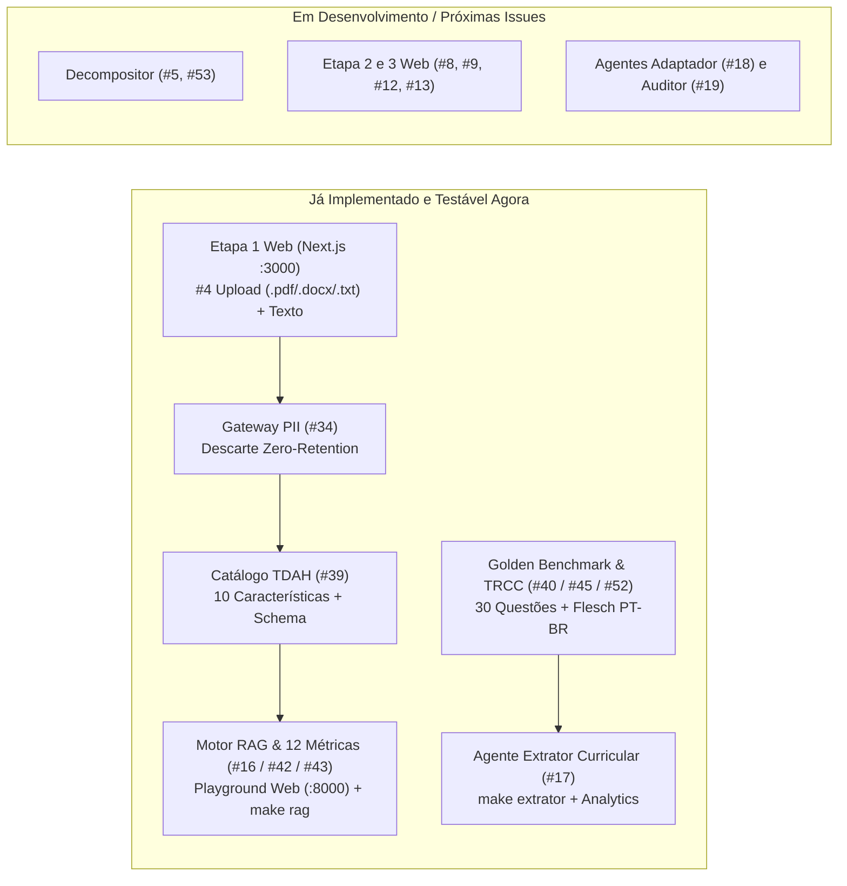

# Roteiro Guiado de Testes Manuais e Validação do `Makefile` — Íris

Este guia permite testar **de ponta a ponta** tudo o que já foi implementado no projeto Íris até o momento — validando os comandos do `Makefile`, as interfaces web (Next.js e Playground FastAPI), as rotas da API, a base científica RAG, as métricas de avaliação e o novo **Agente Extrator Curricular (#17)**.

---

## 1. Mapa do que Já Está Implementado vs. O que Entra a Seguir



---

## 2. Preflight: Validando o Ambiente e o `Makefile`

Execute todos os comandos dentro da pasta `iris/`:

### Passo 2.1 — Conferir os comandos disponíveis
```bash
make help
```
* **Resultado esperado:** Exibe a tabela com `make up`, `make check`, `make test`, `make dev`, `make backend`, `make front`, `make rag`, `make extrator`, `make extrator-bench`, `make extrator-analytics`, `make docs` e `make setup`.

### Passo 2.2 — Smoke-check completo de ambiente, API, PII, RAG e Extrator
```bash
make check
```
* **O que valida automaticamente:**
  1. Pacotes Python no `.venv` (`fastapi`, `uvicorn`, `pydantic`, `pymupdf`, `python-docx`, `rank_bm25`).
  2. Presença de `node`, `npm` e `frontend/node_modules`.
  3. Status do daemon Ollama local e modelos instalados (`llama3:latest`).
  4. Carga do catálogo JSON (`#39`), `chunks.jsonl` e 30 questões do Golden Benchmark (`#45`).
  5. Endpoints REST (`/api/v1/health`, `/api/v1/catalog`, `/api/v1/materials/text` com sanitização de PII e validação `< 50` chars, `/api/v1/rag/search`, `/api/v1/eval/metrics`, `/api/v1/eval/extractor-analytics`).
  6. Cálculo de TRCC determinístico (`#52`), Flesch PT-BR (`#40`/`#45`) e extração com `CurriculumExtractorAgent` (`#17`).
* **Resultado esperado:** Todas as linhas marcadas com `[OK]` e mensagem final `RESULTADO: TUDO ÍNTEGRO E PRONTO PARA TESTE MANUAL!`.

### Passo 2.3 — Bateria completa de testes unitários
```bash
make test
```
* **Resultado esperado:** Executa **67 testes** em `backend/tests/` com saída `OK (skipped=1)` *(o teste `test_aceitacao_real` é pulado intencionalmente enquanto não houver saídas finais geradas em `reports/saidas/iris.jsonl`)*.

---

## 3. Subindo a Plataforma Completa (`make up`)

### Passo 3.1 — Subir tudo em um comando
```bash
make up
```
* **O que o `make up` (`scripts/start_all.sh`) faz automaticamente:**
  1. Verifica `.venv` e dependências Python (executando `uv sync` se faltar algo).
  2. Verifica a base de chunks do RAG (`rag/setup_rag.sh --padrao`).
  3. Sobe `pgvector` no Docker caso o Docker esteja ativo (ou segue em modo BM25 local sem erro).
  4. Garante `ollama serve` ativo e verifica o modelo `llama3:latest`.
  5. Verifica `node`/`npm`, executa `npm install` em `frontend/` caso `node_modules` falte ou esteja desatualizado, e inicia o Next.js na porta **`3000`**.
  6. Sobe o Backend FastAPI na porta **`8000`** com hot-reload e abre a interface no navegador.
  7. Ao pressionar `Ctrl+C`, encerra tanto o Backend quanto o Frontend em segundo plano.

> **Alternativa em terminais separados:** Se preferir isolar os logs, rode `make backend` em um terminal e `make front` em outro.

---

## 4. Roteiro de Testes na Interface Web (Next.js + FastAPI)

Com o `make up` ativo, teste os dois portais web:

### 4.1. Portal Docente Oficial (Next.js — `http://localhost:3000`) — Issues `#4` e `#34`
1. **Tela de Acesso (Figma):**
   * Teste o botão de **Alternar Modo Escuro/Claro** (ícone Lua/Sol) no canto superior direito.
   * Clique em **"Entrar"** (ou em **"Ir direto para Etapa 1"**).
2. **Etapa 1 — Entrada de Material Didático (`Step1MaterialIntake.tsx`):**
   * **Acessibilidade:** Teste o botão de **Alto Contraste** (WCAG 2.1 AA) no topo.
   * **Teste de mínimo de caracteres:** Digite menos de 50 caracteres (ex.: `"Questão rápida"`) e clique em processar/conferir.
     * *Esperado:* Rejeição clara com orientação sobre o mínimo de 50 caracteres (`TEXT_TOO_SHORT`).
   * **Teste do Sanitizador de PII (Zero-Retention — `#34`):** Use o botão de exemplo pré-carregado da tela (que contém `"Escola Municipal Professora Cecília Meireles"` e `"Aluno(a): Gabriel Silva de Oliveira... Matrícula: 20261045"`) **ou** cole o texto abaixo contendo PII misto:
     ```text
     Colégio Estadual Machado de Assis
     Aluno: Lucas Ferreira Mendes
     CPF: 123.456.789-00 | E-mail: lucas.mendes@escola.br | Tel: (61) 99876-5432

     Questão 1: Leia o texto e explique como os cloroplastos produzem glicose e oxigênio durante a fotossíntese.
     ```
     * *Esperado:* O sistema exibe o texto sanitizado para conferência imediata substituindo os dados pessoais por marcadores irreversíveis (`[ESCOLA]`, `[ESTUDANTE]`, `[CPF]`, `[EMAIL]`, `[TELEFONE]`) e exibe a contagem exata de substituições nos metadados.
   * **Teste de Upload de Arquivos (`.txt`, `.docx`, `.pdf`):**
     * Arraste um arquivo `.txt` ou `.pdf`/`.docx` com texto selecionável na zona de upload.
     * Teste enviar um formato não permitido (ex.: `.png` ou `.csv`) para validar a rejeição orientativa imediata no cliente.
     * Se enviar um PDF apenas imagem (sem camada de texto), o backend informa que o arquivo não possui texto extraível (OCR entra na Semana 5 — `#6`).

### 4.2. Playground RAG & API Swagger (`http://127.0.0.1:8000`) — Issues `#16`, `#39`, `#42`, `#43`
1. Abra `http://127.0.0.1:8000` no navegador.
   * *Esperado:* Badge superior mostra `LLM: ollama (...) | Ollama: ONLINE | Zero-DB: true`.
   * *Painel de Métricas:* Exibe as **6 métricas Íris** (Recall@5 `0.42`, MRR, Frases Sustentadas `86.1%`, 0 citações inválidas, Kappa) e as **7 métricas RAGAS** (0 a 10).
2. **Teste de Busca Filtrada por Característica (`#39` + `#16`):**
   * Selecione uma característica no dropdown (ex.: *Comandos múltiplos conjugados*), escolha o Nível `2` e clique em buscar.
   * *Esperado:* Exibe as ações permitidas, restrições de escopo e os trechos científicos recuperados `[T1..T5]` do DUA/MEC.
3. **Teste de Geração ao Vivo no Llama 3:**
   * Digite uma dúvida pedagógica e acione a resposta ao vivo.
   * *Esperado:* Resposta gerada pelo Llama 3 local com citações `[Tn]` verificadas automaticamente.
4. **Documentação OpenAPI (Swagger):**
   * Acesse `http://127.0.0.1:8000/docs` e confira todos os endpoints agrupados (`materials`, `catalogo`, `rag`, `eval`, `infra`), incluindo `GET /api/v1/eval/extractor-analytics`.

---

## 5. Roteiro de Testes no Terminal (`make rag`, `make extrator` e `make docs`)

### 5.1. Central Interativa do RAG (`make rag`) — Issues `#16` e `#42`
```bash
make rag
```
* **Sugestão de validação no menu:**
  * Opção `1`: Visualizar as tabelas completas de métricas (Íris + RAGAS).
  * Opção `2`: Rodar 1 consulta RAG ao vivo no Llama 3.
  * Opção `3`: Digitar uma pergunta pedagógica livre e conferir a auditoria de citações `[T1..T5]`.
  * Opção `0`: Sair.

### 5.2. Central Interativa do Agente Extrator Curricular (`make extrator`) — Issue `#17`
```bash
make extrator
```
* **Sugestão de validação no menu (opções 1 a 7):**
  * **Opção `1` (Casos padrão):** Roda Ciências (fotossíntese) e Matemática (equação $3x + 12 = 30$), mostrando `verbo_comando_bncc`, `conceitos_obrigatorios`, `termos_tecnicos_intocaveis`, `alerta_anti_muleta` e a linha de telemetria (`total`, `inferência`, `cold_load`, `tok/s`).
  * **Opção `2` (Golden Benchmark):** Liste as questões (`s`) e teste `Q01` (Português), `Q10` (Matemática) ou `Q25` (História) comparando com a trava de referência.
  * **Opção `3` (Questão livre):** Cole qualquer enunciado seu (mín. 15 caracteres), informe disciplina e ano escolar e inspecione os invariantes extraídos.
  * **Opção `4` (Benchmark em lote Zero-Hint):** Teste rodar `5` questões (ou todas as `30`) para ver o `warmup` eliminar o *cold start* e gerar a tabela por disciplina, faixa etária e tipo de comando.
  * **Opção `5` (Analytics Dinâmico):** Filtre os logs gravados em `reports/extractor_telemetry.jsonl` por disciplina (ex.: `Matemática`), faixa etária (ex.: `11-12` ou `Fund. I`) ou comando conjugado (`s`/`n`).
  * **Opção `6`:** Roda os 11 testes unitários específicos de `test_curriculum_extractor.py`.
  * **Opção `7`:** Permite alternar em tempo de execução entre `ollama`, `groq` ou `extractive`.

> **Atalhos diretos sem abrir menu:** `make extrator-bench` e `make extrator-analytics`.

### 5.3. Portal de Documentação MkDocs (`make docs`) — Issues `#41`, `#47`, `#51`
```bash
make docs
```
* Acesse `http://127.0.0.1:8001` e valide que todas as páginas (Visão do Produto, RF/RNF, Backlog & Rastreabilidade com Seção 2.3, Arquitetura com Seção 2.4 e 7.4, Relatório RAG, Skills e este Roteiro de Testes) renderizam incluindo os diagramas Mermaid e fórmulas LaTeX.

