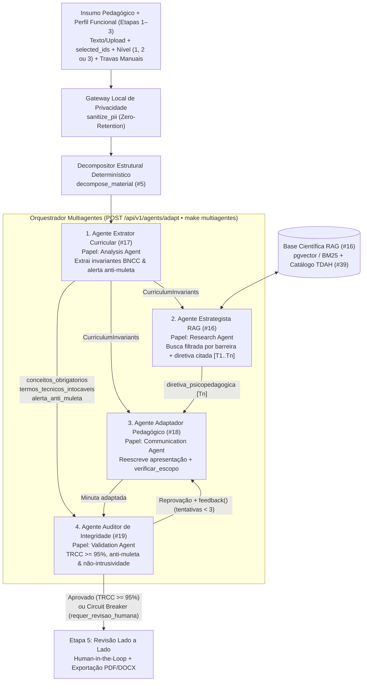
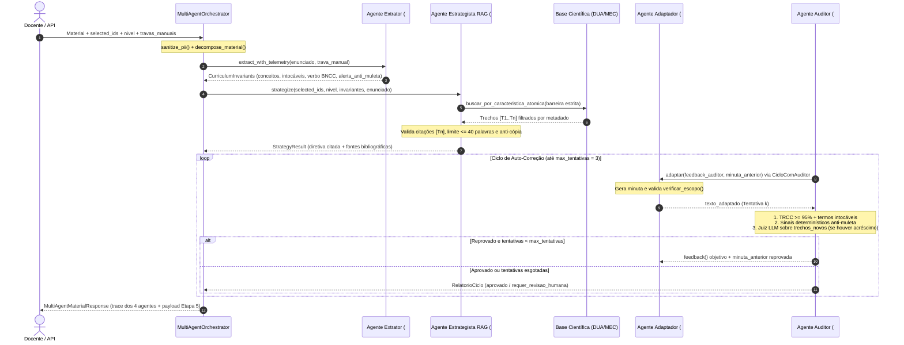

# Sistema Multiagentes — Arquitetura, Responsabilidades e Colaboração (Semana 4)

Este documento consolida os entregáveis técnicos da **Semana 4 do Challenge 2 (Residência em IA — Grupo 3)** para o **Sistema Multiagentes da plataforma Íris**, conectando os quatro agentes especializados implementados sob o **Épico 2.1 (`#15`)**:

1. **Agente Extrator Curricular** (`CurriculumExtractorAgent` — Issue `#17`)
2. **Agente Estrategista RAG** (`StrategistAgent` — Issue `#16`)
3. **Agente Adaptador Pedagógico** (`AdapterAgent` + `CicloComAuditor` — Issue `#18`)
4. **Agente Auditor de Integridade** (`AgenteAuditor` — Issue `#19`)

---

## 1. Diagrama da Arquitetura dos Agentes

A orquestração é conduzida de forma **100% stateless e em memória** por [`MultiAgentOrchestrator`](file:///Users/aluno1/Residencia_IA/challenge_2_residencia_ia_grupo_3/iris/backend/src/iris/agents/orchestrator.py), após sanitização preventiva de dados pessoais (PII) e decomposição estrutural determinística da atividade.



---

## 2. Descrição das Responsabilidades de Cada Agente

Os quatro agentes foram especializados segundo princípios de **separação estrita de papéis** e **guardrails determinísticos**, garantindo que um único prompt monolítico não simplifique o currículo nem dê respostas prontas (*efeito muleta*).

| Agente no Íris | Papel Multiagentes | Issue / Módulo | Entradas | Saídas (Contrato Pydantic) | Guardrails Determinísticos e Fallback |
| :--- | :--- | :--- | :--- | :--- | :--- |
| **1. Agente Extrator Curricular**<br/>(`CurriculumExtractorAgent`) | **Analysis Agent**<br/>*(Análise e síntese de invariantes)* | `#17`<br/>[`curriculum_extractor.py`](file:///Users/aluno1/Residencia_IA/challenge_2_residencia_ia_grupo_3/iris/backend/src/iris/agents/curriculum_extractor.py) | Enunciado da questão, contexto de apoio, disciplina, ano escolar e travas manuais do docente | `ExtractionResult`<br/>(`CurriculumInvariants` + `ExtractionTelemetry`) | Normaliza verbo de comando BNCC para infinitivo, injeta travas manuais obrigatoriamente e possui fallback léxico/regex caso o LLM falhe ou esteja offline. |
| **2. Agente Estrategista RAG**<br/>(`StrategistAgent`) | **Research Agent**<br/>*(Recuperação de evidências científicas)* | `#16`<br/>[`strategist_agent.py`](file:///Users/aluno1/Residencia_IA/challenge_2_residencia_ia_grupo_3/iris/backend/src/iris/agents/strategist_agent.py) | `StrategyRequest` (`caracteristicas` ativadas, `nivel`, `invariantes`, `enunciado`) | `StrategyResult`<br/>(`diretiva`, `intervencoes`, `fontes`, `StrategyTelemetry`) | Filtro pré-prompt pela barreira associada (`trechos_fora_do_filtro`); conferência pós-LLM vetando intervenções sem citação `[Tn]`, com $>40$ palavras, de característica não selecionada ou com cópia literal ($\ge 12$ palavras). Fallback para diretiva estruturada do catálogo + citações. |
| **3. Agente Adaptador Pedagógico**<br/>(`AdapterAgent` + `CicloComAuditor`) | **Communication Agent**<br/>*(Adaptação da apresentação ao público-alvo)* | `#18`<br/>[`adapter_agent.py`](file:///Users/aluno1/Residencia_IA/challenge_2_residencia_ia_grupo_3/iris/backend/src/iris/agents/adapter_agent.py) | `AdaptationRequest` (`enunciado`, `id_caracteristica`, `nivel`, `invariantes`, `diretiva_psicopedagogica`, `feedback_auditor`, `minuta_anterior`) | `AdaptationResult`<br/>(`texto_adaptado`, `justificativas`, `ScopeReport`, `AdaptationTelemetry`) | Toda saída do LLM passa por `verificar_escopo()` (contagem de palavras, ordem via LCS e retenção da trava). Se reprovar ou falhar, aciona saída de reserva determinística (`destacar_comandos` no Nível 1; `decompor_em_etapas` nos Níveis 2 e 3). |
| **4. Agente Auditor de Integridade**<br/>(`AgenteAuditor`) | **Validation Agent**<br/>*(Validação, inconsistências e auto-correção)* | `#19`<br/>[`auditor.py`](file:///Users/aluno1/Residencia_IA/challenge_2_residencia_ia_grupo_3/iris/backend/src/iris/agents/auditor.py) | Enunciado original, minuta adaptada, `CurriculumInvariants` e `caracteristicas_nao_selecionadas` | `ResultadoAuditoria` e `RelatorioCiclo` (`aprovado`, `texto_final`, `requer_revisao_humana`) | Calcula TRCC determinística ($\ge 95\%$), exige 100% dos `termos_tecnicos_intocaveis`, detecta marcas de gabarito/cálculo resolvido/eliminação de alternativas e usa juiz LLM apenas sobre `trechos_novos` com citação literal obrigatória. Falha fechado (*Circuit Breaker* em `max_tentativas=3`). |

---

## 3. Fluxo de Interação e Colaboração entre os Agentes

O diagrama de sequência abaixo detalha os contratos trocados entre os quatro agentes, incluindo o **ciclo iterativo de auto-correção** entre o `AgenteAuditor` e o `AdapterAgent` (via `CicloComAuditor`):



---

## 4. Demonstração Prática (Execução Ponta a Ponta)

A colaboração entre os quatro agentes pode ser testada tanto pelo **terminal (CLI)** quanto diretamente pela **interface web** da aplicação Íris:

### 4.1. Demonstração via Terminal (`make multiagentes`)

```bash
cd iris
make multiagentes
```

Ou executando diretamente com parâmetros customizados:

```bash
cd iris
PYTHONPATH=backend/src:rag/iris-rag/pacote .venv/bin/python3 scripts/demo_multiagentes.py --demo --provider extractive
PYTHONPATH=backend/src:rag/iris-rag/pacote .venv/bin/python3 scripts/demo_multiagentes.py --question Q18 --nivel 3 --simular-autocorrecao
```

A demonstração oficial (`--demo`) executa dois cenários:
1. **Cenário 1 (Fluxo Completo com Aprovação Direta — `Q13` Matemática):**
   * **Extrator (`#17`)** isola os invariantes `["equação", "2x + 6 = 14"]` e o verbo BNCC `"resolver"`.
   * **Estrategista RAG (`#16`)** recupera os trechos `[T1..T5]` para a barreira `memoria_trabalho` e monta a diretiva citada.
   * **Adaptador (`#18`)** separa os dois comandos em checklist numerado no Nível 2 (`1. [ ] **Resolva** a equação 2x + 6 = 14` / `2. [ ] **Verifique** se o valor encontrado está correto.`), passando no laudo de isolamento de escopo.
   * **Auditor (`#19`)** confirma **TRCC = 100%**, ausência de resolução indevida e aprova na **Tentativa 1**.
2. **Cenário 2 (Colaboração e Auto-Correção `Auditor ↔ Adaptador` — `Q18` Ciências):**
   * Na **Tentativa 1**, simula-se uma omissão de conceito obrigatório da trava curricular (`plantas`).
   * O **Agente Auditor (`#19`)** reprova a minuta ($\text{TRCC} < 95\%$) e envia automaticamente o feedback corretivo (`"Reinclua os conceitos-chave ausentes, exatamente como no original: plantas."`) junto com a minuta reprovada para o **Agente Adaptador (`#18`)**.
   * Na **Tentativa 2**, o **Adaptador** regenera a questão preservando todos os conceitos da trava em passos do Nível 3, e o **Auditor** aprova com **TRCC = 100%**.

### 4.2. Demonstração na Aplicação Web (`Etapa 1` → `Etapa 5`)

1. Suba o backend e o frontend com `make up` dentro de `iris/`.
2. Acesse `http://localhost:3000`:
   * **Etapa 1 (`/etapa-1`):** Insira ou faça upload de uma atividade didática (passando pelo sanitizador de PII).
   * **Etapa 2 (`/etapa-2`):** Selecione a(s) característica(s) funcional(is) observada(s) no catálogo TDAH.
   * **Etapa 3 (`/etapa-3`):** Calibre o nível de andaime (Nível 1, 2 ou 3) e avance para a Etapa 4.
   * **Etapa 4 (`/etapa-4`):** Acione **"Executar Sistema Multiagentes"** (com opção de testar em modo `auto`, `extractive`, `ollama` ou `groq`, informar travas manuais e ativar a simulação de auto-correção) via `POST /api/v1/agents/adapt`. A tela exibe os 4 cards de colaboração dos agentes e o histórico de tentativas do Auditor.
   * **Etapa 5 (`/etapa-5`):** Revise lado a lado o original e a versão adaptada, consulte as justificativas DUA, edite/homologue e exporte em PDF ou DOCX.
