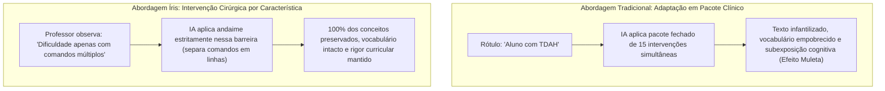

# Visão do Produto — Íris

## 1. Declaração de Visão do Produto

> **Para** professores da educação básica e especialistas em Atendimento Educacional Especializado (AEE),  
> **que** enfrentam alta sobrecarga de trabalho e escassez de tempo para adaptar materiais didáticos para estudantes com perfis atípicos de aprendizagem,  
> **o Íris** é uma plataforma inteligente de apoio à decisão pedagógica e adaptação cirúrgica de atividades,  
> **que** atua como copiloto pedagógico aplicando intervenções pontuais direcionadas **estritamente às características e dificuldades funcionais observadas em sala de aula** (ancoradas no DUA e em Funções Executivas), preservando integralmente o núcleo curricular e a autonomia do estudante.  
> **Diferente de** ferramentas de LLM genéricas (que aplicam adaptações em bloco baseadas em rótulos clínicos, resumem superficialmente o conteúdo e geram subexposição cognitiva),  
> **o nosso produto** foca na **característica neurodivergente específica**, garante a integridade curricular por meio de **travas avaliativas inegociáveis**, assegura conformidade estrita com a **LGPD (Zero-Database)** e mantém a supervisão docente contínua (*Human-in-the-Loop*).

---

## 2. O Cenário Escolhido e o Problema Real

### 2.1. O Cenário Educacional
O cenário educacional brasileiro reflete uma crescente e indispensável inclusão de estudantes neurodivergentes no ensino regular. Contudo, essa ampliação no número de matrículas não veio acompanhada de suporte estrutural e operacional suficiente ao corpo docente.

Professores da educação básica lidam rotineiramente com jornadas exaustivas, turmas numerosas e escassez de recursos de apoio pedagógico. Embora possuam preparo e sensibilidade diagnóstica para mapear as barreiras de aprendizagem presentes na sala de aula, a execução prática, que exige converter atividades genéricas em múltiplos materiais customizados, torna-se inviável pela falta crônica de tempo hábil.

### 2.2. A Falácia da Adaptação em Pacote Clínico e o Efeito Muleta
Ao tentar recorrer a LLMs genéricos comerciais com comandos generalistas (*"Adapte esta prova para um aluno com TDAH"*), o resultado frequentemente prejudica o estudante:
* **Super-Adaptação e Infantilização:** Modelos comerciais assumem que todo diagnóstico de TDAH carrega um "pacote fechado" de sintomas. Eles reescrevem o texto inteiro, reduzem o vocabulário, eliminam termos técnicos e inserem apoios desnecessários, gerando **subexposição cognitiva (*efeito muleta*)**.
* **Rotulação Médica vs. Realidade de Sala de Aula:** Alunos com o mesmo laudo médico manifestam perfis cognitivos inteiramente distintos. Tratar a condição em vez do indivíduo ignora as potencialidades e a autonomia do aluno.

---

## 3. O Paradigma do Íris: Intervenção Cirúrgica por Característica

O grande diferencial do Íris é **deslocar o foco da condição clínica (o diagnóstico) para a característica funcional atômica (a dificuldade real observada pelo professor)**.

### O Princípio da Intervenção Atômica
Considere um exemplo hipotético:
* O diagnóstico de TDAH reúne um espectro amplo de características (por exemplo, 15 traços funcionais possíveis, que vão desde impulsividade motora até desorganização sequencial ou fadiga atencional).
* No entanto, um estudante específico em sala de aula pode manifestar **apenas uma dessas características** (ex.: *dificuldade de sustentação atencional exclusivamente diante de enunciados com blocos contínuos de texto*), mantendo pleno domínio de vocabulário, raciocínio lógico e interpretação.
* **A regra de ouro do Íris:** O professor assinala **somente essa característica observada**. O motor de IA adapta **exclusivamente essa dimensão** (ex.: fragmentando o parágrafo longo em etapas visuais limpas) e **ignora completamente as outras 14 características**.
* **Resultado:** O vocabulário técnico permanece original, o nível de exigência da questão não é rebaixado e a autonomia do estudante é preservada. Não há adaptação excessiva.

---

## 4. Proposta de Valor e Diferenciais

| Dimensão | Soluções Comerciais Genéricas | Plataforma Íris |
| :--- | :--- | :--- |
| **Abordagem de Perfil** | Pacote clínico fechado ("Template para TDAH") | **Intervenção Cirúrgica na Característica Observada** |
| **Intensidade do Suporte** | Binária e generalista (simplifica tudo) | **Andaime Cognitivo em 3 Níveis** restrito ao traço selecionado |
| **Preservação Curricular** | Alto risco de eliminação de habilidades da BNCC | **Trava Curricular Inegociável** monitorada por Agente Auditor |
| **Dependência Médica** | Exige compreensão de laudos/CID clínicos | **Despatologização:** foco empírico nas barreiras práticas de sala |
| **Fundamentação Pedagógica** | Alucinação probabilística de intervenções | **RAG Científico** ancorado no DUA, MEC e Funções Executivas |
| **Privacidade de Menores** | Coleta e armazenamento de dados em nuvem | **Zero-Database de Estudantes** + Sanitização local de PII |
| **Continuidade Pedagógica** | Inexistente ou dependente de banco central | **Perfil Pedagógico Portátil** (`.json`/`.pdf`) local e anônimo |

---

## 5. Personas

### Persona 1: O Professor (Carlos)
* **Perfil:** Carlos, 38 anos, professor de Biologia no Ensino Fundamental II (redes pública e privada, 35 horas semanais em sala de aula).
* **Contexto da sala de aula:** Leciona para 6 turmas com média de 32 alunos. Percebe que vários alunos possuem traços atípicos de atenção ou processamento, mas muitos não possuem laudo médico formal.
* **Dores:** Dedica finais de semana ao planejamento e correção. Sente frustração e receio de descaracterizar a prova ao tentar adaptá-la manualmente, ou de gastar tempo criando versões completamente diferentes para cada perfil.
* **Objetivo no sistema:** Colar o texto de sua avaliação bimestral, selecionar a **característica funcional exata** que percebeu em determinado estudante (ex.: *perda de foco diante de múltiplos comandos conjugados*) e receber a versão com intervenção cirúrgica acompanhada da justificativa do DUA.

### Persona 2: A Estudante com Barreiras (Beatriz)
* **Perfil:** Beatriz, 13 anos, aluna do 8º ano com TDAH.
* **Contexto escolar:** Possui excelente raciocínio biológico e domina os conceitos científicos em debates orais, mas erra questões de prova unicamente quando o enunciado mistura três perguntas em uma única frase longa sem quebra visual.
* **Necessidades reais:** Beatriz **não** precisa de resumo de conteúdo nem de substituição de palavras difíceis por termos infantis; precisa apenas que os comandos sejam destacados em tópicos isolados para conseguir demonstrar com autonomia o que já sabe.

---

## 6. Escopo do MVP e Evolução por Neurodivergência

### 6.1. Recorte Inicial: Catálogo de Características do TDAH
No MVP do Challenge 2, o catálogo de barreiras é populado a partir das características executivas mais frequentes associadas ao TDAH:
1. Saturação atencional diante de blocos contínuos de texto extenso;
2. Dificuldade de processamento de comandos múltiplos na mesma frase;
3. Sobrecarga de memória de trabalho ao reter dados intermediários;
4. Iniciação e decomposição de tarefas compostas em passos sequenciais;
5. Distração decorrente de poluição visual e baixa hierarquia tipográfica.

### 6.2. Arquitetura Modular e Expansão para TEA e Dislexia
Por atuar sobre **características atômicas** e não sobre o rótulo psiquiátrico, a arquitetura do Íris é naturalmente extensível para outras neurodivergências via catálogo modular (`catalogs/`):
* **Características do Espectro Autista (TEA):** Dificuldade com metáforas e linguagem figurada, necessidade de previsibilidade da estrutura avaliativa e instruções literais.
* **Características da Dislexia:** Dificuldade na decodificação de grafemas/fonemas complexos, necessidade de espaçamento tipográfico ampliado e apoio de organizadores visuais.

---

## 7. Limites do MVP (O que entra vs. O que não entra)

### No Escopo do MVP
1. **Entrada de Materiais Didáticos:** Inserção direta de texto ou upload (.pdf, .docx, .txt).
2. **Seleção Cirúrgica de Características:** Filtros atômicos baseados em necessidades observáveis, sem burocracia de laudos.
3. **Isolamento de Escopo da IA:** A aplicação intervém estritamente sobre a característica selecionada, mantendo o restante do material intacto.
4. **Calibragem em 3 Níveis:** Leve, Moderado e Intensivo.
5. **Travas Curriculares Inegociáveis:** Garantia de que a habilidade avaliada não seja simplificada.
6. **Geração com Justificativas DUA:** Explicações transparentes de cada intervenção pedagógica.
7. **Editor Comparativo Lado a Lado:** Revisão livre e supervisão docente obrigatória (*Human-in-the-Loop*).
8. **Exportação Pronta e Portabilidade:** PDF formatado, DOCX editável e Perfil Pedagógico Portátil local.

### Fora do Escopo do MVP (Limites Éticos Inegociáveis)
1. **Diagnóstico ou Triagem Clínica:** O Íris não realiza testes psicológicos, não emite laudos e não rotula clinicamente os estudantes.
2. **Adaptações em Bloco Padronizadas:** É proibido tratar estudantes como categorias clínicas homogêneas.
3. **Armazenamento Centralizado de Menores:** Proibido qualquer banco de dados cadastral de estudantes (*Zero-Database*).
4. **Geração sem Validação Humana:** O material nunca é aplicado sem a revisão e aprovação explícita do professor regente.
