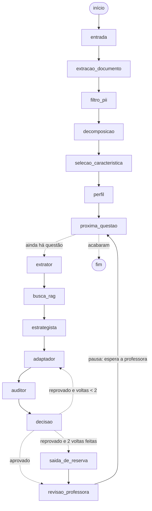

# Íris em LangGraph: como ficaria e quando vale a pena

Proposta para o grupo, com base num protótipo que roda de verdade na bancada (`bancada/langgraph/grafo_iris.py`, saída em `pacote/outputs/39-langgraph.json`). O protótipo usa um provedor determinístico ("eco", sem rede e sem modelo): mostra o fluxo, não a qualidade das adaptações.

## 1. O que é LangGraph, em 3 frases

Hoje o pipeline do Íris é como uma receita lida de cima para baixo: uma função chama a próxima, em Python corrido. O LangGraph troca a receita por um fluxograma que o computador executa: cada caixa (nó) é um passo, as setas (arestas) dizem para onde ir e algumas setas têm condição, como "se o Auditor reprovou, volta ao Adaptador". Uma ficha (o estado) passa de caixa em caixa e pode ser arquivada a cada passo (checkpointer), o que permite parar no meio para esperar uma pessoa (interrupt) e continuar depois de onde parou.

É uma biblioteca Python, licença MIT, da mesma empresa do LangChain. Ela não substitui os agentes: só organiza quem chama quem.

## 2. O desenho



A versão gerada pelo próprio LangGraph (`grafo.get_graph().draw_mermaid()`) está no campo `mermaid` do JSON. Os nós de cima (entrada até perfil) rodam uma vez por material; os de baixo, uma vez por questão.

O limite de 2 voltas é o `max_retries = 2` que o grupo já decidiu em `docs/arquitetura.md` (ADR-06, ainda em validação contra o RNF-07).

## 3. O que o protótipo mostrou

Código usado: dev `65e1f09` mais os arquivos novos do PR #81 (`4479fd9`, Estrategista), do PR #74 (`289d9ee`, Auditor) e a versão do PR #80 (`0513128`) de `adapter_agent.py` e `schemas/adaptation.py` (feedback do Auditor). A montagem é feita numa pasta fora do clone (`montar_codigo.py`); nada do grupo foi copiado nem alterado.

| Material | Questões | Caminho | Voltas | Parou para a professora |
|---|---|---|---|---|
| M1 ciências (docx) | 2 | direto até a revisão | 0 | sim, nas 2 |
| M2 matemática (pdf) | 2 | direto até a revisão | 0 | sim, nas 2 |
| M3 história (txt) | 3 | direto até a revisão | 0 | sim, nas 3 |
| M4 forçado (volta) | 1 | adaptador → auditor reprova → volta → aprova | 1 | sim (aceitou) |
| M5 forçado (limite) | 1 | 3 tentativas reprovadas → saída de reserva com alerta | 2 | sim (editou) |

Nos casos forçados, a bancada acrescenta "Resposta correta: a) oxigênio" à minuta do Adaptador. Quem pega é a checagem determinística do Auditor do PR #74 (marca de gabarito). No M4, a segunda tentativa recebe a correção do Auditor pelo campo `feedback_auditor` do PR #80 e sai limpa.

Também foi demonstrado:

- Retomar após falha: o Adaptador cai de propósito na 1ª questão do M2; o grafo retoma do último passo salvo e o Extrator, a busca e o Estrategista não rodam de novo.
- Ver o estado de cada passo: `get_state_history()` devolve a ficha depois de cada nó (19 estados salvos para a questão do M4); está no campo `historico_exemplo`.
- Dado pessoal: o texto bruto do arquivo nunca entra no estado (fica no "contexto" da execução, que o checkpointer não salva). Nome e CPF plantados no M4, M1 e M2 não aparecem em nenhum estado salvo. No M3 o nome "Ciclana Exemplo Falso" aparece, porque o `sanitize_pii` deixa ele passar (achado já registrado nas saídas 26 e 35); o grafo não piora nem melhora isso.

## 4. O que muda no código do grupo

O que não muda: os agentes continuam as mesmas classes (`CurriculumExtractorAgent`, `StrategistAgent`, `AdapterAgent`, `AgenteAuditor`), com os mesmos contratos Pydantic e os mesmos testes. Cada nó do grafo é uma função pequena que monta o pedido, chama o agente e devolve só os campos que mudaram.

O que muda:

- Um arquivo novo, por exemplo `backend/src/iris/agents/grafo.py`, com o estado (cerca de 40 linhas), os nós (cerca de 150 linhas) e a montagem do grafo (cerca de 30 linhas). Uns 250 linhas no total, sem contar comentários.
- A rota da API que hoje termina na decomposição passaria a chamar `grafo.invoke(...)`.
- O laço que hoje está dentro de `AgenteAuditor.executar_ciclo` (PR #74) e `CicloComAuditor` (PR #80) vira a aresta `decisao → adaptador`. As duas classes podem continuar existindo para testes, mas o pipeline usaria só uma forma do laço.
- `langgraph` entraria no `pyproject.toml` com versão fixa (o protótipo usa 1.2.21). Ele já aparece no `uv.lock` do dev como dependência indireta (`langchain-community` → `langchain` → `langgraph`), mas não está declarado.

## 5. Riscos

1. O checkpointer guarda texto. Ele arquiva a ficha a cada passo, e a ficha tem o enunciado e a minuta. Isso conflita com o RNF-01 (stateless, sem banco de alunos), o RNF-02 (descarte imediato) e as histórias #35 e #37. Soluções, da mais simples para a mais trabalhosa:
   - `MemorySaver` (memória do processo) que vive só durante a requisição, com `delete_thread` ao terminar. É o que o protótipo faz: depois de apagar, 0 bytes guardados.
   - Estado sem conteúdo: só ids, contagens e decisões no estado; os textos ficam no contexto da execução. Perde-se a retomada com texto, mas nada sensível é arquivado.
   - Nunca usar checkpointer em banco ou disco (`SqliteSaver`, `PostgresSaver`) com texto de aluno.
2. A pausa da professora atravessa duas requisições. Dentro do mesmo processo funciona; numa API, entre o "gerar" e o "aprovar" (#21, #22) o estado teria de ficar guardado em algum lugar. Com zero retenção, a saída é devolver tudo ao navegador e começar um grafo novo na aprovação, o que tira boa parte da vantagem do `interrupt`.
3. Dependência nova. Traz `langchain-core` e o cliente `langsmith` junto. A API mudou bastante entre as versões 0.x e 1.x: fixar a versão e ler o changelog antes de atualizar (RNF-11).
4. LangSmith é um serviço externo e pago de rastreamento. Não ligar com material de aluno. Garantir que `LANGSMITH_TRACING` e `LANGCHAIN_TRACING_V2` fiquem desligados e manter a telemetria própria dos agentes (RNF-08, #37).
5. Curva de aprendizado. Estado, nó, aresta condicional, checkpointer e interrupt são conceitos novos. O erro mais comum é colocar no estado o que não devia (texto bruto, objetos grandes).

## 6. Quando vale adotar

Vale quando pelo menos duas destas forem verdade:

- o Auditor (PR #74) e o Estrategista (PR #81) estão no dev e o laço Auditor-Adaptador está ligado no pipeline real;
- existe mais de um caminho condicional além do laço (por exemplo, pular o Estrategista no nível 1, ou mandar ao OCR da #6 quando o PDF é imagem);
- a revisão da professora (#21, #22) precisa continuar o mesmo processamento, e não começar outro;
- o grupo quer retomar uma adaptação depois de uma queda do modelo sem refazer o começo.

Não vale enquanto o pipeline for uma linha reta sem laço: um `for` com chamadas diretas é mais simples e o grupo já domina.

## 7. Migração em fases pequenas

1. Fase 0: juntar os PRs #74, #80 e #81 no dev do jeito atual, sem LangGraph. O grafo só faz sentido com os agentes no lugar.
2. Fase 1: declarar `langgraph` no `pyproject.toml` com versão fixa e criar `agents/grafo.py` só com os nós por questão (extrator → busca → estrategista → adaptador → auditor → decisão), sem checkpointer. Mesmo resultado do código atual, conferido por teste.
3. Fase 2: testes de fluxo, como os de `bancada/langgraph/test_grafo.py`: o laço respeita o limite, o grafo para na revisão, o estado não tem o nome nem o CPF plantados.
4. Fase 3: incluir os nós do material (entrada, extração, filtro, decomposição) e ligar a rota da API ao grafo.
5. Fase 4: só então decidir sobre checkpointer e `interrupt`, com a regra de zero retenção escrita antes (MemorySaver por requisição ou estado sem conteúdo).

Cada fase cabe num PR pequeno e pode ser desfeita sem mexer nos agentes.

## 8. Como rodar o protótipo

```bash
cd pacote
make langgraph GRUPO=caminho/do/clone/Iris PYL=caminho/do/venv-langgraph/bin/python
cd ../bancada/langgraph
(o mesmo alvo roda os 8 testes no fim)
```

## 9. Limitações do protótipo

- Provedor determinístico: o Estrategista recebe do "eco" uma resposta que não é JSON e usa a diretiva de reserva do catálogo; o caminho com modelo dele não foi exercitado.
- O juiz LLM do Auditor foi trocado por um substituto que nunca acusa nada; as checagens determinísticas do Auditor são as do grupo.
- A reprovação foi forçada pela bancada, e numa característica (impulsividade) em que o laudo de escopo do Adaptador não barra a marca de gabarito antes do Auditor.
- A decisão da professora é sintética; não há front.
- Os `__init__.py` de `agents` e `schemas` ficaram como no dev (os PRs #80 e #81 mudam o mesmo arquivo de jeitos diferentes).
- Latências medem o encanamento numa VPS sem GPU; não dizem nada sobre o RNF-07 com modelo.
