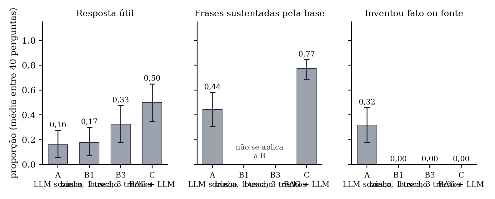
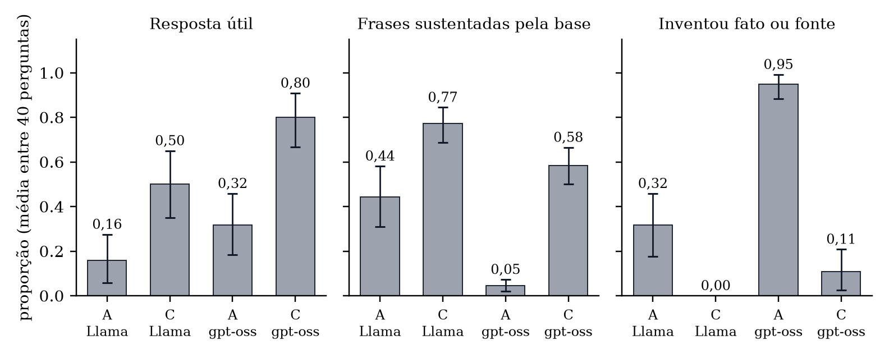
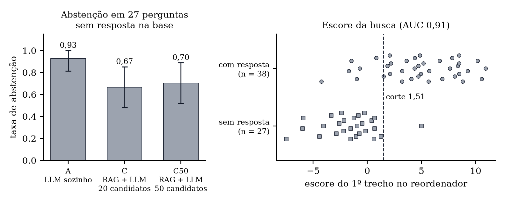

<div class="capa">
<p class="inst">RESIDÊNCIA EM IA – TURMA 1</p>
<p class="parceria">Universidade de Brasília (UnB) · Lab Livre · Instituto de Pesquisas Eldorado · Softex · MCTI</p>
<p class="autor">GRUPO 3</p>
<p class="titulo">ÍRIS: LLM SOZINHO, BUSCA SEM LLM E RAG COM LLM NO AGENTE ESTRATEGISTA</p>
<p class="subtitulo">Relatório técnico da Semana 3 do Segundo Desafio (LLM x RAG)</p>
<p class="local">Brasília<br>2026</p>
</div>

<h1 class="pre">RESUMO</h1>

Este relatório compara quatro formas de responder às perguntas de professores no Íris, sistema que adapta material didático para estudantes neurodivergentes: o modelo de linguagem sozinho (A), a busca sem modelo, que devolve os trechos recuperados (B), a geração aumentada por recuperação com modelo, que é o sistema atual (C), e o produto completo adaptando questões escolares com e sem recuperação (D). As hipóteses, as métricas e a regra de decisão foram escritas antes de qualquer execução. Com o modelo de produção, Llama 3.1 8B, em 40 perguntas e três repetições, um juiz automático (Claude Opus) que não conhecia a origem das respostas classificou como sustentadas pela base 77% das frases de C, ante 44% de A (diferença de 0,33; IC 95%: 0,15 a 0,50). C foi útil em 50% das respostas, ante 16% de A, e não apresentou fato inventado em nenhuma, ante 32% de A. Pela regra de decisão pré-registrada, entretanto, a condição escolhida é A: C não passou no requisito de abstenção, porque respondeu, nas três repetições, a uma das duas perguntas sem resposta na base. O relatório apresenta o resultado da regra tal como escrita e, em seção separada e identificada como interpretação posterior, recomenda manter a recuperação com modelo no produto, condicionada à correção da abstenção e a novo teste. No teste D não houve diferença entre as configurações, porque 83% das saídas foram a saída de reserva do Adaptador. Com um modelo maior, gpt-oss 20B, nenhuma condição passou no requisito de abstenção. Em rodada complementar com a busca de melhor recall (reordenação sobre 50 candidatos), os resultados de C não mudaram, e a busca com três trechos passou a ter utilidade equivalente à de C, sem fato inventado. Em segunda rodada complementar, com 25 perguntas novas sem resposta na base, C absteve-se em 68% delas (IC 95%: 48% a 84%) e, quando respondeu, trouxe fato ausente dos trechos em metade das perguntas; o escore da busca separou as perguntas com e sem resposta com AUC de 0,91, valor medido nas mesmas 65 perguntas em que o corte foi escolhido. Um corte nesse escore é candidato a critério de recusa, ainda não validado em perguntas independentes, e não uma solução: ele barraria seis perguntas que têm resposta na base e deixaria passar a pergunta sobre dose de medicamento, que é o caso mais grave. O diagnóstico do teste D mostrou que a minuta do Llama é reprovada no laudo de escopo do grupo em 83% das execuções, com e sem recuperação; com o gpt-oss e o cliente corrigido, a recuperação reduziu a aprovação da minuta de 17 para 6 em 30 questões. Com correção para comparações múltiplas, a vantagem de utilidade de C sobre a busca com três trechos deixa de ser significativa; as demais diferenças se mantêm. O juiz não foi validado por pessoa, e os conjuntos de referência foram elaborados por modelo de linguagem; essas duas conferências humanas ficaram para depois da entrega, o que torna os resultados provisórios.

**Palavras-chave:** geração aumentada por recuperação; modelos de linguagem; avaliação pareada; pré-registro; educação inclusiva.

<h1 class="pre">SUMÁRIO</h1>

<!-- SUMARIO -->

# 1 INTRODUÇÃO

## 1.1 Contexto

O Íris é um sistema de apoio ao professor que transforma material didático comum em material adaptado para estudantes neurodivergentes. O Agente Estrategista responde a perguntas do professor e fundamenta a adaptação em uma base de conhecimento de 38 documentos. Na entrega de 09/11/2026, o grupo construiu essa base e o protótipo de geração aumentada por recuperação (RAG) e escolheu o método de busca: busca vetorial com reordenação.

## 1.2 Objetivo

A proposta da Semana 3 é comparar o uso de modelo de linguagem (LLM) e de RAG, com e sem LLM, e escolher a melhor configuração para o produto. Este relatório responde a duas perguntas: se vale usar RAG no Íris e, em caso afirmativo, se a resposta deve ser escrita por um LLM ou se bastam os trechos recuperados.

## 1.3 Escopo

A busca entra fixa, na configuração padrão do código: busca vetorial com reordenação sobre 20 candidatos. A variante com reordenação sobre 50 candidatos, apresentada como método adotado no relatório de 09/11, não é o padrão do código e não foi usada na análise principal; ela foi testada em rodada complementar (seção 6.7). Nenhum prompt, parâmetro de busca ou modelo foi ajustado nesta etapa: o teste C é o sistema como está. Varia-se apenas a presença da recuperação e a presença do LLM. O primeiro perfil atendido continua sendo o do estudante com transtorno do déficit de atenção com hiperatividade (TDAH). Nenhum dado de estudante foi usado.

Modelos de linguagem foram empregados como objeto do estudo, como juiz das respostas e como apoio à implementação, à análise e à redação. Os resultados numéricos são produzidos por scripts versionados (Apêndice C).

## 1.4 Hipóteses

As quatro hipóteses foram registradas antes de qualquer execução, em `rag/iris-rag/semana3/PREREG.md`:

a) H1: RAG com LLM (C) tem mais frases sustentadas pela base que o LLM sozinho (A);
b) H2: RAG sem LLM (B) tem menos respostas úteis que RAG com LLM (C);
c) H3: com RAG, o Adaptador mantém a retenção da trava curricular e não piora comandos conjugados nem legibilidade em relação ao Adaptador sem RAG (D);
d) H4: um modelo maior não muda a decisão.

## 1.5 Organização do documento

A seção 2 apresenta os conceitos. A seção 3 descreve o sistema avaliado. A seção 4 descreve a metodologia e a seção 5, a execução. A seção 6 traz os resultados da análise principal (6.1 a 6.6) e das análises complementares (6.7 a 6.11), a seção 7 a análise de erros e a seção 8 a decisão e a recomendação. A seção 9 trata das ameaças à validade e a seção 10 das considerações finais. O Apêndice D descreve o ambiente de execução e o Apêndice E lista as perguntas complementares.

# 2 FUNDAMENTAÇÃO

Na geração aumentada por recuperação, o sistema busca trechos de uma base de documentos e os entrega ao modelo junto com a pergunta (LEWIS *et al*., 2020). A avaliação desse tipo de sistema separa duas partes: a busca, medida pela presença dos trechos relevantes entre os recuperados, e a geração, medida pela fidelidade da resposta aos trechos e pela sua utilidade (ES *et al*., 2023; SAAD-FALCON *et al*., 2023; YU *et al*., 2024).

Para saber quanto cada parte contribui, compara-se o sistema completo com versões em que uma parte é retirada. Neste estudo há duas linhas de base: o LLM sem documentos, que mostra o que o modelo sabe de memória, e a busca sem LLM, que mostra o que os trechos entregam sem redação.

A comparação é pareada: as mesmas perguntas passam por todas as condições, e o resultado é a diferença por pergunta. Miller (2024) recomenda informar intervalo de confiança, analisar diferenças pareadas, agrupar o erro quando várias perguntas vêm do mesmo documento e repetir a geração quando o modelo não é determinístico. O uso de um LLM como juiz exige modelo de família diferente da dos geradores, critérios binários e conferência contra avaliação humana (ZHENG *et al*., 2023).

Um sistema de RAG também precisa recusar a pergunta que a base não responde. Chen *et al*. (2024) tratam essa capacidade, a rejeição negativa, como um teste próprio, medido com perguntas cujos documentos recuperados não contêm a resposta. Quando várias comparações são feitas sobre os mesmos dados, a chance de alguma parecer significativa por acaso aumenta; a correção de Holm (1979) ajusta os valores-p para o número de comparações.

# 3 SISTEMA AVALIADO

## 3.1 Fluxo de consulta

O fluxo do Agente Estrategista tem três etapas: a pergunta do professor é vetorizada (Qwen3-Embedding-0.6B); a busca vetorial recupera 20 trechos e um modelo de reordenação seleciona 5 (configuração padrão do código, `qwen3+rerank`); o LLM recebe a pergunta e os 5 trechos e escreve a resposta com citação por frase, ou declara que a base não tem a informação. O Quadro 1 mostra o que cada teste mantém desse fluxo.

<p class="legenda">Quadro 1 – Partes do fluxo presentes em cada teste</p>

| Teste | Busca | LLM | O que é devolvido ao professor |
|---|---|---|---|
| A – LLM sozinho | não | sim | resposta escrita de memória, sem citação |
| B – busca sem LLM | sim | não | texto do 1º trecho (B1) ou dos 3 primeiros (B3) |
| C – RAG com LLM | sim | sim | resposta escrita a partir de 5 trechos, com citação |
| D – produto | com e sem | sim | questão escolar adaptada pelo Agente Adaptador |

<p class="fonte">Fonte: elaboração própria, a partir de <code>rag/iris-rag/semana3/PREREG.md</code>.</p>

## 3.2 Versões

O código do estudo está na pasta `rag/iris-rag/semana3` do repositório do grupo. O teste D executa o código do repositório do grupo no commit `65e1f09`, somente para leitura. Nesse commit, o Agente Estrategista do produto não está implementado; a bancada de testes usa uma diretiva substituta, montada a partir dos trechos recuperados. Os trechos da base estão congelados (1.368 trechos; sha256 iniciado por `1b517d249bef1873`).

# 4 METODOLOGIA

## 4.1 Desenho

O estudo é uma comparação pareada com pré-registro. O documento `rag/iris-rag/semana3/PREREG.md` fixou, em 12/11/2026, antes de qualquer geração, as perguntas, as condições, as métricas, as hipóteses, a análise estatística e a regra de decisão. Toda mudança posterior foi registrada no mesmo documento como desvio, com data, hora e motivo, antes da execução da parte afetada (seção 5.3).

## 4.2 Conjuntos de teste

Os testes A, B e C usam as 40 perguntas do conjunto de referência da entrega anterior: 14 factuais (os trechos relevantes vêm de um único documento), 24 de síntese (trechos relevantes em dois ou mais documentos) e 2 sem resposta na base, incluídas para verificar a abstenção (Q39, sobre dose de medicamento, e Q40, sobre prancha de comunicação alternativa para estudante com transtorno do espectro autista). O teste D usa as 30 questões escolares do conjunto de referência do grupo (*Golden Benchmark*), em estado de rascunho.

Uma rodada complementar (seção 6.8) usa 25 perguntas novas que a base não responde, escritas antes da geração: 20 sobre o tema do produto, com um pedido específico que nenhum trecho atende (mesmo desenho de Q39 e Q40), e 5 fora do assunto. Foram elaboradas por modelo de linguagem e conferidas por busca de termos nos 1.368 trechos, sem revisão humana (Apêndice E).

## 4.3 Condições e configuração fixa

Em A e C, o prompt atribui o mesmo papel ao modelo, limita a resposta a seis frases e define uma frase fixa de abstenção. A busca foi executada uma única vez para as 40 perguntas e gravada; A, B, C e o juiz usam os mesmos trechos. Os prompts de A e C foram gravados em arquivo e enviados sem alteração aos dois modelos. A temperatura é 0 e cada pergunta foi gerada três vezes.

O teste D executa o Agente Adaptador nas 30 questões, no nível de apoio 2, em duas configurações: `completo`, com recuperação, e `sem_rag`. Foram três rodadas de cada.

<p class="legenda">Tabela 1 – Modelos do estudo</p>

| Papel | Modelo | Execução | Motivo |
|---|---|---|---|
| Gerador principal (a decisão usa este) | Llama 3.1 8B | local, Ollama | modelo de produção do Íris |
| Gerador de comparação (H4) | gpt-oss 20B | local, Ollama | modelo aberto maior |
| Juiz | Claude Opus | assinatura, um agente por lote | família diferente da dos geradores |

<p class="fonte">Fonte: elaboração própria, a partir de <code>rag/iris-rag/semana3/PREREG.md</code>.</p>

## 4.4 Métricas

As métricas calculadas por código são: abstenção nas duas perguntas sem resposta, cobertura nas 38 perguntas com resposta, proporção de frases com citação, existência do trecho citado, tamanho, latência, quantidade de tokens e estabilidade entre repetições. Para B, calculam-se recall@5, número de consultas com ao menos um trecho relevante e posição recíproca média. Para D, usam-se as funções do grupo: retenção da trava curricular, comandos conjugados resolvidos, legibilidade (índice de Flesch), aderência ao nível e taxa de saída de reserva.

O juiz aplica critérios binários. Por frase: se o conteúdo está sustentado pelos trechos e, em caso negativo, se contradiz algum trecho. Por resposta: se é útil para o professor (sim, não ou parcial com justificativa), se traz fato específico que não está nos trechos e se houve abstenção. Por adaptação: utilidade, entrega da resposta ao estudante, mudança do que a questão avalia, informação acrescentada e respeito ao nível de apoio.

A fidelidade por frase é a proporção de frases sustentadas em cada resposta. Em A, o juiz compara as frases com os mesmos cinco trechos que a busca traria. A métrica mede, portanto, se o que o modelo diz de memória está na base, e não se está correto.

## 4.5 Juiz

O juiz recebeu lotes de até 40 respostas embaralhadas, sem identificação de teste ou de modelo. Cada lote foi julgado por um agente novo, com acesso somente à pasta do próprio lote e à rubrica (Apêndice B). Repetições com texto idêntico foram julgadas uma única vez, e o veredito vale para todas. A chave que associa cada resposta à sua origem só foi aberta depois de gravados todos os vereditos da primeira rodada. A temperatura do juiz não pôde ser fixada em 0.

## 4.6 Análise estatística

Para cada pergunta calcula-se a média das três repetições; a estatística de cada condição é a média entre perguntas. As comparações usam a diferença pareada por pergunta, com intervalo de confiança de 95% por *bootstrap* (2.000 reamostragens, semente fixa), intervalo agrupado por documento dominante e teste de Wilcoxon pareado como complemento (EFRON, 1979; WILCOXON, 1945). Considera-se que há diferença somente quando o intervalo exclui o zero. Com 40 perguntas, uma pergunta corresponde a 2,5 pontos percentuais.

Três análises foram acrescentadas depois de conhecidos os resultados e estão identificadas como complementares: a correção de Holm sobre os valores-p das nove comparações pareadas do modelo de produção; a menor diferença detectável com poder de 80% e alfa de 5%, calculada com o desvio-padrão observado das diferenças; e a área sob a curva ROC (AUC) do escore da busca para separar perguntas com e sem resposta, com corte pelo índice de Youden (HANLEY; McNEIL, 1982; YOUDEN, 1950).

## 4.7 Regra de decisão

A regra, escrita antes dos testes e aplicada com o modelo de produção, tem três passos:

a) só concorre a condição que se abstém nas duas perguntas sem resposta, nas três repetições, e cuja latência no percentil 95 não ultrapassa 40 s;
b) entre as que concorrem, vence a de maior fidelidade por frase;
c) em caso de empate (intervalo da diferença inclui o zero), vence a mais simples, na ordem B, A, C.

A condição B não tem como se abster e, por isso, não concorre; entra como referência de utilidade. Para D, H3 confirma-se quando o limite inferior do intervalo da diferença entre `completo` e `sem_rag` fica acima de −0,05 na retenção da trava e nos comandos conjugados e acima de −5 pontos no índice de Flesch.

# 5 EXECUÇÃO

## 5.1 Geração

A geração ocorreu em 12/11/2026, em computador com GPU, pelo Ollama. O contexto do servidor foi fixado em 8.192 tokens, porque o cliente do grupo não informa esse parâmetro e o maior prompt do teste D teve 5.146 tokens. Nenhuma das 690 chamadas do Llama foi truncada. A Tabela 2 resume a integridade das saídas.

<p class="legenda">Tabela 2 – Integridade das saídas geradas</p>

| Arquivo | Linhas | Erros | Vazias | Texto idêntico nas 3 repetições |
|---|---|---|---|---|
| A, Llama 3.1 8B | 120 de 120 | 0 | 0 | 20 de 40 perguntas |
| C, Llama 3.1 8B | 120 de 120 | 0 | 0 | 38 de 40 perguntas |
| D, Llama 3.1 8B | 180 de 180 | 0 | 0 | 60 de 60 pares questão-configuração |
| B (busca) | 80 de 80 | 0 | 0 | determinístico, 1 rodada |
| A, gpt-oss 20B | 120 de 120 | 0 | 0 | 7 de 40 perguntas |
| C, gpt-oss 20B | 120 de 120 | 0 | 0 | 13 de 40 perguntas |
| D, gpt-oss 20B | 180 de 180 | 0 | 0 | 42 de 60 pares questão-configuração |

<p class="fonte">Fonte: <code>rag/iris-rag/semana3/saidas/metricas.txt</code> e <code>rag/iris-rag/semana3/saidas/integridade.json</code>.</p>

## 5.2 Julgamento

O julgamento teve quatro rodadas. Na primeira, sete agentes julgaram 242 itens: 182 respostas distintas de A, B e C com o Llama e 60 adaptações distintas do teste D. Na segunda, quatro agentes julgaram as 158 respostas distintas de A e C com o gpt-oss, e dois agentes julgaram de novo dois lotes da primeira rodada, pelo motivo descrito na seção 5.3. Na terceira, quatro agentes julgaram os 121 itens da rodada complementar (seção 6.7). Na quarta, um agente julgou as 20 respostas distintas dadas a perguntas sem resposta na base (seção 6.8). Nas três últimas rodadas não houve incidente de isolamento. Um conferidor automático só aceitou cada arquivo de vereditos quando o número de linhas e o número de frases por resposta coincidiam com o lote.

## 5.3 Desvios registrados

Os desvios estão datados em `rag/iris-rag/semana3/PREREG.md`. Os que afetam a leitura dos resultados são:

a) o modelo de comparação previsto, Qwen 3.8 27B por API, foi substituído pelo gpt-oss 20B local, antes de qualquer julgamento, por limite de cota do serviço; as 80 respostas já geradas com o modelo anterior foram retiradas da análise sem terem sido julgadas;
b) o registro previa texto idêntico entre repetições no Ollama, o que não ocorreu em A; por isso, cada texto distinto foi julgado uma vez;
c) na primeira rodada de julgamento, três agentes gravaram rascunhos em uma pasta temporária comum e os arquivos se sobrescreveram. Dois juízes leram respostas de outros lotes (4 e 12 respostas). Os vereditos com identificador alheio foram recusados pelo conferidor e os itens corretos foram julgados de novo. Como a regra de isolamento foi quebrada, os dois lotes foram rejulgados por agentes novos, com pasta de rascunho própria; ficou registrado, antes do rejulgamento, que o veredito novo substituiria o antigo qualquer que fosse o resultado;
d) a conferência do juiz por pessoa, em amostra de 30 respostas, e a revisão humana do conjunto de referência foram adiadas para depois desta entrega, por decisão do responsável;
e) a apresentação da decisão em duas partes (regra aplicada como escrita e recomendação separada) foi definida depois de conhecido o resultado do Llama e está registrada como tal;
f) a rodada complementar com reordenação sobre 50 candidatos (seção 6.7) foi pedida e executada depois de conhecidos todos os demais resultados; foi registrada antes da execução e não substitui a análise principal;
g) em 13/11/2026, depois de conhecidos todos os resultados anteriores, foi registrado um reforço metodológico com as análises das seções 6.8 a 6.11, cada uma com a expectativa escrita antes da execução. Nenhuma delas altera a regra de decisão nem as hipóteses.

# 6 RESULTADOS

## 6.1 Respostas ao professor com o modelo de produção

A Tabela 3 e a Figura 1 apresentam as quatro condições com o Llama 3.1 8B.

<p class="legenda">Tabela 3 – Resultados por condição, Llama 3.1 8B, 40 perguntas (média entre perguntas e IC 95%)</p>

| Métrica | A – LLM sozinho | B1 – 1 trecho | B3 – 3 trechos | C – RAG com LLM |
|---|---|---|---|---|
| Frases sustentadas pela base (juiz) | 0,44 [0,31; 0,58] | não se aplica | não se aplica | 0,77 [0,69; 0,84] |
| Idem, só quando o sistema respondeu | 0,14 [0,07; 0,23] | não se aplica | não se aplica | 0,74 [0,65; 0,83] |
| Resposta útil (juiz) | 0,16 [0,06; 0,28] | 0,18 [0,08; 0,30] | 0,33 [0,18; 0,48] | 0,50 [0,35; 0,65] |
| Útil ou parcialmente útil (juiz) | 0,51 | 0,70 | 0,85 | 0,85 |
| Inventou fato ou fonte (juiz) | 0,32 [0,18; 0,46] | 0,00 | 0,00 | 0,00 |
| Alguma frase contradiz a base (juiz) | 0,22 | não se aplica | não se aplica | 0,20 |
| Abstenção em Q39 e Q40 (código) | 6 de 6 | não se abstém | não se abstém | 3 de 6 |
| Cobertura nas 38 com resposta (código) | 0,68 | 1,00 | 1,00 | 0,89 |
| Latência, percentil 95 | 1,6 s | 14,1 s (busca) | 14,1 s (busca) | 16,3 s |
| Tokens por resposta (entrada + saída) | 209 + 93 | 0 | 0 | 2.888 + 231 |

<p class="fonte">Fonte: <code>rag/iris-rag/semana3/saidas/juiz_metricas.txt</code> e <code>rag/iris-rag/semana3/saidas/metricas.txt</code>. O tempo de busca foi medido em servidor sem GPU.</p>

<p class="legenda">Figura 1 – Utilidade, fidelidade e invenção por condição, Llama 3.1 8B (A: LLM sozinho; B1 e B3: busca com 1 e 3 trechos; C: RAG com LLM; barras de erro: IC 95%)</p>



<p class="fonte">Fonte: elaboração própria, a partir de <code>rag/iris-rag/semana3/saidas/juiz_metricas.json</code>.</p>

Em cada dez perguntas, o LLM sozinho deu resposta útil em cerca de duas, declarou não saber em três ou quatro e trouxe fato específico ausente da base em três. O RAG com LLM deu resposta útil em cinco e não trouxe fato ausente da base em nenhuma.

A fidelidade de A, de 0,44, inclui as abstenções, porque a frase de abstenção conta como sustentada pela rubrica. Consideradas apenas as respostas em que o modelo de fato respondeu, a fidelidade de A é 0,14.

## 6.2 Diferenças pareadas

<p class="legenda">Tabela 4 – Diferenças pareadas por pergunta, Llama 3.1 8B (n = 40)</p>

| Comparação | Métrica | Diferença [IC 95%] | Wilcoxon p | Melhoraram / pioraram |
|---|---|---|---|---|
| C − A | frases sustentadas | +0,33 [0,15; 0,50] | 0,002 | 26 / 10 |
| C − A | idem, só respondidas (n = 22) | +0,68 [0,58; 0,78] | < 0,001 | 22 / 0 |
| C − A | resposta útil | +0,34 [0,19; 0,49] | < 0,001 | 14 / 1 |
| C − A | inventou | −0,32 [−0,45; −0,18] | < 0,001 | 15 perguntas deixaram de ter invenção |
| C − B1 | resposta útil | +0,33 [0,15; 0,50] | 0,001 | 14 / 1 |
| C − B3 | resposta útil | +0,18 [0,03; 0,33] | 0,035 | 9 / 2 |
| C − B3 | útil ou parcial | 0,00 [−0,13; 0,13] | 1,000 | 4 / 4 |

<p class="fonte">Fonte: <code>rag/iris-rag/semana3/saidas/juiz_metricas.txt</code>.</p>

Por categoria, a diferença de fidelidade entre C e A é de +0,47 [0,25; 0,67] nas 24 perguntas de síntese e de +0,19 [−0,09; 0,46] nas 14 factuais; nesta última o intervalo inclui o zero. Com o intervalo agrupado por documento, a diferença geral de fidelidade é +0,33 [0,07; 0,51].

A diferença de utilidade entre C e B3 é a menos estável do estudo. Com o intervalo agrupado por documento, ela é +0,18 [0,00; 0,31]. Na primeira rodada de julgamento, antes do rejulgamento de dois lotes, era +0,10 [−0,08; 0,28]. Contando também as respostas parcialmente úteis, C e B3 empatam em 0,85.

## 6.3 Busca

A busca, medida contra o conjunto de referência e contando apenas os trechos que respondem diretamente à pergunta, obteve recall@5 de 0,36 (IC 95%: 0,26 a 0,46). Em 29 das 38 perguntas com resposta, ao menos um trecho relevante esteve entre os cinco; em 16, o primeiro trecho era relevante. O relatório de 09/11 informou 0,42 (IC 95%: 0,32 a 0,52), com 33 das 38 perguntas atendidas. Os dois valores foram medidos contra o mesmo conjunto de referência e diferem na configuração da busca: 0,36 corresponde à reordenação sobre 20 candidatos, que é o padrão do código (`qwen3+rerank` em `rag/iris-rag/pacote/outputs/16-gabarito-opus.txt`); 0,42 corresponde à reordenação sobre 50 candidatos (`qwen3+rerank50` em `rag/outputs/18-variacoes-busca.txt`). A diferença pareada entre as duas, medida em 09/11, é de 0,06 (IC 95%: 0,01 a 0,13).

Os testes B e C da análise principal usaram, portanto, uma busca inferior à melhor variante já medida. O teste A não é afetado. O efeito dessa escolha foi medido na rodada complementar da seção 6.7.

## 6.4 Produto (teste D)

<p class="legenda">Tabela 5 – Teste D, Llama 3.1 8B, 30 questões, 3 rodadas (90 saídas por configuração)</p>

| Métrica | `completo` (com RAG) | `sem_rag` |
|---|---|---|
| Saídas de reserva do Adaptador | 75 de 90 | 75 de 90 |
| Retenção da trava curricular | 1,00 | 1,00 |
| Comandos conjugados resolvidos | 1,00 | 1,00 |
| Índice de Flesch, antes e depois | 55,6 e 55,8 | 55,6 e 55,8 |
| Adaptação útil (juiz) | 0,43 | 0,47 |
| Nível de apoio respeitado (juiz) | 0,53 | 0,57 |
| Entrega a resposta, muda o que avalia ou inventa (juiz) | 0 de 90 | 0 de 90 |
| Tokens por questão | 7.147 | 1.769 |
| Tempo do ciclo, percentil 95 | 3,1 s | 2,9 s |

<p class="fonte">Fonte: <code>rag/iris-rag/semana3/saidas/metricas.txt</code> e <code>rag/iris-rag/semana3/saidas/juiz_metricas.txt</code>.</p>

Em 75 das 90 saídas de cada configuração, a resposta do Llama foi reprovada no laudo de isolamento de escopo e o Adaptador entregou a saída de reserva, que não depende do modelo nem da recuperação. As diferenças pareadas entre as configurações são nulas na retenção da trava, nos comandos conjugados e na legibilidade, e de −0,03 [−0,10; 0,00] na utilidade segundo o juiz.

O Adaptador passou nas duas configurações, na mesma questão e rodada, em apenas três questões (nove pares). Nesses pares, a utilidade foi igual (3 de 9 em cada) e o nível de apoio foi respeitado em 3 de 9 com RAG e em 6 de 9 sem RAG. Três questões não sustentam conclusão. A seção 6.11 examina o texto que o modelo escreveu antes da reserva.

## 6.5 Modelo maior (H4)

<p class="legenda">Tabela 6 – Testes A e C com os dois modelos (média entre 40 perguntas e IC 95%)</p>

| Métrica | A, Llama 8B | C, Llama 8B | A, gpt-oss 20B | C, gpt-oss 20B |
|---|---|---|---|---|
| Frases sustentadas pela base | 0,44 [0,31; 0,58] | 0,77 [0,69; 0,84] | 0,05 [0,02; 0,07] | 0,58 [0,50; 0,67] |
| Resposta útil | 0,16 [0,06; 0,28] | 0,50 [0,35; 0,65] | 0,32 [0,18; 0,46] | 0,80 [0,67; 0,91] |
| Inventou fato ou fonte | 0,32 [0,18; 0,46] | 0,00 | 0,95 [0,88; 0,99] | 0,11 [0,03; 0,21] |
| Abstenção em Q39 e Q40 | 6 de 6 | 3 de 6 | 0 de 6 | 3 de 6 |
| Cobertura nas 38 com resposta | 0,68 | 0,89 | 1,00 | 0,99 |
| Frases com citação | não se aplica | 0,62 | não se aplica | 0,96 |
| Latência, percentil 95 | 1,6 s | 16,3 s | 1,9 s | 16,6 s |

<p class="fonte">Fonte: <code>rag/iris-rag/semana3/saidas/juiz_metricas.txt</code> e <code>rag/iris-rag/semana3/saidas/metricas.txt</code>.</p>

<p class="legenda">Figura 2 – Testes A e C com os dois modelos (barras de erro: IC 95%)</p>



<p class="fonte">Fonte: elaboração própria, a partir de <code>rag/iris-rag/semana3/saidas/juiz_metricas.json</code>.</p>

Com o gpt-oss, a diferença entre C e A tem a mesma direção e é maior: +0,54 [0,46; 0,62] em frases sustentadas, +0,48 [0,33; 0,63] em utilidade e −0,84 [−0,93; −0,73] em invenção. Sem os trechos, o modelo maior nunca se absteve e trouxe fato específico ausente da base em 95% das perguntas. Com os trechos, foi mais útil que o Llama e menos fiel.

No teste D, o gpt-oss não produziu comparação válida. O cliente do grupo não informa ao modelo o esforço de raciocínio, o modelo consumiu o limite de tokens raciocinando e a resposta voltou truncada. Nas três rodadas, 144 das 180 saídas foram de reserva, 143 delas por falha de leitura da resposta; a extração curricular recorreu à salvaguarda em 180 de 180; e a diretiva montada a partir dos trechos teve tamanho zero em 87 das 88 execuções com RAG. Nenhuma saída final ficou vazia, porque a reserva preenche o campo. A seção 6.11 repete o teste com esses dois parâmetros informados.

## 6.6 Estabilidade do juiz

Os dois lotes julgados duas vezes (80 respostas, 196 frases) permitem medir a concordância do juiz consigo mesmo em sessões diferentes (COHEN, 1960).

<p class="legenda">Tabela 7 – Concordância entre o primeiro julgamento e o rejulgamento</p>

| Critério | Iguais | Concordância | Kappa de Cohen |
|---|---|---|---|
| Frase sustentada | 189 de 196 | 0,96 | 0,93 |
| Resposta útil (sim, parcial, não) | 70 de 80 | 0,88 | 0,81 |
| Inventou | 78 de 80 | 0,98 | 0,91 |
| Absteve | 80 de 80 | 1,00 | 1,00 |

<p class="fonte">Fonte: <code>rag/iris-rag/semana3/saidas/juiz_concordancia.txt</code>.</p>

O critério menos estável é a utilidade: em 8 respostas o segundo julgamento trocou "sim" por "parcial". Essa medida informa a repetibilidade do juiz, e não a sua concordância com uma pessoa.

## 6.7 Rodada complementar: busca com 50 candidatos

Esta rodada repete os testes B e C com a reordenação sobre 50 candidatos, mantendo o prompt, o modelo (Llama 3.1 8B), as três repetições, o juiz e o cálculo. Foi registrada antes da execução e depois de conhecidos os resultados anteriores; por isso é complementar e não substitui a análise principal.

Antes da geração, duas conferências foram feitas. Com 20 candidatos, a busca executada no computador local devolveu os mesmos cinco trechos gravados pelo servidor, na mesma ordem, nas 40 perguntas. Com 50 candidatos, reproduziu os valores de 09/11: recall@5 de 0,42 (IC 95%: 0,32 a 0,53) e 33 das 38 perguntas com ao menos um trecho relevante. A mudança de 20 para 50 candidatos alterou os cinco trechos em 30 das 40 perguntas.

<p class="legenda">Tabela 8 – Busca com 20 e com 50 candidatos, Llama 3.1 8B (média entre 40 perguntas e IC 95%)</p>

| Métrica | C, 20 candidatos | C, 50 candidatos | B3, 20 candidatos | B3, 50 candidatos |
|---|---|---|---|---|
| Frases sustentadas pela base | 0,77 [0,69; 0,84] | 0,79 [0,70; 0,86] | não se aplica | não se aplica |
| Resposta útil | 0,50 [0,35; 0,65] | 0,50 [0,35; 0,65] | 0,33 [0,18; 0,48] | 0,53 [0,38; 0,68] |
| Útil ou parcialmente útil | 0,85 | 0,83 | 0,85 | 0,90 |
| Inventou fato ou fonte | 0,00 | 0,05 [0,00; 0,13] | 0,00 | 0,00 |
| Alguma frase contradiz a base | 0,20 | 0,13 | não se aplica | não se aplica |
| Abstenção em Q39 e Q40 | 3 de 6 | 3 de 6 | não se abstém | não se abstém |
| Cobertura nas 38 com resposta | 0,89 | 0,84 | 1,00 | 1,00 |

<p class="fonte">Fonte: <code>rag/iris-rag/semana3/saidas_r50/juiz_r50.txt</code> e <code>rag/iris-rag/semana3/saidas_r50/metricas.txt</code>.</p>

Em C, a busca com 50 candidatos não produziu diferença mensurável: +0,02 [−0,06; 0,11] em frases sustentadas e 0,00 [−0,13; 0,13] em utilidade. O requisito de abstenção continua não atendido, porque C responde a Q40 nas três repetições. Duas perguntas passaram a ter fato ausente dos trechos, e a resposta à Q12 atingiu o limite de 1.500 tokens e saiu truncada nas três repetições.

Em B3, a utilidade aumentou 0,20 [0,08; 0,35]. Em B1, não houve diferença (+0,05 [−0,10; 0,20]). Com a busca de 50 candidatos, a diferença de utilidade entre C e B3 é de −0,03 [−0,18; 0,13]: a resposta escrita pelo LLM e os três trechos sem redação têm utilidade equivalente, e os trechos não trazem fato inventado.

A regra de decisão, aplicada a esta rodada como leitura complementar, tem o mesmo resultado: C não passa no requisito de abstenção.

## 6.8 Rodada complementar: perguntas sem resposta na base

O requisito de abstenção da regra apoia-se em duas perguntas. Esta rodada mede a abstenção em 25 perguntas novas (seção 4.2), com o Llama 3.1 8B, três repetições, nas condições A, C e C com 50 candidatos (C50). A abstenção é detectada por código, pela frase fixa do prompt, como na análise principal. O comportamento foi idêntico nas três repetições em todas as perguntas.

<p class="legenda">Tabela 9 – Abstenção em perguntas sem resposta na base, Llama 3.1 8B (proporção de perguntas e IC 95%)</p>

| Conjunto | A – LLM sozinho | C – RAG com LLM | C50 – RAG com LLM, 50 candidatos |
|---|---|---|---|
| 20 perguntas sobre o tema do produto | 0,90 [0,75; 1,00] | 0,60 [0,40; 0,80] | 0,70 [0,50; 0,90] |
| 5 perguntas fora do assunto | 1,00 | 1,00 | 0,80 |
| 27 perguntas (as 25 novas, Q39 e Q40) | 0,93 [0,81; 1,00] | 0,67 [0,48; 0,85] | 0,70 [0,52; 0,89] |
| Perguntas respondidas, das 25 novas | 2 | 8 | 7 |

<p class="fonte">Fonte: <code>rag/iris-rag/semana3/saidas_fora/abstencao.txt</code>.</p>

Em cada dez perguntas sobre o tema do produto que a base não responde, o sistema atual responde a quatro. A falha em Q40 não é um caso isolado. Em C50, o juiz classificou como abstenção duas das sete respostas que o código contou como respondidas: o modelo recusou com outras palavras, e o detector por frase fixa não reconheceu. Contadas essas duas, C50 abstém-se em 20 das 25 perguntas novas.

As 20 respostas distintas em que não houve abstenção foram ao juiz.

<p class="legenda">Tabela 10 – Respostas dadas a perguntas sem resposta na base (juiz), por pergunta</p>

| Medida | A | C | C50 |
|---|---|---|---|
| Perguntas respondidas | 2 | 8 | 5 |
| Com fato ou fonte ausente dos trechos | 1 | 4 | 1 |
| Resposta útil | 1 | 0 | 0 |
| Resposta parcialmente útil | 0 | 4 | 2 |
| Frases sustentadas pelos trechos | 0 de 26 | 48 de 191 | 54 de 111 |

<p class="fonte">Fonte: <code>rag/iris-rag/semana3/saidas_fora/juiz_fora.txt</code> e <code>rag/iris-rag/semana3/juiz/vereditos/</code>. Frases contadas nas três repetições. Em C50, excluídas as duas perguntas em que o juiz viu abstenção.</p>

Quando C responde sem que a base tenha a resposta, traz fato ou fonte ausente dos trechos em metade das perguntas (4 de 8), o que corresponde a 16% das 25 perguntas novas. Na análise principal, com perguntas que têm resposta, C não trouxe fato ausente em nenhuma. Os casos observados são de transposição: a resposta sobre o benefício de prestação continuada cita lei e decreto que não estão nos trechos; a resposta sobre implante coclear usa orientações escritas para estudantes com TDAH. Nenhuma das oito respostas foi classificada como útil.

A expectativa registrada para C foi atendida (abstenção entre 40% e 70% nas perguntas sobre o tema e de ao menos 80% nas demais). A expectativa para A não foi: previu-se abstenção de 30% a 60% e observou-se 90%. O LLM sozinho recusa quase tudo o que não reconhece, o que explica também as suas abstenções indevidas na análise principal.

**Escore da busca como critério de recusa.** O modelo de reordenação atribui um escore a cada trecho. A Figura 3 compara o escore do primeiro trecho nas 38 perguntas com resposta e nas 27 sem resposta.

<p class="legenda">Figura 3 – Abstenção nas perguntas sem resposta e escore da busca com e sem resposta na base</p>



<p class="fonte">Fonte: elaboração própria, a partir de <code>rag/iris-rag/semana3/saidas_fora/abstencao.json</code> e <code>limiar.json</code>.</p>

O escore separa os dois grupos com AUC de 0,91 (IC 95%: 0,83 a 0,97); com 50 candidatos, 0,92 (0,84 a 0,98). Com o corte de 1,51, 32 das 38 perguntas com resposta seriam liberadas e 26 das 27 sem resposta seriam barradas, entre elas as oito perguntas novas a que C respondeu. A exceção é Q39, sobre dose de medicamento, cujo primeiro trecho tem escore alto porque a base trata do medicamento sem informar a dose. O corte foi escolhido no mesmo conjunto em que é relatado; na conferência em que cada pergunta é classificada por um corte escolhido sem ela, os números são 31 de 38 e 25 de 27. Das seis perguntas com resposta que seriam barradas, quatro são perguntas em que a busca não trouxe trecho relevante (seção 6.9). A expectativa registrada era AUC entre 0,65 e 0,85; o observado ficou acima.

O resultado indica que um limiar de escore antes da geração merece teste. Ele não foi aplicado ao sistema nem validado em perguntas independentes, e não resolve a abstenção: barraria seis perguntas que têm resposta e deixaria passar Q39, o caso mais grave entre as perguntas sem resposta.

## 6.9 Busca certa e busca errada

Esta análise separa as 38 perguntas com resposta conforme a busca tenha trazido, entre os cinco trechos, ao menos um marcado como relevante no conjunto de referência. Ela usa os julgamentos já feitos.

<p class="legenda">Tabela 11 – Resultados conforme o acerto da busca (média entre perguntas e IC 95%)</p>

| Condição e métrica | Busca certa | Busca errada | Diferença |
|---|---|---|---|
| C, resposta útil | 0,62 [0,45; 0,79] (n = 29) | 0,11 [0,00; 0,33] (n = 9) | +0,51 [0,22; 0,76] |
| C, frases sustentadas, só respondidas | 0,80 [0,71; 0,88] (n = 26) | 0,58 [0,43; 0,75] (n = 6) | +0,22 [0,02; 0,39] |
| C, útil ou parcialmente útil | 0,86 | 0,89 | −0,03 [−0,24; 0,23] |
| C, alguma frase contradiz a base | 0,21 | 0,22 | −0,02 [−0,34; 0,28] |
| C, abstenção | 0,10 | 0,33 | −0,23 [−0,56; 0,07] |
| C50, resposta útil | 0,61 [0,42; 0,76] (n = 33) | 0,00 (n = 5) | +0,61 [0,42; 0,76] |
| B3, resposta útil | 0,45 [0,28; 0,62] (n = 29) | 0,00 (n = 9) | +0,45 [0,28; 0,62] |
| B3 com 50 candidatos, resposta útil | 0,64 [0,48; 0,79] (n = 33) | 0,00 (n = 5) | +0,64 [0,48; 0,79] |
| A (controle), resposta útil | 0,17 [0,03; 0,31] (n = 29) | 0,15 [0,00; 0,37] (n = 9) | +0,02 [−0,24; 0,24] |

<p class="fonte">Fonte: <code>rag/iris-rag/semana3/saidas/analise_complementar.txt</code>.</p>

Quando a busca acerta, C é útil em seis de cada dez perguntas; quando erra, em uma. O controle com A, que não vê os trechos, não mostra diferença entre os dois grupos, o que afasta a explicação de que as perguntas com busca certa sejam apenas mais fáceis. A utilidade do sistema depende, portanto, primeiro da busca. A taxa de contradição não muda com o acerto da busca: as falhas de grau e de inversão descritas na seção 7 ocorrem com o trecho certo em mãos e são falhas de redação. A análise depende do conjunto de referência, que não foi revisado por pessoa, e o grupo de busca errada tem nove perguntas.

## 6.10 Comparações múltiplas e poder do teste

<p class="legenda">Tabela 12 – Comparações pareadas do Llama 3.1 8B com correção de Holm (n = 40)</p>

| Comparação | Diferença | Wilcoxon p | p ajustado (Holm) | Significativa a 5% | Menor diferença detectável |
|---|---|---|---|---|---|
| C − A, frases sustentadas | +0,33 | 0,0016 | 0,009 | sim | 0,25 |
| C − A, resposta útil | +0,34 | 0,0002 | 0,002 | sim | 0,22 |
| C − A, inventou | −0,32 | 0,0004 | 0,003 | sim | 0,20 |
| C − B1, resposta útil | +0,33 | 0,0008 | 0,006 | sim | 0,23 |
| C − B3, resposta útil | +0,18 | 0,035 | 0,174 | não | 0,22 |
| A − B1, resposta útil | −0,02 | 0,81 | 1,00 | não | 0,26 |
| A − B3, resposta útil | −0,17 | 0,094 | 0,377 | não | 0,28 |
| C − B1, inventou | 0,00 | 1,00 | 1,00 | não | não se aplica |
| C − B3, inventou | 0,00 | 1,00 | 1,00 | não | não se aplica |

<p class="fonte">Fonte: <code>rag/iris-rag/semana3/saidas/analise_complementar.txt</code>.</p>

As diferenças entre C e A e entre C e B1 mantêm-se depois da correção. A diferença de utilidade entre C e B3 não se mantém: o valor-p passa de 0,035 para 0,17. Com 40 perguntas e a dispersão observada, o estudo detecta com poder de 80% diferenças de utilidade a partir de cerca de 0,22; a diferença observada entre C e B3, de 0,18, está abaixo desse limite. O estudo não tem tamanho para afirmar nem para descartar uma diferença dessa ordem.

## 6.11 Diagnóstico do teste D

O rastro de execução guarda o texto que o modelo escreveu antes do laudo de isolamento de escopo do grupo (a minuta) e o laudo correspondente. A leitura desses rastros, sem nova geração para o Llama, mostra por que o Adaptador cai na saída de reserva.

<p class="legenda">Tabela 13 – Minuta do modelo no teste D, antes da saída de reserva</p>

| Medida | Llama, com RAG | Llama, sem RAG | gpt-oss corrigido, com RAG | gpt-oss corrigido, sem RAG |
|---|---|---|---|---|
| Execuções com rastro | 88 | 88 | 30 | 30 |
| Minuta aprovada no laudo de escopo | 15 | 15 | 6 | 17 |
| Reprovada por acrescentar palavras | 67 | 58 | 21 | 10 |
| Reprovada por retirar palavras do original | 20 | 35 | 13 | 7 |
| Reprovada por perder conceito da trava curricular | 11 | 21 | 7 | 3 |
| Tamanho da minuta em relação ao original (mediana) | 2,5 vezes | 1,7 vez | 1,3 vez | 1,1 vez |
| Retenção da trava curricular na minuta | 0,95 | 0,85 | 0,95 | 0,98 |
| Comandos conjugados resolvidos na minuta | 0,41 | 0,32 | 0,67 | 0,67 |
| Tokens por questão | 7.147 | 1.769 | 5.975 | 1.873 |

<p class="fonte">Fonte: <code>rag/iris-rag/semana3/saidas/d_diagnostico.txt</code>. Llama: três rodadas do produto como está; duas execuções da primeira rodada não têm rastro. gpt-oss corrigido: uma rodada, com esforço de raciocínio e limite de tokens informados na chamada, sem alteração do código do grupo. Uma minuta pode ter mais de um motivo de reprovação.</p>

Com o Llama, a minuta é reprovada em 73 de 88 execuções, com e sem recuperação. O motivo predominante é o acréscimo de palavras: o laudo do grupo só admite o enunciado original reorganizado, e o modelo reescreve, explica ou acrescenta itens. A diretiva montada a partir dos trechos altera a minuta em 82 das 88 execuções, mas não altera a taxa de aprovação (diferença de 0,00; IC 95%: −0,13 a 0,13). Na retenção da trava curricular, a minuta com recuperação fica 0,09 acima (IC 95%: −0,03 a 0,22), sem diferença demonstrada. A saída de reserva, determinística, resolve todos os comandos conjugados; a minuta do Llama resolve quatro em dez.

Com o gpt-oss e os dois parâmetros informados, as falhas de leitura desaparecem (nenhuma em 60 execuções, ante 143 em 180) e o teste passa a comparar as configurações. A minuta é aprovada em 17 das 30 questões sem recuperação e em 6 das 30 com recuperação (diferença de −0,37; IC 95%: −0,60 a −0,10; Wilcoxon p = 0,008). Com a diretiva, o modelo passa a incluir no texto da questão marcas de citação dos trechos e termos da orientação, que o laudo reprova. Esse resultado vem de uma rodada, de uma configuração que não é a do produto, e a expectativa registrada (queda das falhas de leitura para menos de 10%) foi atendida.

As duas leituras apontam para o mesmo ponto: no Adaptador, a recuperação aumenta o consumo de tokens em três a quatro vezes e não aumenta a proporção de minutas que passam no laudo. Com o modelo maior, essa proporção diminui.

# 7 ANÁLISE DE ERROS

A análise a seguir classifica as falhas do sistema atual (C, Llama 3.1 8B, busca com 20 candidatos) a partir das observações escritas pelo juiz em cada resposta. A classificação foi feita em uma leitura, pelo analista, sem segundo avaliador, e é descritiva. Uma pergunta pode aparecer em mais de um tipo. Das 40 perguntas, 10 não receberam ressalva.

<p class="legenda">Tabela 14 – Tipos de falha nas respostas de C, por pergunta</p>

| Tipo de falha | Perguntas | Exemplo observado pelo juiz |
|---|---|---|
| Reforça o grau do que o trecho diz ou acrescenta efeito | 8 | o trecho diz "alguma evidência" de efeito pequeno a médio; a resposta diz "efeito comprovado" (Q31) |
| Contradiz ou inverte o trecho | 8 | percentuais de acerto apresentados como percentuais de professores que acreditam no mito (Q36) |
| Acrescenta conteúdo que não está nos trechos | 6 | instruções em etapas, linguagem simples e repetição, ausentes dos trechos (Q10) |
| Resposta fiel, mas genérica ou fora do foco da pergunta | 5 | pergunta sobre diagramação da prova respondida com rotina de sala e pausas (Q05) |
| Atribuição errada de versão, documento ou tipo de estudo | 4 | organização de versão anterior das diretrizes atribuída à versão 3.0 (Q12) |
| Abstenção quando os trechos traziam a resposta | 2 | os trechos listavam o público-alvo do atendimento especializado (Q26) |
| Resposta a pergunta sem resposta na base | 1 | 7 de 9 frases sem apoio nos trechos (Q40) |

<p class="fonte">Fonte: elaboração própria, a partir do campo <code>obs</code> de <code>rag/iris-rag/semana3/juiz/vereditos/</code>.</p>

Das 8 perguntas com contradição, 7 tratam de evidência de pesquisa (Q27 a Q38). Nelas o modelo recebeu trechos sobre o assunto e alterou o grau da conclusão ou inverteu um resultado. Esse tipo de falha não é detectado pela conferência de citação por código, que verifica apenas se o trecho citado existe.

No teste A, as falhas têm outro perfil. O Llama absteve-se em 35% das perguntas e, quando respondeu, 14% das frases tinham apoio na base. O gpt-oss não se absteve em nenhuma, inclusive na pergunta sobre dose de medicamento.

# 8 DECISÃO E RECOMENDAÇÃO

## 8.1 Resultado da regra de decisão

Aplicada como foi escrita, com o modelo de produção, a regra dá o seguinte resultado:

a) A passa nos dois requisitos: abstém-se em Q39 e Q40 nas três repetições e tem latência de 1,6 s no percentil 95;
b) C passa no requisito de latência (16,3 s) e não passa no de abstenção: abstém-se em Q39 e responde a Q40 nas três repetições;
c) B não tem como se abster e não concorre.

A única condição que concorre é A. **Pela regra pré-registrada, a condição escolhida é A, o LLM sozinho.** O passo de comparação de fidelidade não chega a ser aplicado.

<p class="legenda">Quadro 2 – Hipóteses</p>

| Hipótese | Resultado | Evidência |
|---|---|---|
| H1: C mais sustentada que A | confirmada | +0,33 [0,15; 0,50] |
| H2: B menos útil que C | confirmada para B1; para B3, o intervalo exclui o zero na busca padrão, mas a diferença não se mantém com correção de Holm (p = 0,17) nem com a busca de 50 candidatos | +0,33 [0,15; 0,50]; +0,18 [0,03; 0,33]; −0,03 [−0,18; 0,13] |
| H3: RAG não piora o Adaptador | confirmada pelos limiares no texto entregue, que é a reserva em 83% dos casos; na minuta do modelo, sem diferença com o Llama e piora com o gpt-oss corrigido (seção 6.11) | diferenças nulas no texto entregue; aprovação da minuta 15 e 15 em 88 (Llama), 6 e 17 em 30 (gpt-oss corrigido) |
| H4: modelo maior não muda a decisão | não confirmada | com o gpt-oss nenhuma condição passa no requisito de abstenção |

<p class="fonte">Fonte: <code>rag/iris-rag/semana3/saidas/juiz_metricas.txt</code>.</p>

## 8.2 Recomendação para o produto (interpretação posterior ao resultado)

Esta seção não faz parte da regra pré-registrada. Foi escrita depois de conhecidos os resultados e está registrada como desvio.

A regra elimina C por um requisito de segurança verificado em duas perguntas, das quais C falha em uma. O mesmo julgamento mostra A inferior a C nas três medidas de qualidade: é útil em 16% das respostas, ante 50%; quando responde, tem 14% das frases apoiadas na base, ante 74%; e traz fato ausente da base em 32% das perguntas, ante nenhuma. A passa no requisito de abstenção porque se abstém com frequência, inclusive em 12 das 38 perguntas que têm resposta na base.

Recomenda-se, por isso:

a) manter a recuperação com LLM (C) como configuração do Agente Estrategista, e não adotar o LLM sozinho;
b) não considerar C aprovada enquanto não se abstiver nas perguntas sem resposta na base: em 27 perguntas desse tipo, C responde a uma em cada três e, quando responde, traz fato ausente dos trechos em metade delas (seção 6.8). A correção deve ocorrer antes da geração. O escore do reordenador é um candidato a critério de recusa, e não uma correção pronta: a AUC de 0,91 e o corte foram obtidos nas mesmas 65 perguntas e precisam ser validados em perguntas independentes. Com o corte testado, 6 das 38 perguntas que têm resposta seriam recusadas (Q01, Q02 e Q04 a Q07). O corte deixaria passar Q39, sobre dose de medicamento, que é o caso mais grave; perguntas em que a base trata do assunto sem trazer o dado pedido exigem outro mecanismo. A abstenção continua não resolvida;
c) adotar a reordenação sobre 50 candidatos como padrão da busca e exibir ao professor os três trechos recuperados, junto com a resposta ou como alternativa a ela: com essa busca, os três trechos tiveram utilidade equivalente à da resposta escrita (0,53 e 0,50) e não trazem fato inventado (seção 6.7);
d) não trocar o modelo de produção com base neste estudo: o modelo maior foi mais útil com RAG, mas menos fiel, e sem RAG trouxe fato ausente da base em quase todas as respostas;
e) priorizar a qualidade da busca: a utilidade de C cai de 0,62 para 0,11 quando nenhum trecho relevante está entre os cinco (seção 6.9).

Para o Adaptador (teste D), os dados não sustentam o uso da recuperação na forma atual. A maior parte das saídas entregues não vem do modelo; a diretiva consome de três a quatro vezes mais tokens por questão; ela não aumenta a aprovação da minuta do Llama no laudo de escopo e, com o gpt-oss, a reduz (seção 6.11). Recomenda-se rever como a diretiva é entregue ao Adaptador, de modo que orientações e marcas de citação não possam ser copiadas para o texto da questão, e medir de novo antes de mantê-la.

# 9 AMEAÇAS À VALIDADE E LIMITAÇÕES

As limitações estão agrupadas pelo tipo de validade que afetam (WOHLIN *et al*., 2012).

## 9.1 Validade de construto: se as medidas medem o que se pretende

a) O juiz é um modelo de linguagem e não foi conferido por pessoa. A concordância medida é do juiz consigo mesmo (seção 6.6). A conferência humana, em amostra de 30 respostas, foi adiada por decisão do responsável e é a principal pendência do estudo.
b) Os conjuntos de referência foram elaborados por modelo de linguagem, sem revisão humana: as 40 perguntas com os trechos relevantes e as 25 perguntas sem resposta. O primeiro afeta o recall da busca, a classificação por categoria e a análise da seção 6.9; não afeta a fidelidade nem a utilidade, que o juiz mede contra os trechos. No segundo, a ausência de resposta foi conferida por busca de termos, não por leitura da base.
c) Em A, a fidelidade mede apoio na base, não correção. Uma frase verdadeira que não está nos trechos conta como não sustentada e pode contar como invenção.
d) A abstenção é detectada por código pela frase fixa do prompt. Em duas perguntas da rodada complementar o modelo recusou com outras palavras e o detector não reconheceu (seção 6.8).
e) O teste B é reconhecível pela forma, por ser texto de documento sem redação. O juiz não fica cego a essa condição.
f) A utilidade é julgada por um modelo no lugar do professor. Nenhum professor avaliou as respostas.

## 9.2 Validade interna: se as diferenças vêm das condições comparadas

g) Na primeira rodada de julgamento, dois juízes leram 16 respostas de outros lotes. Os dois lotes foram rejulgados, e o segundo julgamento é o que vale.
h) O texto variou entre repetições em A, apesar da temperatura 0.
i) A análise principal usa a busca padrão do código, com reordenação sobre 20 candidatos (recall@5 de 0,36). A variante com 50 candidatos (0,42) foi testada em rodada complementar, só com o modelo de produção.
j) No teste D, o texto entregue é a saída de reserva em 83% dos casos com o Llama; a comparação entre configurações só é informativa na minuta do modelo (seção 6.11). O Agente Estrategista do produto não está implementado no commit avaliado, e a diretiva é a substituta da bancada de testes. Com o gpt-oss, a comparação válida vem de uma rodada com cliente corrigido.

## 9.3 Validade de conclusão estatística

k) São 40 perguntas e 30 questões. O estudo detecta diferenças de utilidade a partir de cerca de 0,22 e não distingue diferenças menores (seção 6.10).
l) O requisito de abstenção da regra pré-registrada apoia-se em duas perguntas, e uma decide o resultado. A rodada com 27 perguntas é complementar e não substitui a regra.
m) O corte de escore da seção 6.8 foi escolhido no conjunto em que é relatado. O grupo de busca errada da seção 6.9 tem nove perguntas.
n) As análises das seções 6.7 a 6.11 e a recomendação da seção 8.2 foram definidas depois de conhecidos os resultados da análise principal. Cada uma foi registrada antes da própria execução, com expectativa escrita, mas a escolha do que analisar não é independente do que já se sabia.

## 9.4 Validade externa: até onde os resultados se aplicam

o) As perguntas tratam de TDAH e de inclusão escolar, em português, sobre uma base de 38 documentos. Os resultados não se estendem a outros perfis, bases ou idiomas.
p) Foram avaliados dois modelos abertos executados localmente, em uma única versão de cada. As respostas geradas com o modelo de comparação originalmente previsto não foram analisadas.
q) As perguntas foram escritas para o estudo; não são perguntas colhidas do uso do produto por professores.

# 10 CONSIDERAÇÕES FINAIS

O estudo executou quatro testes com o modelo de produção e aplicou uma regra de decisão escrita antes dos resultados. A regra escolhe o LLM sozinho, por um requisito de abstenção em que o sistema atual falha em uma pergunta. As medidas de qualidade apontam no sentido oposto: com a recuperação, o mesmo modelo é mais útil, mais fiel à base e não acrescenta fato ausente dela. O relatório mantém os dois resultados separados. As análises complementares reforçam os dois lados: em 27 perguntas sem resposta na base, o sistema atual responde a uma em cada três, de modo que a falha de abstenção é real; e a utilidade do sistema depende sobretudo de a busca trazer o trecho certo.

Os trabalhos subsequentes previstos são:

a) corrigir a abstenção do sistema atual; testar um limiar de escore da busca antes da geração, em perguntas que não foram usadas para escolhê-lo, e buscar outro mecanismo para os casos em que a base trata do assunto sem trazer o dado pedido;
b) conferir o juiz com a amostra de 30 respostas e revisar os dois conjuntos de referência com pessoa do domínio, pendências humanas deste estudo;
c) tratar as falhas de grau e de inversão de resultado nas perguntas sobre evidência de pesquisa, que a conferência de citação por código não detecta;
d) rever a forma como a diretiva da recuperação chega ao Adaptador e a instrução dada ao modelo, já que a minuta é reprovada no laudo de escopo sobretudo por acrescentar palavras;
e) informar o esforço de raciocínio e o tamanho de contexto no cliente Ollama do grupo, para permitir o teste com outros modelos;
f) tornar a reordenação sobre 50 candidatos o padrão do código, se for essa a decisão do grupo, e avaliar com professores a exibição dos trechos recuperados;
g) ampliar o conjunto de perguntas, para que diferenças da ordem de 0,15 entre a resposta escrita e os trechos possam ser medidas.

<h1 class="pos">REFERÊNCIAS</h1>

<div class="refs">

ASSOCIAÇÃO BRASILEIRA DE NORMAS TÉCNICAS. **ABNT NBR 10719**: informação e documentação: relatório técnico e/ou científico: apresentação. Rio de Janeiro: ABNT, 2015.

CHEN, J. *et al*. Benchmarking large language models in retrieval-augmented generation. *In*: AAAI CONFERENCE ON ARTIFICIAL INTELLIGENCE, 38., 2024. **Proceedings** [...]. 2024. p. 17754-17762. Disponível em: https://arxiv.org/abs/2309.01431. Acesso em: 13 nov. 2026.

COHEN, J. A coefficient of agreement for nominal scales. **Educational and Psychological Measurement**, v. 20, n. 1, p. 37-46, 1960.

EFRON, B. Bootstrap methods: another look at the jackknife. **The Annals of Statistics**, v. 7, n. 1, p. 1-26, 1979.

ES, S. *et al*. **RAGAS**: automated evaluation of retrieval augmented generation. arXiv:2309.15217, 2023. Disponível em: https://arxiv.org/abs/2309.15217. Acesso em: 12 nov. 2026.

HANLEY, J. A.; McNEIL, B. J. The meaning and use of the area under a receiver operating characteristic (ROC) curve. **Radiology**, v. 143, n. 1, p. 29-36, 1982.

HOLM, S. A simple sequentially rejective multiple test procedure. **Scandinavian Journal of Statistics**, v. 6, n. 2, p. 65-70, 1979.

LEWIS, P. *et al*. Retrieval-augmented generation for knowledge-intensive NLP tasks. *In*: ADVANCES IN NEURAL INFORMATION PROCESSING SYSTEMS, 33., 2020. **Proceedings** [...]. 2020. p. 9459-9474.

MILLER, E. **Adding error bars to evals**: a statistical approach to language model evaluations. arXiv:2411.00640, 2024. Disponível em: https://arxiv.org/abs/2411.00640. Acesso em: 12 nov. 2026.

SAAD-FALCON, J. *et al*. **ARES**: an automated evaluation framework for retrieval-augmented generation systems. arXiv:2311.09476, 2023. Disponível em: https://arxiv.org/abs/2311.09476. Acesso em: 12 nov. 2026.

WILCOXON, F. Individual comparisons by ranking methods. **Biometrics Bulletin**, v. 1, n. 6, p. 80-83, 1945.

WOHLIN, C. *et al*. **Experimentation in software engineering**. Berlin: Springer, 2012.

YOUDEN, W. J. Index for rating diagnostic tests. **Cancer**, v. 3, n. 1, p. 32-35, 1950.

YU, H. *et al*. **Evaluation of retrieval-augmented generation**: a survey. arXiv:2405.07437, 2024. Disponível em: https://arxiv.org/abs/2405.07437. Acesso em: 12 nov. 2026.

ZHENG, L. *et al*. Judging LLM-as-a-judge with MT-Bench and Chatbot Arena. *In*: ADVANCES IN NEURAL INFORMATION PROCESSING SYSTEMS, 36., 2023. **Proceedings** [...]. 2023. Disponível em: https://arxiv.org/abs/2306.05685. Acesso em: 13 nov. 2026.

</div>

<h1 class="pos">APÊNDICE A – PROMPT DO TESTE A</h1>

O prompt do teste C é o `v1` de `rag/iris-rag/pacote/gerar.py`, em produção. O prompt do teste A, escrito para ser equivalente sem os trechos, é:

```
Você é o Agente Estrategista do Íris, que apoia professores a adaptar atividades para alunos
com TDAH sem reduzir a habilidade avaliada. Responda em português do Brasil.

Regras:
1. Responda com o que você sabe sobre o assunto.
2. Se não souber responder com segurança, responda exatamente: "Não sei responder a isso com segurança."
   e nada mais. É melhor não responder do que inventar.
3. Diferencie o que é evidência de pesquisa, o que é norma e o que é orientação prática.
4. No máximo 6 frases. Sem introdução, sem conclusão genérica.
```

<h1 class="pos">APÊNDICE B – RUBRICA DO JUIZ</h1>

A rubrica completa está em `rag/iris-rag/semana3/juiz/INSTRUCOES-JUIZ.md`. Os critérios são:

<p class="legenda">Quadro 3 – Critérios do juiz</p>

| Unidade | Critério | Pergunta | Valores |
|---|---|---|---|
| Frase | sustentada | O conteúdo da frase está dito nos trechos, no mesmo grau? | sim, não |
| Frase | contradiz | A frase diz o contrário do que algum trecho diz? | sim, não |
| Resposta | útil | Um professor conseguiria agir a partir desta resposta? | sim, não, parcial com justificativa |
| Resposta | inventou | Traz fato, número, lei, autor ou estudo específico que não está nos trechos? | sim, não |
| Resposta | absteve | Diz que não sabe ou que a base não tem a informação? | sim, não |
| Adaptação | útil | Deixa a questão mais fácil de entender e seguir? | sim, não, parcial com justificativa |
| Adaptação | entrega a resposta | Dá a resposta ou dica que dispensa o raciocínio? | sim, não |
| Adaptação | mudou o que avalia | Tirou, trocou ou facilitou o conteúdo avaliado? | sim, não |
| Adaptação | inventou | Acrescenta informação que não está no enunciado? | sim, não |
| Adaptação | nível respeitado | A forma segue o nível de apoio pedido? | sim, não |

<p class="fonte">Fonte: <code>rag/iris-rag/semana3/juiz/INSTRUCOES-JUIZ.md</code>.</p>

Na dúvida entre sim e não, a rubrica determina a resposta mais conservadora, a que não favorece a resposta avaliada.

<h1 class="pos">APÊNDICE C – PROJETO E REPRODUÇÃO</h1>

<p class="legenda">Quadro 4 – Localização dos artefatos</p>

| Item | Local |
|---|---|
| Repositório do grupo (produto) | https://github.com/challenge-2-residencia-ia-grupo-3/Iris, commit `65e1f09` |
| Código, saídas e pré-registro do estudo | mesmo repositório, pasta `rag/iris-rag/semana3` |
| Pré-registro e desvios | `rag/iris-rag/semana3/PREREG.md` |
| Geração | `rag/iris-rag/semana3/busca.py`, `gerar_ac.py`, `teste_b.py`, `teste_d.py`, `rodar_no_pc.py` |
| Métricas por código | `rag/iris-rag/semana3/metricas.py`; saídas em `rag/iris-rag/semana3/saidas/metricas.txt` |
| Lotes do juiz e chave | `rag/iris-rag/semana3/pacotes_juiz.py`; `rag/iris-rag/semana3/juiz/chave.json` |
| Vereditos do juiz | `rag/iris-rag/semana3/juiz/vereditos/`; primeiro julgamento dos lotes rejulgados em `substituidos/` |
| Análise do juiz | `rag/iris-rag/semana3/analise_juiz.py`; saídas em `rag/iris-rag/semana3/saidas/juiz_metricas.txt` |
| Estabilidade do juiz | `rag/iris-rag/semana3/concordancia_rejulgamento.py`; saída em `rag/iris-rag/semana3/saidas/juiz_concordancia.txt` |
| Rodada complementar (50 candidatos) | `rag/iris-rag/semana3/rodada_r50.py`; saídas em `rag/iris-rag/semana3/saidas_r50/` |
| Rodada complementar (perguntas sem resposta) | `rag/iris-rag/gabarito/fora_da_base_v1.json`; `rag/iris-rag/semana3/rodada_fora.py`; saídas em `rag/iris-rag/semana3/saidas_fora/` |
| Busca certa e errada, Holm e poder | `rag/iris-rag/semana3/analise_complementar.py`; saída em `rag/iris-rag/semana3/saidas/analise_complementar.txt` |
| Diagnóstico do teste D | `rag/iris-rag/semana3/d_diagnostico.py`; saídas em `rag/iris-rag/semana3/saidas/d_diagnostico.txt` e `rag/iris-rag/semana3/saidas_d_corrigido/` |
| Relatório | `docs/rag/semana3/` (versão do site e PDF); fonte e scripts de montagem em `rag/iris-rag/semana3/relatorio/` |

<p class="fonte">Fonte: elaboração própria.</p>

O estudo foi conduzido em repositório de trabalho privado e trazido para este repositório ao final. As respostas geradas e os lotes do juiz contêm texto integral de documentos sem licença aberta e não são distribuídos; os vereditos, a chave e as saídas agregadas estão versionados. Para reproduzir a geração são necessários o Ollama com os modelos `llama3.1:8b` e `gpt-oss:20b`, o repositório do grupo no commit indicado e o arquivo de prompts gravados, que não é distribuído pelo mesmo motivo. O teste D e o seu diagnóstico dependem da bancada de testes do repositório de trabalho, que não acompanha este pacote (`rag/iris-rag/semana3/README.md`).

<h1 class="pos">APÊNDICE D – AMBIENTE DE EXECUÇÃO</h1>

<p class="legenda">Quadro 5 – Ambiente e parâmetros</p>

| Item | Valor |
|---|---|
| Computador da geração | GPU NVIDIA GeForce RTX 5070 Ti, 16 GB; Windows 11 |
| Servidor de modelos | Ollama 0.40.16, contexto de 8.192 tokens |
| Llama 3.1 8B | `llama3.1:8b`, quantização Q4_K_M, identificador `46e0c10c039e` |
| gpt-oss 20B | `gpt-oss:20b`, quantização MXFP4, identificador `f38aa0c53da5`; esforço de raciocínio baixo e limite de 4.000 tokens em A e C |
| Parâmetros de geração | temperatura 0; semente 42; limite de 1.500 tokens de saída; três repetições |
| Modelo de vetorização | `Qwen/Qwen3-Embedding-0.6B` |
| Modelo de reordenação | `cross-encoder/mmarco-mMiniLMv2-L12-H384-v1`, sobre 20 candidatos (padrão) ou 50 |
| Bibliotecas da busca | Python 3.11.16; PyTorch 2.14.1; sentence-transformers 6.2.0; NumPy 2.4.6 |
| Base | 1.368 trechos; sha256 iniciado por `1b517d249bef1873` |
| Juiz | Claude Opus pela assinatura (o modelo identificou-se como `claude-opus-5-5`); temperatura não fixável |
| Estatística | *bootstrap* com 2.000 reamostragens e semente 20261112; Wilcoxon pela SciPy |
| Código do produto | repositório do grupo, commit `65e1f09`, sem alteração |

<p class="fonte">Fonte: elaboração própria, a partir dos registros de execução.</p>

<h1 class="pos">APÊNDICE E – PERGUNTAS SEM RESPOSTA NA BASE</h1>

<p class="legenda">Quadro 6 – Perguntas da rodada complementar da seção 6.8</p>

| Id | Estrato | Pergunta |
|---|---|---|
| N01 | tema do produto | Qual a dose de melatonina para uma criança de 8 anos com TDAH que não consegue dormir? |
| N02 | tema do produto | Como é feito o diagnóstico de discalculia e qual teste a escola pode aplicar? |
| N03 | tema do produto | Quantas horas semanais de terapia ABA são indicadas para uma criança com TEA de 5 anos? |
| N04 | tema do produto | Qual é o piso salarial do profissional de apoio escolar na rede pública em 2026? |
| N05 | tema do produto | Como usar o método fônico para alfabetizar um aluno com síndrome de Down? |
| N06 | tema do produto | Meu aluno tem transtorno opositor desafiador e agride os colegas. Qual o protocolo para contê-lo na hora da crise? |
| N07 | tema do produto | Qual tamanho de fonte ampliada devo usar na prova de um aluno com baixa visão? |
| N08 | tema do produto | Como ajudar um aluno com gagueira a apresentar um seminário? |
| N09 | tema do produto | Como solicitar transporte escolar adaptado para um aluno cadeirante e qual o prazo de atendimento? |
| N10 | tema do produto | Como montar o cardápio da merenda para um aluno com TEA e seletividade alimentar? |
| N11 | tema do produto | Um aluno cego vai trazer o cão-guia para a sala. Quais regras a escola precisa seguir? |
| N12 | tema do produto | Como avaliar oralmente um aluno com mutismo seletivo? |
| N13 | tema do produto | Quantas horas de tela por dia são recomendadas para uma criança com TDAH? |
| N14 | tema do produto | Por quais letras começar o ensino do alfabeto Braille para um aluno cego do 2º ano? |
| N15 | tema do produto | Quais sinais de Libras devo usar para ensinar frações a um aluno surdo? |
| N16 | tema do produto | O que fazer se um aluno com epilepsia tiver uma crise convulsiva na sala de aula? |
| N17 | tema do produto | Qual o valor por matrícula que o Fundeb repassa em 2026 por aluno atendido no AEE? |
| N18 | tema do produto | Como a família de um aluno com deficiência pede o BPC ao INSS e quais documentos levar? |
| N19 | tema do produto | Que cuidados tomar na aula de educação física com um aluno que usa implante coclear? |
| N20 | tema do produto | Onde fazer avaliação neuropsicológica gratuita no Distrito Federal e quanto tempo demora a fila? |
| F01 | fora do assunto | Como um MEI declara o imposto de renda da pessoa física? |
| F02 | fora do assunto | Qual a receita de bolo de cenoura com cobertura de chocolate? |
| F03 | fora do assunto | Como trocar o pneu furado de um carro? |
| F04 | fora do assunto | Quem ganhou a Copa do Mundo de futebol de 2002 e qual foi o placar da final? |
| F05 | fora do assunto | Como configurar a senha do roteador Wi-Fi de casa? |

<p class="fonte">Fonte: <code>rag/iris-rag/gabarito/fora_da_base_v1.json</code>, que traz também a justificativa e os termos conferidos em cada pergunta.</p>
